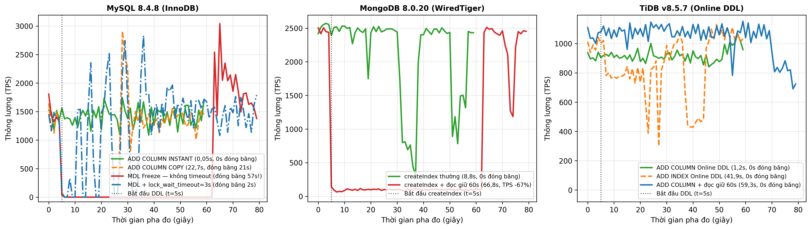
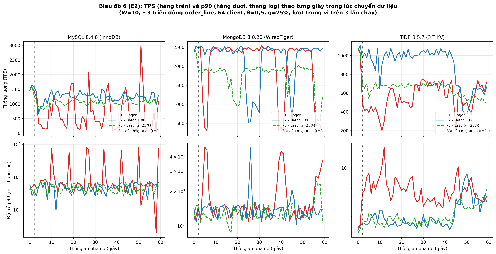
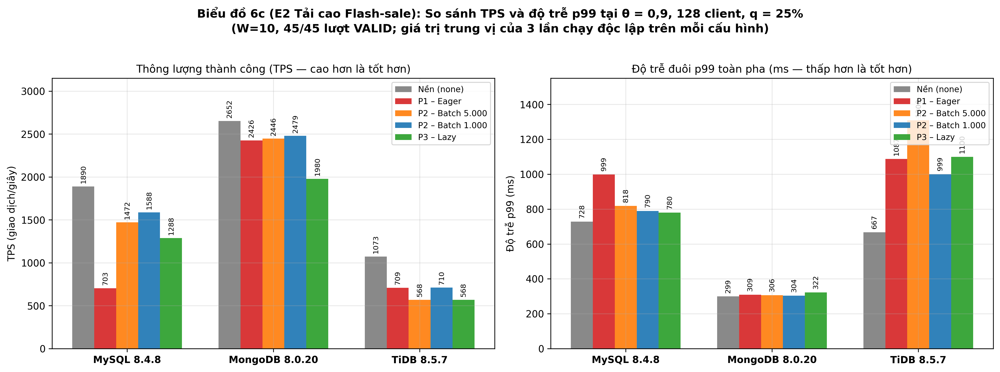
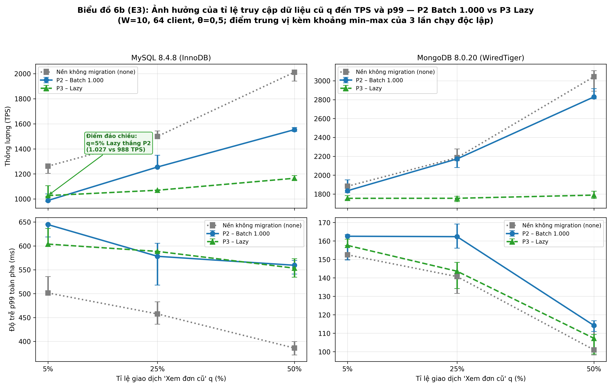

# Thực nghiệm Mục 2.4 – Đổi lược đồ khi đang bán hàng (Online Schema Evolution)

Tài liệu này tổng hợp thiết kế, kết quả thực đo và quy trình khuyến nghị của **mục 2.4** (*Đổi lược đồ khi đang bán hàng: so sánh chiến lược chuyển dữ liệu*) trên cả ba hệ quản trị cơ sở dữ liệu **MySQL 8.4.8**, **MongoDB 8.0.20** và **TiDB 8.5.7**.

> **Phạm vi & nhãn kết quả:** Toàn bộ **159/159 lượt chạy** đều đạt **`VALID`** (100% giữ đủ 3 luật tồn kho + đối soát chuyển đổi `ol_discount`: 66 MySQL + 54 MongoDB + 39 TiDB) trên cùng một máy ảo AWS `c6i.4xlarge` (16 vCPU, 32 GiB RAM, EBS gp3 100 GiB 3000 IOPS / 125 MB/s) chạy Docker Compose giới hạn **`8 CPU / 16 GiB RAM`**, bộ nhớ đệm ngang nhau (**3 GiB**: InnoDB buffer pool 3 GiB, WiredTiger cache 3 GiB, 3 TiKV × 1 GiB block cache) và độ bền giao dịch ngang nhau (`innodb_flush_log_at_trx_commit=1, sync_binlog=1` vs `{w:"majority", j:true}` vs Raft sync mặc định). Kết quả gắn nhãn **sơ bộ (1 VM Docker)** theo quy ước mục 2.1.

---

## 1. Thiết kế thực nghiệm (theo `bao_cao_DBMS_ban_chot.docx`, trang 19–23)

- **Dữ liệu gốc:** TPC-C `W = 10` kho, 9 bảng/collection, trong đó `order_line` là bảng lớn nhất với **2.998.678 dòng/tài liệu** (`ol_o_id <= 3000`).
- **Lược đồ đích chung:** Thêm 2 trường vào `order_line`:
  - `ol_discount` (số nguyên, đơn vị cent)
  - `ol_mig_state` (`'UNMIGRATED'` hoặc `'MIGRATED'`; document MongoDB cũ thiếu trường được coi là `UNMIGRATED`).
- **Phép biến đổi xác định, idempotent:**
  $$\text{ol\_discount} = \left\lfloor \frac{\text{ol\_quantity} \times \text{i\_price} \times r}{100} \right\rfloor$$
  với $r = 10$ nếu $\text{i\_price} \ge 5000$, $r = 5$ nếu $2500 \le \text{i\_price} < 5000$, ngược lại $r = 0$.
- **Tải nền:** `New-Order : Payment = 1 : 1` kết hợp giao dịch đọc **`"Xem đơn cũ"`** chiếm tỉ lệ `q` (`q = 25%` ở E1/E2; quét `q ∈ {5%, 25%, 50%}` ở E3), `64 client`, `θ = 0,5`, chọn kho `uniform`, mỗi điểm đo chạy **3 lần độc lập** (30s warmup + 60s đo; E1 có giao dịch dài đo 80s).
- **Kiểm tra đúng đắn sau mọi lượt chạy:**
  1. Đủ 3 luật tồn kho mục 2.1 (không âm, không bán vượt, không đơn trùng).
  2. Không mất hay nhân đôi dòng `order_line`.
  3. 100% dòng cũ được đánh dấu `MIGRATED` và có `ol_discount` khớp đúng công thức biến đổi.

---

## 2. Kết quả E1 – Đổi lược đồ gốc dưới tải & kẹt Metadata Lock (`results/official/2.4-e1/`)

Thí nghiệm chạy lệnh DDL gốc (`ADD COLUMN`, `ADD INDEX` / `createIndex`) vào giây thứ 5 của pha đo trong hai điều kiện: không có giao dịch dài và có **1 giao dịch đọc `order_line` giữ mở 60 giây** (`BEGIN; SELECT ol_o_id FROM order_line LIMIT 1;`).

| Hệ DBMS | Kịch bản E1 | Lượt VALID | TPS đo *(median)* | p99 toàn pha *(ms)* | Đỉnh p99 1s *(ms)* | Thời gian DDL *(s)* | **Đóng băng lâu nhất** | Ghi chú cơ chế |
| --- | --- | --- | ---: | ---: | ---: | ---: | ---: | --- |
| **MySQL 8.4.8** | `add_column_instant` | 6/6 | **1.420,2** | 523,9 | 713,7 | **0,05 s** | **0 s** | Chỉ sửa metadata, không ảnh hưởng tải |
| **MySQL 8.4.8** | `add_column_copy` | 3/3 | **903,4** | 562,2 | **22.857,9** | **22,7 s** | **21 s** | Chép lại ~3 triệu dòng, chặn ghi 21s |
| **MySQL 8.4.8** | `add_index_inplace` | 3/3 | **1.084,6** | 537,6 | 3.255,2 | **24,3 s** | **1 s** | Online DDL dựng index tại chỗ |
| **MySQL 8.4.8** | **`mdl_freeze`** *(đọc 60s, không timeout ngắn)* | 3/3 | **502,1** *(-66,5%)* | 350,8 | **58.066,7** | **58,0 s** | **57 s** | 1 giao dịch đọc làm treo cứng cả bảng 57s |
| **MySQL 8.4.8** | **`mdl_timeout_retry`** *(`lock_wait_timeout=3`)* | 3/3 | **1.276,8** *(2,54×)* | 473,7 | **3.208,6** | 29,5 s *(timeout)* | **2 s** | DDL tự rút sau 3s, giảm đóng băng 28× |
| **MongoDB 8.0.20** | `create_index` *(không giao dịch dài)* | 3/3 | **2.125,5** | 171,8 | 422,9 | **8,8 s** | **0 s** | Không cần DDL thêm cột; dựng index nhanh |
| **MongoDB 8.0.20** | `create_index_long_txn` *(đọc 60s)* | 3/3 | **706,1** *(-66,8%)* | 140,7 | 359,0 | **66,8 s** | **0 s** | Không treo `0 TPS`, nhưng commit index phải chờ 60s |
| **TiDB 8.5.7** | `add_column_online` | 3/3 | **920,1** | 284,8 | 380,3 | **1,2 s** | **0 s** | Online DDL qua trạng thái trung gian, 0 lỗi |
| **TiDB 8.5.7** | `add_index_online` | 3/3 | **848,1** | 339,5 | 732,6 | **41,9 s** | **0 s** | Điền index phân tán nền trên 3 TiKV |
| **TiDB 8.5.7** | **`mdl_long_txn`** *(đọc 60s)* | 3/3 | **1.042,2** | **250,9** | **422,7** | **59,3 s** | **0 s** | **Hệ duy nhất không chặn tải mới & không tụt TPS!** |

**Bằng chứng `performance_schema.metadata_locks` trong `mdl_freeze` (MySQL):**
- `1` giao dịch đọc dài cầm `SHARED_READ (GRANTED)` trên `order_line`.
- `1` lệnh `ALTER TABLE ... INSTANT` xếp hàng `EXCLUSIVE (PENDING)`.
- **`47–52` giao dịch Flash-sale đến sau (`35–42 SHARED_WRITE` + `6–16 SHARED_READ`) bị chặn cứng ở `PENDING` suốt 57 giây.**
- Khi đặt **`SET SESSION lock_wait_timeout = 3` kèm retry**, thời gian đóng băng giảm từ **57 s → 2 s**, đỉnh p99 1s giảm **18×** (`58,1 s → 3,2 s`), và TPS tăng gấp **2,54×**.
- Trên **TiDB 8.5.7**, cơ chế Metadata Lock vẫn chờ giao dịch đọc kết thúc (`59,3 s`) để đảm bảo **0 lỗi `Information schema is changed`**, nhưng **không xếp hàng chặn các giao dịch mới**, giữ nguyên `1.042,2 TPS` và `0 s` đóng băng.

---

## 3. Kết quả E2 – So sánh 3 chiến lược chuyển dữ liệu trên 3 hệ (`q = 25%`)

Mọi mức giảm TPS (`%`) và mức tăng p99 (`× nền`) được tính so với đường nền không migration (`strategy = none`, `results/official/2.4-baseline/`).

| Hệ DBMS | Chiến lược | TPS trung vị *(min–max)* | Giảm TPS *(vs nền)* | p99 toàn pha *(ms)* | Tăng p99 *(× nền)* | Đỉnh 1s p99 *(ms)* | `read_clean` / `read_migrated` p99 *(ms)* | Hoàn tất *(s)* |
| --- | --- | --- | ---: | ---: | ---: | ---: | --- | ---: |
| **MySQL 8.4.8** | Nền (`none`) | **1.499,6** *(1.483,2–1.543,5)* | 0,0% | 457,6 | 1,00× | — | — | — |
| **MySQL 8.4.8** | **P1 – Eager** | **704,9** *(684,2–773,2)* | **-53,0%** | 896,6 | **1,96×** | **8.202,9** | 13,8 / — | **71,3 s** |
| **MySQL 8.4.8** | **P2 – Batch 5.000** | **1.104,8** *(1.094,2–1.106,0)* | -26,3% | 619,5 | 1,35× | 846,0 | 15,3 / — | 89,7 s |
| **MySQL 8.4.8** | **P2 – Batch 1.000** | **1.255,2** *(1.254,7–1.349,5)* | **-16,3%** | **578,2** | **1,26×** | 730,2 | 15,4 / — | 106,5 s |
| **MySQL 8.4.8** | **P3 – Lazy** | **1.069,8** *(1.066,6–1.072,6)* | -28,7% | 588,5 | 1,29× | **684,2** | **16,5 / 575,0** | 97,6 s |
| **MongoDB 8.0.20** | Nền (`none`) | **2.185,4** *(2.153,0–2.277,5)* | 0,0% | 140,7 | 1,00× | — | 94,8 / — | — |
| **MongoDB 8.0.20** | **P1 – Eager** | **2.053,0** *(2.036,8–2.062,0)* | -6,1% | 201,5 | 1,43× | 479,8 | 158,4 / — | **126,8 s** |
| **MongoDB 8.0.20** | **P2 – Batch 5.000** | **2.088,7** *(2.062,0–2.133,8)* | -4,4% | 161,1 | 1,15× | 393,5 | 99,2 / — | 197,3 s |
| **MongoDB 8.0.20** | **P2 – Batch 1.000** | **2.172,4** *(2.080,2–2.186,8)* | **-0,6%** | 162,3 | 1,15× | 477,7 | 107,7 / — | 207,8 s |
| **MongoDB 8.0.20** | **P3 – Lazy** | **1.755,2** *(1.720,6–1.777,2)* | -19,7% | **143,6** | **1,02×** | **234,0** | **99,2 / 102,6** | 202,0 s |
| **TiDB 8.5.7** | Nền (`none`) | **980,1** *(909,7–1.005,2)* | 0,0% | 276,6 | 1,00× | — | 35,5 / — | — |
| **TiDB 8.5.7** | **P1 – Eager** | **568,5** *(532,8–619,7)* | **-42,0%** | 588,5 | **2,13×** | **1.668,5** | 60,0 / — | **81,3 s** |
| **TiDB 8.5.7** | **P2 – Batch 5.000** | **702,1** *(523,4–748,0)* | -28,4% | 506,4 | 1,83× | 934,1 | 55,1 / — | 117,4 s |
| **TiDB 8.5.7** | **P2 – Batch 1.000** | **895,0** *(753,7–918,5)* | **-8,7%** | 340,4 | 1,23× | **599,9** | 39,9 / — | 133,8 s |
| **TiDB 8.5.7** | **P3 – Lazy** | **655,0** *(628,2–660,4)* | -33,2% | **311,8** | **1,13×** | 707,6 | **39,0 / 226,9** | 131,9 s |

**Kiểm chứng giả thuyết H1 & H2:**
- **H1 đúng trên cả 3 hệ:** P1 (Eager) luôn hoàn tất nhanh nhất (`71,3 s` MySQL; `81,3 s` TiDB; `126,8 s` MongoDB) nhưng gây tác động hiệu năng mạnh nhất (`-53,0%` TPS / `1,96×` p99 trên MySQL; `-42,0%` / `2,13×` trên TiDB; `-6,1%` / `1,43×` trên MongoDB).
- **H2 đúng trên cả 3 hệ:** **P2 Batch lô `1.000` dòng là chiến lược đạt TPS cao nhất trên CẢ 3 HỆ** (`-16,3%` MySQL; `-0,6%` MongoDB; `-8,7%` TiDB) và tốt hơn rõ rệt so với lô `5.000` dòng.

### 3.2. Kết quả E2 tải cao Flash-sale (`θ = 0,9`, `128 client`, `q = 25%`, `results/official/2.4-highload/`, 45/45 VALID)

| Hệ DBMS | Chiến lược | TPS trung vị *(min–max)* | Giảm TPS *(vs nền)* | p99 toàn pha *(ms)* | Tăng p99 *(× nền)* | Đỉnh 1s p99 *(ms)* | `read_clean` / `read_migrated` p99 *(ms)* | Hoàn tất *(s)* |
| --- | --- | --- | ---: | ---: | ---: | ---: | --- | ---: |
| **MySQL 8.4.8** | Nền (`none`) | **1.890,3** *(1.871,6–2.164,8)* | 0,0% | 728,2 | 1,00× | — | 12,5 / — | — |
| **MySQL 8.4.8** | **P1 – Eager** | **702,6** *(656,4–831,9)* | **-62,8%** | 999,1 | **1,37×** | **22.201,0** *(22,2 s!)* | 11,6 / — | **128,8 s** |
| **MySQL 8.4.8** | **P2 – Batch 5.000** | **1.472,4** *(1.472,0–1.474,4)* | -22,1% | 817,8 | 1,12× | 1.038,0 | 13,6 / — | 163,3 s |
| **MySQL 8.4.8** | **P2 – Batch 1.000** | **1.587,8** *(1.559,6–1.614,0)* | **-16,0%** | 789,6 | 1,08× | **868,7** | 13,1 / — | 170,0 s |
| **MySQL 8.4.8** | **P3 – Lazy** | **1.288,0** *(1.284,5–1.288,2)* | -31,9% | **779,8** | **1,07×** | 873,9 | **14,6 / 739,5** | 166,9 s |
| **MongoDB 8.0.20** | Nền (`none`) | **2.652,3** *(2.589,8–2.703,7)* | 0,0% | 298,9 | 1,00× | — | 86,8 / — | — |
| **MongoDB 8.0.20** | **P1 – Eager** | **2.425,6** *(2.424,5–2.562,3)* | -8,5% | 309,2 | 1,03× | 487,9 | 111,6 / — | **138,3 s** |
| **MongoDB 8.0.20** | **P2 – Batch 5.000** | **2.446,3** *(2.136,0–2.490,7)* | -7,8% | 306,4 | 1,02× | 457,1 | 89,9 / — | 205,3 s |
| **MongoDB 8.0.20** | **P2 – Batch 1.000** | **2.478,6** *(2.411,5–2.547,0)* | **-6,5%** | **304,2** | **1,02×** | **448,8** | 113,8 / — | 211,5 s |
| **MongoDB 8.0.20** | **P3 – Lazy** | **1.979,6** *(1.950,6–1.994,1)* | -25,4% | 322,4 | 1,08× | 502,4 | **128,1 / 136,1** | 203,1 s |
| **TiDB 8.5.7** | Nền (`none`) | **1.073,5** *(1.028,9–1.086,1)* | 0,0% | 667,2 | 1,00× | — | 45,4 / — | — |
| **TiDB 8.5.7** | **P1 – Eager** | **708,6** *(668,1–723,4)* | -34,0% | 1.087,0 | 1,63× | 2.027,3 | 66,5 / — | **85,3 s** |
| **TiDB 8.5.7** | **P2 – Batch 5.000** | **568,2** *(551,7–615,4)* | -47,1% | 1.308,5 | 1,96× | 2.108,5 | 72,7 / — | 127,1 s |
| **TiDB 8.5.7** | **P2 – Batch 1.000** | **710,4** *(638,1–792,9)* | **-33,8%** | **999,5** | **1,50×** | **1.434,3** | 71,6 / — | 131,6 s |
| **TiDB 8.5.7** | **P3 – Lazy** | **567,8** *(524,6–610,6)* | -47,1% | 1.100,0 | 1,65× | 1.491,7 | **71,7 / 373,6** | 145,7 s |

**Nhận xét ở tải cao Flash-sale (`θ = 0,9`, `128 client`):**
- **P2 Batch lô `1.000` giữ ngôi đầu TPS trên CẢ 3 HỆ** kể cả dưới tải Flash-sale dồn (`-16,0%` MySQL; `-6,5%` MongoDB; `-33,8%` TiDB) và cắt **25,5 lần** gai p99 1s của MySQL Eager (`22.201 ms → 869 ms`)!
- Trên **MySQL**, Eager chịu tác động nặng nhất khi tăng tải: giảm TPS từ `-53,0%` xuống **`-62,8%`**, đỉnh p99 1s vọt từ `8,2 s` lên **`22,2 s`**, thời gian hoàn tất tăng gần gấp đôi (`71,3 s → 128,8 s`).
- Trên **MongoDB**, tỉ lệ retry của giao dịch nền tăng lên `~15,7%` (do tranh chấp món nóng `θ = 0,9`), nhưng nhờ khóa mức tài liệu WiredTiger nên cả Batch 1.000 (`-6,5%`) lẫn Eager (`-8,5%`) đều giữ p99 sát nền (`1,02×–1,03×`).
- Trên **TiDB**, ở tải cao `128 client`, **Batch 1.000 thắng toàn diện cả TPS lẫn p99** (`710,4 TPS`, `999,5 ms`), trong khi Batch 5.000 và Lazy tụt sâu (`-47,1%`) do chi phí 2PC/Raft phân tán cộng hưởng với lô ghi lớn hoặc ghi on-demand.

---

## 4. Kết quả E3 – Ảnh hưởng tỉ lệ truy cập dữ liệu cũ `q` (Biểu đồ 6b)

| Hệ DBMS | Tỉ lệ `q` | Nền (`none`) TPS / p99 | **P2 – Batch 1.000** TPS *(giảm)* / p99 *(× nền)* | **P3 – Lazy** TPS *(giảm)* / p99 *(× nền)* | Dòng on-demand (Lazy) | Bên thắng về TPS |
| --- | --- | --- | --- | --- | ---: | --- |
| **MySQL 8.4.8** | **`q = 5%`** | 1.262,0 / 501,5 ms | 988,0 *(-21,7%)* / 644,7 ms *(1,29×)* | **1.027,1** *(-18,6%)* / **603,8 ms** *(1,20×)* | 27.515 *(0,92%)* | **P3 Lazy** *(cả TPS & p99)* |
| **MySQL 8.4.8** | **`q = 25%`** | 1.499,6 / 457,6 ms | **1.255,2** *(-16,3%)* / **578,2 ms** *(1,26×)* | 1.069,8 *(-28,7%)* / 588,5 ms *(1,29×)* | 141.056 *(4,70%)* | **Đảo chiều → P2 Batch** |
| **MySQL 8.4.8** | **`q = 50%`** | 2.011,8 / 386,1 ms | **1.553,4** *(-22,8%)* / 559,5 ms *(1,45×)* | 1.165,4 *(-42,1%)* / **553,3 ms** *(1,43×)* | 294.463 *(9,82%)* | **P2 Batch (+33,3%)** |
| **MongoDB 8.0.20** | **`q = 5%`** | 1.882,9 / 152,5 ms | **1.835,5** *(-2,5%)* / 162,6 ms *(1,07×)* | 1.754,7 *(-6,8%)* / **157,6 ms** *(1,03×)* | 47.846 *(1,60%)* | **P2 Batch (+4,6%)** |
| **MongoDB 8.0.20** | **`q = 25%`** | 2.185,4 / 140,7 ms | **2.172,4** *(-0,6%)* / 162,3 ms *(1,15×)* | 1.755,2 *(-19,7%)* / **143,6 ms** *(1,02×)* | 228.944 *(7,63%)* | **P2 Batch (+23,8%)** |
| **MongoDB 8.0.20** | **`q = 50%`** | 3.044,2 / 101,0 ms | **2.829,7** *(-7,0%)* / 114,2 ms *(1,13×)* | 1.788,9 *(-41,2%)* / **107,3 ms** *(1,06×)* | 446.218 *(14,88%)* | **P2 Batch (+58,2%)** |

**Kiểm chứng giả thuyết H3 (BullFrog ở tầng ứng dụng):**
- Trên **MySQL**, xuất hiện **điểm đảo chiều rõ rệt giữa `q = 5%` và `q = 25%`**: khi `q = 5%`, Lazy thắng Batch 1.000 ở cả TPS (`-18,6%` vs `-21,7%`) lẫn p99 (`1,20×` vs `1,29×`); khi `q ≥ 25%`, chi phí `UPDATE + COMMIT (fsync)` trên đường đọc làm `read_migrated_p99` tăng vọt (`535–609 ms` so với `15–17 ms` đọc sạch) khiến Lazy tụt hẳn sau Batch (`-42,1%` vs `-22,8%` ở `q = 50%`).
- Trên **MongoDB** và **TiDB**, Lazy giữ **p99 toàn pha sát nền nhất** (`1,02×` MongoDB; `1,13×` TiDB), nhưng biến đọc thành ghi vẫn kéo TPS của Lazy xuống thấp hơn Batch 1.000 khi `q ≥ 25%`.

---

## 5. Quy trình khuyến nghị ("Mở rộng → Chuyển → Thu gọn")

Từ bằng chứng E1–E3 trên ba hệ, quy trình vận hành an toàn khi đổi lược đồ bảng lớn đang chịu tải Flash-sale gồm 6 bước:

1. **Kiểm tra giao dịch dài & đặt `lock_wait_timeout` ngắn** (ví dụ `3 s` kèm retry trên MySQL) trước khi chạy DDL — tránh bẫy đóng băng 57 giây của Metadata Lock (giảm còn 2 giây).
2. **Thêm cột bằng cơ chế ít chặn nhất:** `ALGORITHM=INSTANT` trên MySQL (`0,05 s`, `0 s` đóng băng), Online DDL trên TiDB (`1,2 s`, `0 s` đóng băng), hoặc ghi trường mới không cần DDL trên MongoDB.
3. **Triển khai mã ứng dụng tương thích hai phiên bản:** đơn mới ghi sẵn `ol_discount` + `MIGRATED`; đọc hỗ trợ cả dòng cũ (`UNMIGRATED`) và mới.
4. **Chọn chiến lược chuyển dữ liệu cũ theo tỉ lệ đọc dữ liệu lịch sử `q`:**
   - Nếu **`q` rất thấp (`≤ 5%`) trên MySQL** hoặc ưu tiên **độ trễ đuôi p99 sát nền nhất**: dùng **Lazy (P3)** kết hợp luồng nền giới hạn tốc độ.
   - Trong đa số trường hợp **`q ≥ 25%`** (cả 3 hệ) hoặc cần **thông lượng cao nhất**: dùng **Batch nền (P2) cỡ lô `1.000` dòng** nghỉ `20 ms` giữa các lô (giảm TPS chỉ `-0,6%` trên MongoDB, `-8,7%` trên TiDB, `-16,3%` trên MySQL).
   - **Tránh Eager (P1)** trên MySQL và TiDB trong giờ cao điểm Flash-sale.
5. **Đối soát & chuyển hẳn sang đọc trường mới** sau khi không còn bản ghi `UNMIGRATED` và kiểm khớp 100% hàm biến đổi.
6. **Thu gọn:** bỏ trường `ol_mig_state` và nhánh tương thích cũ ngoài giờ cao điểm.

---

## 6. Phần `NOT TESTED` / Phạm vi cắt

- **E3 quét `q = 5%` và `50%` trên TiDB:** `NOT TESTED` (TiDB đã đo đủ mốc trung tâm `q = 25%` ở cả tải thường `64c, θ=0,5` lẫn tải cao `128c, θ=0,9` và đầy đủ E1 Online DDL).
- **Hạ tầng đa VM AWS cho 2.4:** `NOT TESTED` (toàn bộ **159 lượt đo VALID** thực hiện trên 1 VM Docker `c6i.4xlarge`, ghi nhãn sơ bộ).
