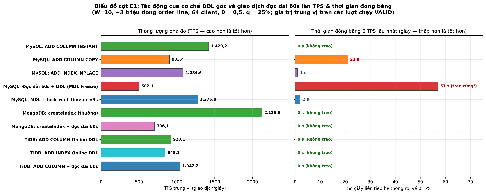
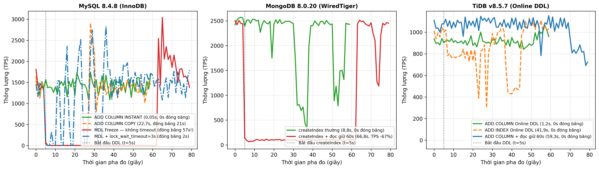

# Bản thảo chuẩn Word: Mục 2.6 (Bản rút gọn cho Báo cáo chính) & Phụ lục D (Phân tích chuyên sâu và Thực nghiệm)

> **Bố cục đề xuất:**
> - **Báo cáo chính — Mục 2.6 (~1,5–2 trang):** Trình bày ngắn gọn, đủ 5 yêu cầu cốt lõi (*Vấn đề → Cơ chế & Triển khai → Kịch bản → Kết quả nổi bật qua 2 Bar Chart → Quy trình khuyến nghị & Giới hạn*), không làm loãng trọng tâm của các mục 2.2–2.5.
> - **Phụ lục D — Chi tiết kỹ thuật, số liệu đo đạc đầy đủ và thực nghiệm thực tế:** Chứa toàn bộ phân tích cơ chế sâu, 4 bảng số liệu đầy đủ (`min–max`, `read_clean/read_migrated`, thời gian hoàn tất), biểu đồ tải cao & quét `q`, chuỗi thời gian từng giây, bằng chứng `metadata_locks` và hướng dẫn tái lập/demo thực tế.

---

# PHẦN A — MỤC 2.6 RÚT GỌN ĐƯA VÀO BÁO CÁO CHÍNH (~1,5–2 TRANG)

## 2.6. Mở rộng: Đổi lược đồ trực tuyến khi đang bán hàng (Online Schema Evolution)

### 2.6.1. Vấn đề kỹ thuật, cơ chế và phương pháp triển khai

Trong thực tế vận hành, nhu cầu bổ sung thuộc tính mới hoặc thay đổi cấu trúc dữ liệu thường phát sinh ngay khi hệ thống đang chịu tải cao. Bài toán này đặt ra hai rủi ro chính: **(1)** thao tác thay đổi cấu trúc bảng (DDL) phải xin khóa siêu dữ liệu (*Metadata Lock — MDL*), dễ gây chặn dây chuyền các giao dịch khác nếu đang có truy vấn đọc kéo dài; **(2)** việc cập nhật bổ sung giá trị cho hàng triệu bản ghi cũ (*data migration*) sẽ cạnh tranh trực tiếp tài nguyên khóa, bộ nhớ đệm và ghi đĩa với luồng mua hàng đang chạy. Cụ thể trong thực nghiệm này, nhóm kiểm chứng kịch bản thêm cột chiết khấu `ol_discount` và trạng thái chuyển đổi `ol_mig_state` trên bảng lớn nhất `order_line` (**2.998.678 dòng**, `W = 10`; công thức tính chi tiết xem *Phụ lục D.1*).

Về cơ chế nội tại: **MySQL 8.4 (InnoDB)** hỗ trợ `ALGORITHM=INSTANT` không chạm dữ liệu nhưng vẫn cần khóa độc quyền `EXCLUSIVE` MDL ở đầu/cuối lệnh; **MongoDB 8.0 (WiredTiger)** linh hoạt lược đồ (*schemaless*) không cần `ALTER` nhưng `createIndex` vẫn chờ snapshot cũ khi chốt; **TiDB v8.5** dùng Online DDL nhiều trạng thái trung gian, chờ giao dịch đọc cũ kết thúc *schema lease* mà không xếp hàng chặn giao dịch mới.

Nhóm hiện thực thống nhất trong [`src/flashsale/e1_ddl.py`](file:///e:/BTL-DBMS/src/flashsale/e1_ddl.py) và [`src/flashsale/migration.py`](file:///e:/BTL-DBMS/src/flashsale/migration.py) theo mô hình tương thích hai phiên bản (*Expand → Migrate → Contract*): đơn `New-Order` mới ghi sẵn `ol_discount` + `MIGRATED`, kết hợp giao dịch đọc `"Xem đơn cũ"` chiếm tỉ lệ `q`, và so sánh **ba chiến lược chuyển dữ liệu lịch sử**:
- **P1 – Eager:** Luồng nền cập nhật liên tục (`sleep = 0`) theo lô lớn.
- **P2 – Batch nền:** Luồng nền cập nhật từng lô nhỏ theo tiền tố khóa chính (`1.000` hoặc `5.000` dòng `order_line`), nghỉ `20 ms` giữa các lô.
- **P3 – Lazy (lấy cảm hứng từ BullFrog ở tầng ứng dụng):** Chuyển đổi có điều kiện ngay trên đường đọc khi `"Xem đơn cũ"` gặp bản ghi `UNMIGRATED`, kết hợp luồng quét nền chậm (`sleep ≥ 50 ms`).

### 2.6.2. Thiết kế thử nghiệm và kết quả nổi bật

Thực nghiệm gồm **159/159 lượt đo `VALID`** (thỏa mãn đồng thời 3 luật tồn kho mục 2.1, bảo toàn chính xác số dòng `order_line`, `0` dòng `UNMIGRATED` và `0` dòng sai công thức sau chuyển đổi), chạy trên 1 máy ảo AWS `c6i.4xlarge` (Docker Compose giới hạn công bằng `8 vCPU / 16 GiB RAM`, bộ nhớ đệm `3 GiB` và độ bền ngang nhau; nhãn **sơ bộ**). Mỗi cấu hình lặp **3 lần độc lập** (`30 s` warmup + `60 s` đo) trên ba nhóm kịch bản: **E1** (phát DDL gốc lúc `t = 5 s` khi có/không có 1 giao dịch đọc mở `60 s`), **E2** (so sánh `none`, Eager, Batch 5.000, Batch 1.000, Lazy ở tải chuẩn `64 client, θ = 0,5` và tải cao `128 client, θ = 0,9`, `q = 25%`), và **E3** (quét `q ∈ {5%, 25%, 50%}`). Toàn bộ bảng số liệu chi tiết, biểu đồ tải cao/quét `q`, chuỗi thời gian và minh chứng demo được trình bày tại **Phụ lục D**.

Ba kết quả trọng tâm rút ra từ **Hình 2.6.1** và **Hình 2.6.2** (chi tiết xem *Phụ lục D.2–D.4*):
1. **Bẫy kẹt Metadata Lock và cách hóa giải (E1):** Khi không có giao dịch dài, `ADD COLUMN INSTANT` trên MySQL (`0,05 s`) và Online DDL trên TiDB (`1,2 s`) đều ghi nhận **`0 s` đóng băng** (so với `21 s` của `ALGORITHM=COPY`). Tuy nhiên, chỉ **1 giao dịch đọc giữ mở `60 s`** đủ làm MySQL (`mdl_freeze`) **treo cứng `0 TPS` suốt `57 s`** (`-66,5%` TPS, `47–52` phiên bị chặn `PENDING` sau khóa `EXCLUSIVE`). Đặt **`SET SESSION lock_wait_timeout = 3` kèm retry** giúp DDL tự rút sau 3 giây, giảm đóng băng **28,5 lần** (`57 s → 2 s`) và khôi phục TPS gấp **`2,54×`** (`1.276,8 TPS`). Ngược lại, **TiDB v8.5** chờ phiên đọc cũ hoàn tất (`59,3 s`) mà **không chặn giao dịch mới (`0 s` đóng băng, `1.042,2 TPS`)**; MongoDB cũng không treo `0 TPS` nhưng áp lực snapshot khi chốt `createIndex` kéo TPS giảm `-66,8%`.
2. **Đánh đổi giữa ba chiến lược chuyển dữ liệu (E2):** **P1 – Eager** hoàn tất nhanh nhất (`71–127 s`) nhưng gây sụt TPS nặng trên MySQL (`-53,0%` ở tải chuẩn; **`-62,8%`** với gai p99 1s lên **`22,2 s`** ở tải cao `128 client, θ = 0,9`) và TiDB (`-42,0%`). **P2 – Batch lô `1.000` dòng là chiến lược đạt TPS cao nhất trên cả ba hệ ở mọi mức tải** (`-0,6%` MongoDB, `-8,7%` TiDB, `-16,3%` MySQL ở tải chuẩn), đồng thời cắt **25,5 lần** gai p99 1s của MySQL Eager ở tải cao (*Bảng D.3, Hình D.3*).
3. **Điểm đảo chiều theo tỉ lệ đọc đơn cũ `q` (E3):** Trên MySQL, tại **`q = 5%`**, **P3 – Lazy thắng P2 – Batch 1.000** cả TPS (`-18,6%` vs `-21,7%`) lẫn p99 (`1,20×` vs `1,29×`); nhưng từ **`q ≥ 25%`**, chi phí `UPDATE + fsync` đồng bộ trên đường đọc (`read_migrated_p99 = 575 ms` so với `16,5 ms` đọc sạch) khiến Lazy tụt lại mạnh (`-42,1%` vs `-22,8%` ở `q = 50%`). Trên MongoDB, Batch 1.000 thắng TPS ở mọi `q` (`-0,6%` đến `-7,0%`), trong khi Lazy giữ p99 toàn pha sát nền nhất (`1,02×–1,06×`; xem *Bảng D.4, Hình D.4–D.5*).

### 2.6.3. Quy trình khuyến nghị và giới hạn

- **Quy trình vận hành an toàn:** *(1)* Kiểm tra giao dịch mở kéo dài và bắt buộc đặt `lock_wait_timeout = 3` + retry trước DDL trên MySQL → *(2)* Thêm cột bằng cơ chế ít chặn nhất (`INSTANT` / Online DDL / schemaless) kết hợp ứng dụng ghi song hành hai phiên bản → *(3)* Chọn **Batch nền lô `1.000` dòng** làm mặc định khi `q ≥ 25%` (chỉ chọn **Lazy** khi `q ≤ 5%` trên MySQL hoặc ưu tiên p99 sát nền trên MongoDB/TiDB; tránh **Eager** giờ cao điểm) → *(4)* Đối soát 100% `MIGRATED` rồi mới thu gọn lược đồ.
- **Giới hạn:** Số liệu mục 2.6 là **sơ bộ** trên 1 máy ảo Docker `c6i.4xlarge` (chưa đo trên cụm đa VM AWS); phép quét `q ∈ {5%, 50%}` ở E3 chưa thực hiện trên TiDB (`NOT TESTED`).

---
---

# PHẦN B — PHỤ LỤC D: PHÂN TÍCH CHUYÊN SÂU, ĐO ĐẠC ĐẦY ĐỦ VÀ THỰC NGHIỆM MỤC 2.6

## Phụ lục D. Đổi lược đồ trực tuyến (Online Schema Evolution) trên MySQL, MongoDB và TiDB

Phụ lục này trình bày chi tiết cơ chế triển khai, toàn bộ bảng số liệu thực đo (**159/159 lượt `VALID`** lưu tại [`results/official/2.4-*/`](file:///e:/BTL-DBMS/results/official)), biểu đồ chuỗi thời gian theo từng giây, kết quả tải cao Flash-sale, phép quét tỉ lệ đọc đơn cũ `q` và hướng dẫn tái lập/demo thực tế cho **Mục 2.6**.

### D.1. Chi tiết cơ chế, kiến trúc triển khai và bộ kiểm định

1. **Lược đồ đích & công thức chuyển đổi lũy đẳng:** Bổ sung `ol_discount BIGINT NULL` và `ol_mig_state VARCHAR(16) NOT NULL DEFAULT 'UNMIGRATED'` trên bảng/collection `order_line` (`2.998.678` dòng lịch sử `ol_o_id ≤ 3000`, `W = 10`). Công thức tính chiết khấu theo bậc giá `i_price` (đơn vị cent):
   $$\text{ol\_discount} = \left\lfloor \frac{\text{ol\_quantity} \times \text{i\_price} \times r}{100} \right\rfloor, \quad r = \begin{cases} 10 & \text{nếu } i\_price \ge 5000 \\ 5 & \text{nếu } 2500 \le i\_price < 5000 \\ 0 & \text{nếu } i\_price < 2500 \end{cases}$$
2. **Chi tiết hiện thực trên từng hệ DBMS ([`src/flashsale/migration.py`](file:///e:/BTL-DBMS/src/flashsale/migration.py) & [`src/flashsale/e1_ddl.py`](file:///e:/BTL-DBMS/src/flashsale/e1_ddl.py)):**
   - **MySQL 8.4.8 & TiDB v8.5.7:** Các lệnh cập nhật lịch sử đi theo tiền tố khóa chính cụm `(ol_w_id, ol_d_id, ol_o_id BETWEEN ? AND ? AND ol_mig_state = 'UNMIGRATED')` kết hợp `JOIN item`. Với P1 Eager, MySQL gom theo từng kho còn TiDB chia cụm `1.000` đơn (~`10.000` dòng) để tôn trọng giới hạn bộ nhớ giao dịch phân tán. Với P2 Batch, worker chạy từng lô `100` đơn (~`1.000` dòng) hoặc `500` đơn (~`5.000` dòng) nghỉ `20 ms`, có retry deadlock/write conflict. Với P3 Lazy, giao dịch đọc `"Xem đơn cũ"` kích hoạt `UPDATE` có điều kiện cho đúng đơn đang đọc (đo riêng `read_clean_p99_ms` và `read_migrated_p99_ms`), chạy kèm luồng quét nền thưa (`sleep ≥ 50 ms`).
   - **MongoDB 8.0.20:** Worker tải sẵn bảng giá `item` vào bộ nhớ, quét theo dải `_id` chưa `MIGRATED` và gom nhóm theo giá trị chiết khấu vào một lệnh `bulk_write` với `WriteConcern(w="majority", j=True)` nhằm bảo đảm độ bền ngang với hai hệ SQL.
3. **Điều kiện gắn nhãn `VALID` (`validate_migration`):** Sau mọi lượt chạy, validator tự động kiểm tra đủ **3 luật tồn kho mục 2.1** (`INV1–INV3`) đồng thời đối soát `total_rows == 2.998.678 + new_order_lines`, `unmigrated_rows == 0` và `wrong_discount_rows == 0`.

---

### D.2. Kết quả chi tiết nhóm E1 (DDL gốc & kẹt Metadata Lock)

**Bảng D.1.** Kết quả thực nghiệm nhóm E1 khi phát lệnh DDL tại `t = 5 s` dưới tải (`W = 10`, `64 client`, `θ = 0,5`, `q = 25%`; nguồn: `results/official/2.4-e1/`).

| Hệ DBMS | Kịch bản E1 | Lượt VALID | TPS trung vị | p99 toàn pha (ms) | Đỉnh p99 1s (ms) | Thời gian DDL (s) | Đóng băng lâu nhất | Hiện tượng cơ chế quan sát được |
| --- | --- | :---: | ---: | ---: | ---: | ---: | ---: | --- |
| **MySQL 8.4.8** | `add_column_instant` | 6/6 | **1.420,2** | 523,9 | 713,7 | **0,05 s** | **0 s** | Chỉ cập nhật metadata, không chạm trang dữ liệu |
| **MySQL 8.4.8** | `add_column_copy` | 3/3 | **903,4** | 562,2 | **22.857,9** | **22,7 s** | **21 s** | Dựng lại toàn bảng ~3 triệu dòng, khóa ghi 21s |
| **MySQL 8.4.8** | `add_index_inplace` | 3/3 | **1.084,6** | 537,6 | 3.255,2 | **24,3 s** | **1 s** | Online DDL dựng chỉ mục phụ tại chỗ |
| **MySQL 8.4.8** | **`mdl_freeze`** *(đọc giữ 60s, mặc định)* | 3/3 | **502,1** *(-66,5%)* | 350,8 | **58.066,7** | **58,0 s** | **57 s** | `EXCLUSIVE` MDL đứng chờ kéo 47–52 phiên sau treo cứng 57s |
| **MySQL 8.4.8** | **`mdl_timeout_retry`** *(`lock_wait_timeout=3`)* | 3/3 | **1.276,8** *(2,54×)* | 473,7 | **3.208,6** | 29,5 s *(retry)* | **2 s** | DDL tự hủy sau 3s chờ khóa, giảm đóng băng 28,5 lần |
| **MongoDB 8.0.20** | `create_index` *(thường)* | 3/3 | **2.125,5** | 171,8 | 422,9 | **8,8 s** | **0 s** | Thêm trường không cần DDL; dựng chỉ mục nền nhanh |
| **MongoDB 8.0.20** | `create_index_long_txn` *(đọc giữ 60s)* | 3/3 | **706,1** *(-66,8%)* | 140,7 | 359,0 | **66,8 s** | **0 s** | Không rơi về `0 TPS`, nhưng bước chốt chỉ mục phải đợi snapshot 60s |
| **TiDB v8.5.7** | `add_column_online` | 3/3 | **920,1** | 284,8 | 380,3 | **1,2 s** | **0 s** | Chuyển trạng thái Online DDL không chặn đọc/ghi |
| **TiDB v8.5.7** | `add_index_online` | 3/3 | **848,1** | 339,5 | 732,6 | **41,9 s** | **0 s** | Quét và điền chỉ mục phân tán nền trên 3 nút TiKV |
| **TiDB v8.5.7** | **`mdl_long_txn`** *(đọc giữ 60s)* | 3/3 | **1.042,2** | **250,9** | **422,7** | **59,3 s** | **0 s** | DDL đợi phiên đọc cũ kết thúc nhưng không chặn giao dịch mới |

**Bằng chứng trích xuất trực tiếp từ `performance_schema.metadata_locks` tại `t = 8 s` trong kịch bản `mdl_freeze` (MySQL):**
- `1` phiên giao dịch đọc dài giữ `SHARED_READ (GRANTED)` trên `order_line`.
- `1` phiên `ALTER TABLE ... ALGORITHM=INSTANT` xếp hàng `EXCLUSIVE (PENDING)`.
- **`47–52` phiên Flash-sale đến sau** (`35–42` yêu cầu `SHARED_WRITE` và `6–16` yêu cầu `SHARED_READ`) bị chặn ở trạng thái `PENDING` suốt `57 s`.

---

### D.3. Kết quả chi tiết nhóm E2 (Tải chuẩn và Tải cao Flash-sale)

**Bảng D.2.** Kết quả chi tiết nhóm E2 ở tải chuẩn (`64 client`, `θ = 0,5`, `q = 25%`; nguồn: `results/official/2.4-{baseline,eager,batch,lazy}/`).

| Hệ DBMS | Chiến lược | TPS trung vị *(khoảng min–max)* | Thay đổi TPS *(vs nền)* | p99 toàn pha *(ms)* | Tỉ số p99 *(× nền)* | Đỉnh p99 1s *(ms)* | `read_clean` / `read_migrated` p99 *(ms)* | Thời gian hoàn tất *(s)* |
| --- | --- | --- | ---: | ---: | ---: | ---: | :---: | ---: |
| **MySQL 8.4.8** | Nền (`none`) | **1.499,6** *(1.483,2–1.543,5)* | 0,0% | 457,6 | 1,00× | — | — | — |
| **MySQL 8.4.8** | **P1 – Eager** | **704,9** *(684,2–773,2)* | **-53,0%** | 896,6 | **1,96×** | **8.202,9** | 13,8 / — | **71,3 s** |
| **MySQL 8.4.8** | **P2 – Batch 5.000** | **1.104,8** *(1.094,2–1.106,0)* | -26,3% | 619,5 | 1,35× | 846,0 | 15,3 / — | 89,7 s |
| **MySQL 8.4.8** | **P2 – Batch 1.000** | **1.255,2** *(1.254,7–1.349,5)* | **-16,3%** | **578,2** | **1,26×** | 730,2 | 15,4 / — | 106,5 s |
| **MySQL 8.4.8** | **P3 – Lazy** | **1.069,8** *(1.066,6–1.072,6)* | -28,7% | 588,5 | 1,29× | **684,2** | **16,5 / 575,0** | 97,6 s |
| **MongoDB 8.0.20** | Nền (`none`) | **2.185,4** *(2.153,0–2.277,5)* | 0,0% | 140,7 | 1,00× | — | 94,8 / — | — |
| **MongoDB 8.0.20** | **P1 – Eager** | **2.053,0** *(2.036,8–2.062,0)* | -6,1% | 201,5 | 1,43× | 479,8 | 158,4 / — | **126,8 s** |
| **MongoDB 8.0.20** | **P2 – Batch 5.000** | **2.088,7** *(2.062,0–2.133,8)* | -4,4% | 161,1 | 1,15× | 393,5 | 99,2 / — | 197,3 s |
| **MongoDB 8.0.20** | **P2 – Batch 1.000** | **2.172,4** *(2.080,2–2.186,8)* | **-0,6%** | 162,3 | 1,15× | 477,7 | 107,7 / — | 207,8 s |
| **MongoDB 8.0.20** | **P3 – Lazy** | **1.755,2** *(1.720,6–1.777,2)* | -19,7% | **143,6** | **1,02×** | **234,0** | **99,2 / 102,6** | 202,0 s |
| **TiDB v8.5.7** | Nền (`none`) | **980,1** *(909,7–1.005,2)* | 0,0% | 276,6 | 1,00× | — | 35,5 / — | — |
| **TiDB v8.5.7** | **P1 – Eager** | **568,5** *(532,8–619,7)* | **-42,0%** | 588,5 | **2,13×** | **1.668,5** | 60,0 / — | **81,3 s** |
| **TiDB v8.5.7** | **P2 – Batch 5.000** | **702,1** *(523,4–748,0)* | -28,4% | 506,4 | 1,83× | 934,1 | 55,1 / — | 117,4 s |
| **TiDB v8.5.7** | **P2 – Batch 1.000** | **895,0** *(753,7–918,5)* | **-8,7%** | 340,4 | 1,23× | **599,9** | 39,9 / — | 133,8 s |
| **TiDB v8.5.7** | **P3 – Lazy** | **655,0** *(628,2–660,4)* | -33,2% | **311,8** | **1,13×** | 707,6 | **39,0 / 226,9** | 131,9 s |

**Bảng D.3.** Kết quả chi tiết nhóm E2 ở tải cao Flash-sale (`128 client`, `θ = 0,9`, `q = 25%`, `45/45` lượt `VALID`; nguồn: `results/official/2.4-highload/`).

| Hệ DBMS | Chiến lược | TPS trung vị *(khoảng min–max)* | Thay đổi TPS *(vs nền)* | p99 toàn pha *(ms)* | Tỉ số p99 *(× nền)* | Đỉnh p99 1s *(ms)* | `read_clean` / `read_migrated` p99 *(ms)* | Thời gian hoàn tất *(s)* |
| --- | --- | --- | ---: | ---: | ---: | ---: | :---: | ---: |
| **MySQL 8.4.8** | Nền (`none`) | **1.890,3** *(1.871,6–2.164,8)* | 0,0% | 728,2 | 1,00× | — | 12,5 / — | — |
| **MySQL 8.4.8** | **P1 – Eager** | **702,6** *(656,4–831,9)* | **-62,8%** | 999,1 | **1,37×** | **22.201,0** | 11,6 / — | **128,8 s** |
| **MySQL 8.4.8** | **P2 – Batch 5.000** | **1.472,4** *(1.472,0–1.474,4)* | -22,1% | 817,8 | 1,12× | 1.038,0 | 13,6 / — | 163,3 s |
| **MySQL 8.4.8** | **P2 – Batch 1.000** | **1.587,8** *(1.559,6–1.614,0)* | **-16,0%** | 789,6 | 1,08× | **868,7** | 13,1 / — | 170,0 s |
| **MySQL 8.4.8** | **P3 – Lazy** | **1.288,0** *(1.284,5–1.288,2)* | -31,9% | **779,8** | **1,07×** | 873,9 | **14,6 / 739,5** | 166,9 s |
| **MongoDB 8.0.20** | Nền (`none`) | **2.652,3** *(2.589,8–2.703,7)* | 0,0% | 298,9 | 1,00× | — | 86,8 / — | — |
| **MongoDB 8.0.20** | **P1 – Eager** | **2.425,6** *(2.424,5–2.562,3)* | -8,5% | 309,2 | 1,03× | 487,9 | 111,6 / — | **138,3 s** |
| **MongoDB 8.0.20** | **P2 – Batch 5.000** | **2.446,3** *(2.136,0–2.490,7)* | -7,8% | 306,4 | 1,02× | 457,1 | 89,9 / — | 205,3 s |
| **MongoDB 8.0.20** | **P2 – Batch 1.000** | **2.478,6** *(2.411,5–2.547,0)* | **-6,5%** | **304,2** | **1,02×** | **448,8** | 113,8 / — | 211,5 s |
| **MongoDB 8.0.20** | **P3 – Lazy** | **1.979,6** *(1.950,6–1.994,1)* | -25,4% | 322,4 | 1,08× | 502,4 | **128,1 / 136,1** | 203,1 s |
| **TiDB v8.5.7** | Nền (`none`) | **1.073,5** *(1.028,9–1.086,1)* | 0,0% | 667,2 | 1,00× | — | 45,4 / — | — |
| **TiDB v8.5.7** | **P1 – Eager** | **708,6** *(668,1–723,4)* | -34,0% | 1.087,0 | 1,63× | 2.027,3 | 66,5 / — | **85,3 s** |
| **TiDB v8.5.7** | **P2 – Batch 5.000** | **568,2** *(551,7–615,4)* | -47,1% | 1.308,5 | 1,96× | 2.108,5 | 72,7 / — | 127,1 s |
| **TiDB v8.5.7** | **P2 – Batch 1.000** | **710,4** *(638,1–792,9)* | **-33,8%** | **999,5** | **1,50×** | **1.434,3** | 71,6 / — | 131,6 s |
| **TiDB v8.5.7** | **P3 – Lazy** | **567,8** *(524,6–610,6)* | -47,1% | 1.100,0 | 1,65× | 1.491,7 | **71,7 / 373,6** | 145,7 s |

---

### D.4. Kết quả chi tiết nhóm E3 (Quét tỉ lệ đọc dữ liệu cũ `q`)

**Bảng D.4.** So sánh P2 – Batch 1.000 và P3 – Lazy khi quét `q ∈ {5%, 25%, 50%}` trên MySQL 8.4.8 và MongoDB 8.0.20 (`64 client`, `θ = 0,5`).

| Hệ DBMS | Tỉ lệ `q` | Nền (`none`) TPS / p99 | **P2 – Batch 1.000** TPS *(vs nền)* / p99 *(× nền)* | **P3 – Lazy** TPS *(vs nền)* / p99 *(× nền)* | Số dòng chuyển on-demand (Lazy) | Chiến lược tối ưu TPS |
| --- | :---: | --- | --- | --- | ---: | --- |
| **MySQL 8.4.8** | **`5%`** | 1.262,0 / 501,5 ms | 988,0 *(-21,7%)* / 644,7 ms *(1,29×)* | **1.027,1** *(-18,6%)* / **603,8 ms** *(1,20×)* | 27.515 *(0,92%)* | **P3 – Lazy** *(cả TPS & p99)* |
| **MySQL 8.4.8** | **`25%`** | 1.499,6 / 457,6 ms | **1.255,2** *(-16,3%)* / **578,2 ms** *(1,26×)* | 1.069,8 *(-28,7%)* / 588,5 ms *(1,29×)* | 141.056 *(4,70%)* | **Đảo chiều → P2 – Batch 1.000** |
| **MySQL 8.4.8** | **`50%`** | 2.011,8 / 386,1 ms | **1.553,4** *(-22,8%)* / 559,5 ms *(1,45×)* | 1.165,4 *(-42,1%)* / **553,3 ms** *(1,43×)* | 294.463 *(9,82%)* | **P2 – Batch 1.000 (+33,3%)** |
| **MongoDB 8.0.20** | **`5%`** | 1.882,9 / 152,5 ms | **1.835,5** *(-2,5%)* / 162,6 ms *(1,07×)* | 1.754,7 *(-6,8%)* / **157,6 ms** *(1,03×)* | 47.846 *(1,60%)* | **P2 – Batch 1.000 (+4,6%)** |
| **MongoDB 8.0.20** | **`25%`** | 2.185,4 / 140,7 ms | **2.172,4** *(-0,6%)* / 162,3 ms *(1,15×)* | 1.755,2 *(-19,7%)* / **143,6 ms** *(1,02×)* | 228.944 *(7,63%)* | **P2 – Batch 1.000 (+23,8%)** |
| **MongoDB 8.0.20** | **`50%`** | 3.044,2 / 101,0 ms | **2.829,7** *(-7,0%)* / 114,2 ms *(1,13×)* | 1.788,9 *(-41,2%)* / **107,3 ms** *(1,06×)* | 446.218 *(14,88%)* | **P2 – Batch 1.000 (+58,2%)** |

---

### D.5. Minh chứng thực nghiệm thực tế, kịch bản Demo UI và lệnh tái lập

1. **Bộ script chạy lại toàn bộ 159 lượt đo:**
   - Nhóm E1: [`scripts/run-2.4-e1.sh`](file:///e:/BTL-DBMS/scripts/run-2.4-e1.sh) (`flashsale e1-ddl`).
   - Nhóm E2 & E3: [`scripts/run-2.4-eager.sh`](file:///e:/BTL-DBMS/scripts/run-2.4-eager.sh), [`scripts/run-2.4-batch.sh`](file:///e:/BTL-DBMS/scripts/run-2.4-batch.sh), [`scripts/run-2.4-lazy.sh`](file:///e:/BTL-DBMS/scripts/run-2.4-lazy.sh) (`flashsale run --migration-strategy ...`).
   - Tái sinh toàn bộ 7 ảnh biểu đồ (Bar Chart + Time-series) từ dữ liệu JSON: `python scripts/plot-2.4.py`.
2. **Kịch bản Demo UI trực quan phục vụ trình bày & kiểm chứng cơ chế ([`docs/demo-ui-2.6.md`](file:///e:/BTL-DBMS/docs/demo-ui-2.6.md)):**
   - **Demo E1 trên 4 phiên SQL song song:** Tái hiện trực tiếp cảnh `SELECT` bị treo dây chuyền phía sau `ALTER TABLE ... INSTANT` khi có 1 phiên đọc quên `COMMIT` trên MySQL (xác nhận qua `performance_schema.metadata_locks`), kiểm chứng `SET SESSION lock_wait_timeout = 3` tự thoát sau 3 giây không chặn phiên đọc thứ ba, và đối chiếu trực tiếp với TiDB Online DDL.
   - **Demo chuyển đổi lũy đẳng (Lazy/Batch) & đối soát cuối:** Cập nhật có điều kiện `WHERE ol_mig_state = 'UNMIGRATED'`, chạy lại lần hai xác nhận `0 rows affected` / `modifiedCount = 0`, và chạy truy vấn đối soát kiểm chứng `unmigrated_rows = 0`, `wrong_discount_rows = 0`.
