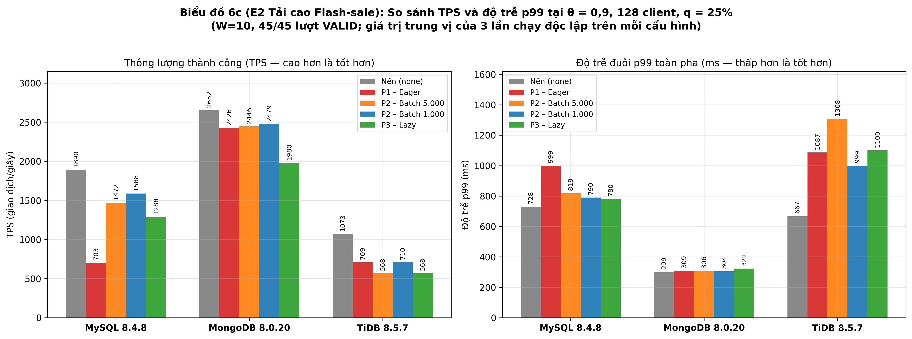
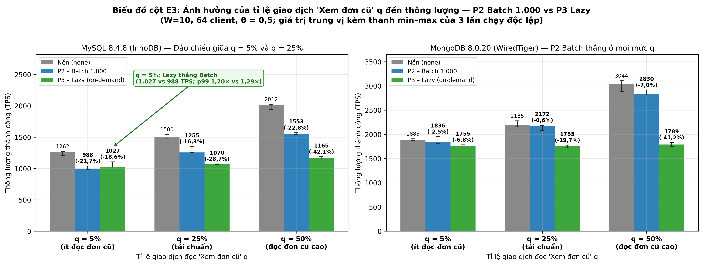
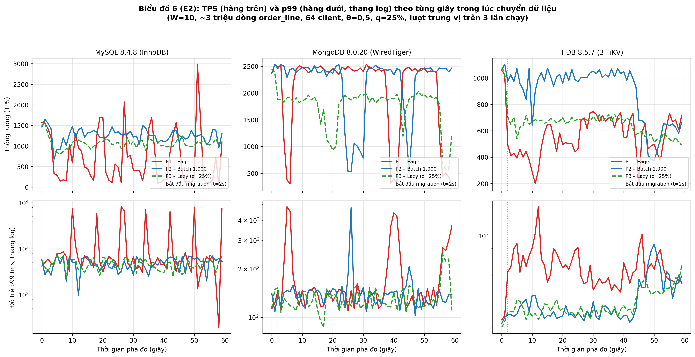
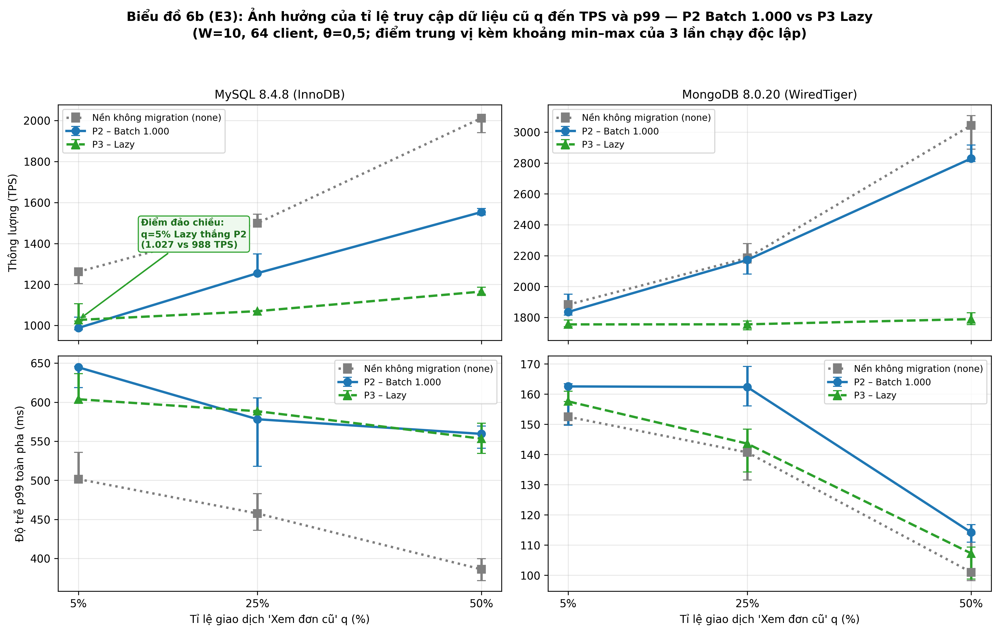

# Bản thảo chuẩn Word: Mục 2.6 (Báo cáo chính) & Phụ lục C.5 (Đo đạc và Thực nghiệm thực tế)

> Tài liệu này được biên soạn theo đúng 5 tiêu chí bắt buộc của **Phần 2 – Phân tích vấn đề chuyên sâu**:
> 1. **Trình bày vấn đề kỹ thuật đã đăng ký** (`2.6.1`)
> 2. **Cơ chế hoạt động** (`2.6.2`)
> 3. **Phương pháp triển khai** (`2.6.3`)
> 4. **Thiết kế kịch bản thử nghiệm** (`2.6.4`)
> 5. **Phân tích kết quả kèm biểu đồ cột (Bar Chart) và quy trình khuyến nghị** (`2.6.5` – `2.6.6`)
>
> Toàn bộ bảng số liệu đầy đủ (kèm khoảng `min–max`), chuỗi thời gian theo từng giây, truy vấn chẩn đoán khóa và kịch bản thực nghiệm thực tế được tách gọn sang **Phụ lục C.5** để phần thân báo cáo mạch lạc, súc tích và đồng bộ với cách trình bày của Mục 2.3 và Mục 2.5.

---

# PHẦN A — NỘI DUNG ĐƯA VÀO BÁO CÁO CHÍNH (THAY THẾ MỤC 2.6 HIỆN TẠI)

## 2.6. Mở rộng: Đổi lược đồ trực tuyến khi đang bán hàng (Online Schema Evolution)

### 2.6.1. Vấn đề kỹ thuật đặt ra

Trong các chiến dịch Flash-sale vận hành liên tục, yêu cầu nghiệp vụ thường phát sinh ngay khi hệ thống đang chịu tải giao dịch lớn — điển hình là bổ sung trường tiền chiết khấu `ol_discount` và trạng thái chuyển đổi `ol_mig_state` vào bảng chi tiết đơn hàng `order_line`. Trên bộ dữ liệu TPC-C quy mô `W = 10` kho, `order_line` là bảng/collection lớn nhất hệ thống với **2.998.678 bản ghi lịch sử** (`ol_o_id ≤ 3000`), đồng thời liên tục nhận dòng ghi mới từ giao dịch `New-Order` và truy vấn đọc từ người dùng tra cứu đơn hàng.

Bài toán đổi lược đồ trực tuyến (*Online Schema Evolution*) dưới tải Flash-sale đặt ra **hai thách thức kỹ thuật tách biệt**:
1. **Rủi ro gián đoạn ở pha thay đổi cấu trúc gốc (DDL / Index):** Dù các DBMS hiện đại đều quảng bá khả năng thay đổi lược đồ trực tuyến (*Online DDL* hoặc *schemaless*), việc cấp phát khóa siêu dữ liệu (*Metadata Lock — MDL*) để đồng bộ phiên bản lược đồ khi có giao dịch đọc kéo dài vẫn có nguy cơ gây hiệu ứng "đoàn tàu kẹt" (*convoy freeze*), làm đóng băng toàn bộ luồng mua hàng về `0 TPS`.
2. **Tranh chấp tài nguyên ở pha chuyển đổi dữ liệu lịch sử (*Data Backfill*):** Ngay cả khi việc thêm cột hoàn tất trong vài chục mili-giây, gần 3 triệu bản ghi cũ vẫn cần được tính toán và điền giá trị `ol_discount` từ bảng `item`. Nếu cập nhật dồn dập toàn bảng, luồng chuyển đổi sẽ tranh chấp trực tiếp khóa dòng, bộ nhớ đệm (*buffer pool / block cache*) và băng thông ghi nhật ký bền vững (`fsync` / Raft WAL) với giao dịch mua hàng thời gian thực; ngược lại, nếu chuyển đổi theo yêu cầu ngay trên đường đọc sẽ biến truy vấn đọc nhẹ thành giao dịch ghi có độ trễ cao.

Mục tiêu của chuyên đề 2.6 là phân tích cơ chế nội tại trên ba kiến trúc DBMS (**MySQL 8.4.8 InnoDB**, **MongoDB 8.0.20 WiredTiger**, **TiDB v8.5.7**), hiện thực ba chiến lược chuyển dữ liệu đại diện và thực nghiệm định lượng để xác định quy trình vận hành không gián đoạn giao dịch.

---

### 2.6.2. Cơ chế hoạt động trên ba hệ DBMS và ba chiến lược chuyển dữ liệu

#### a) Cơ chế thay đổi lược đồ gốc và khóa siêu dữ liệu (DDL & Metadata Lock)
- **MySQL 8.4 (InnoDB):** Hỗ trợ ba thuật toán `ALTER TABLE`: `INSTANT` (chỉ cập nhật từ điển dữ liệu trong vài chục ms, không chạm trang dữ liệu), `INPLACE` (dựng chỉ mục tại chỗ và ghi đệm thay đổi đồng thời vào *online change log*), và `COPY` (tạo bảng tạm, chép lại toàn bộ ~3 triệu dòng và chặn ghi). Tuy nhiên, cả ở bước mở đầu và kết thúc, ngay cả `ALGORITHM=INSTANT` vẫn phải xin khóa siêu dữ liệu độc quyền **`EXCLUSIVE` Metadata Lock (MDL)**. Hàng đợi MDL ưu tiên yêu cầu `EXCLUSIVE` đang chờ trước các yêu cầu `SHARED_READ` / `SHARED_WRITE` đến sau: chỉ cần **một giao dịch đọc cũ chưa kết thúc** giữ `SHARED_READ`, lệnh `ALTER` sẽ đứng chờ ở trạng thái `PENDING` và kéo theo toàn bộ giao dịch đọc/ghi mới bị chặn dây chuyền phía sau.
- **MongoDB 8.0 (WiredTiger):** Lưu trữ tài liệu theo định dạng nhị phân BSON linh hoạt lược đồ (*schemaless*), cho phép tài liệu mới có sẵn `ol_discount` cùng tồn tại với tài liệu cũ chưa có trường này mà không cần lệnh `ALTER`. Dù vậy, khi cần tạo chỉ mục phụ (`createIndex`) trên tập dữ liệu lớn, WiredTiger vẫn phải quét nền collection và tại pha chốt (*commit index build*) phải chờ các giao dịch đa tài liệu giữ snapshot cũ kết thúc.
- **TiDB v8.5 (kiến trúc F1 Online DDL):** Lấy cảm hứng từ giao thức Google F1, TiDB phân rã một lệnh DDL thành chuỗi các trạng thái trung gian bất đồng bộ (`none → delete only → write only → write reorganization → public`), đảm bảo tại mọi thời điểm tối đa hai phiên bản lược đồ liền kề cùng hoạt động trên các nút xử lý SQL. Cơ chế Metadata Lock phiên bản mới của TiDB buộc tiến trình chuyển trạng thái DDL chờ các giao dịch cũ kết thúc *schema lease* (nhờ đó tránh lỗi `Information schema is changed`), nhưng **không chặn hàng đợi đối với các giao dịch mới** khởi tạo trên phiên bản lược đồ hiện hành.

#### b) Cơ chế hoạt động của ba chiến lược chuyển đổi dữ liệu lịch sử
Với cùng hàm nghiệp vụ tất định và lũy đẳng (*idempotent*) tính mức chiết khấu theo bậc giá mặt hàng `i_price` (đơn vị cent):
$$\text{ol\_discount} = \left\lfloor \frac{\text{ol\_quantity} \times \text{i\_price} \times r}{100} \right\rfloor, \quad r = \begin{cases} 10 & \text{nếu } i\_price \ge 5000 \\ 5 & \text{nếu } 2500 \le i\_price < 5000 \\ 0 & \text{nếu } i\_price < 2500 \end{cases}$$

ba chiến lược chuyển đổi hoạt động theo các cơ chế đánh đổi khác nhau:
- **Chiến lược P1 – Chuyển ồ ạt (*Eager Backfill*):** Tiến trình nền quét liên tục không nghỉ (`sleep = 0`) theo dải khóa chính và cập nhật hàng loạt các bản ghi có `ol_mig_state = 'UNMIGRATED'` trong các giao dịch kích thước lớn. Cơ chế này tối thiểu hóa tổng thời gian chuyển đổi nhưng giữ khóa dải dài, làm bẩn trang đệm liên tục và bão hòa băng thông `fsync`/Raft.
- **Chiến lược P2 – Chuyển nền theo lô nhỏ (*Throttled Batch Backfill*):** Tiến trình nền chia dải khóa chính `(ol_w_id, ol_d_id, ol_o_id)` thành các giao dịch ngắn kích thước cố định (`1.000` hoặc `5.000` dòng `order_line`, tương ứng ~100 hoặc ~500 đơn hàng) và chủ động nghỉ `20 ms` giữa hai lô liên tiếp. Nhờ phạm vi khóa hẹp và nhịp nghỉ điều độ, luồng nền nhường chu kỳ I/O và khóa dòng cho giao dịch mua hàng.
- **Chiến lược P3 – Chuyển lười theo yêu cầu kết hợp quét nền chậm (*Lazy On-Demand / lấy cảm hứng từ BullFrog*):** Khi khách hàng thực hiện giao dịch đọc *"Xem đơn cũ"*, nếu phát hiện đơn hàng còn ở trạng thái `UNMIGRATED`, tầng ứng dụng lập tức thực thi cập nhật có điều kiện (`WHERE ... AND ol_mig_state = 'UNMIGRATED'`) để chuyển đổi ngay đơn hàng đó trước khi trả kết quả; đồng thời một luồng quét nền tốc độ thấp (`sleep ≥ 50 ms`) thu dọn phần dữ liệu lạnh ít được đọc nhằm đảm bảo hội tụ 100% về lược đồ mới.

---

### 2.6.3. Phương pháp triển khai thực tế

Hệ thống thực nghiệm được hiện thực thống nhất trong hai mô-đun [`src/flashsale/e1_ddl.py`](file:///e:/BTL-DBMS/src/flashsale/e1_ddl.py) và [`src/flashsale/migration.py`](file:///e:/BTL-DBMS/src/flashsale/migration.py) theo nguyên tắc **tương thích hai phiên bản lược đồ (*Expand → Migrate → Contract*)**:

1. **Mở rộng lược đồ không gián đoạn (*Expand*):** Trên MySQL sử dụng `ALTER TABLE order_line ADD COLUMN ol_discount BIGINT NULL, ADD COLUMN ol_mig_state VARCHAR(16) NOT NULL DEFAULT 'UNMIGRATED', ALGORITHM=INSTANT`; trên TiDB sử dụng Online DDL tương đương; trên MongoDB coi các tài liệu thiếu trường hoặc có `ol_mig_state != 'MIGRATED'` là chưa chuyển đổi. Đặc biệt trên MySQL, mô-đun [`e1_ddl.py`](file:///e:/BTL-DBMS/src/flashsale/e1_ddl.py) hiện thực cơ chế bảo vệ **`SET SESSION lock_wait_timeout = 3`** kết hợp thử lại hàm mũ (*exponential backoff*, tối đa 5 lần) để chủ động hủy yêu cầu khóa `EXCLUSIVE` nếu phát hiện giao dịch đọc dài đang giữ bảng.
2. **Đường ghi/đọc song hành ở tầng ứng dụng (*Dual-schema application logic*):** Mọi giao dịch `New-Order` mới phát sinh trong pha đo đều tính sẵn `ol_discount` và ghi trực tiếp `ol_mig_state = 'MIGRATED'`. Bổ sung giao dịch đọc **`"Xem đơn cũ"`** chiếm tỉ lệ `q` tổng tải, truy vấn ngẫu nhiên một đơn lịch sử `(ol_w_id, ol_d_id, ol_o_id ≤ 3000)` và tách riêng phép đo độ trễ p99 giữa lượt đọc đơn đã chuyển (`read_clean_p99_ms`) và lượt đọc kích hoạt ghi chuyển đổi tại chỗ (`read_migrated_p99_ms`).
3. **Thực thi chuyển đổi thích ứng theo kiến trúc lưu trữ:**
   - Với **MySQL và TiDB**, câu lệnh `UPDATE order_line JOIN item ... WHERE ol_w_id = ? AND ol_d_id = ? AND ol_o_id BETWEEN ? AND ? AND ol_mig_state = 'UNMIGRATED'` đi thẳng theo tiền tố khóa chính cụm (*clustered PK prefix*), tránh quét toàn bảng; riêng trên TiDB, P1 Eager chia theo cụm 1.000 đơn (~10.000 dòng) để tuân thủ giới hạn bộ nhớ giao dịch phân tán.
   - Với **MongoDB**, do không có phép `JOIN` nguyên tử trong `updateMany`, worker nạp bảng giá 100.000 mặt hàng `item` vào bộ nhớ, truy vấn khóa `_id` của lô tài liệu chưa chuyển đổi và gom nhóm theo giá trị chiết khấu vào một lệnh `bulk_write` với `WriteConcern(w="majority", j=True)` ngang độ bền với hai hệ SQL.
4. **Bộ đối soát tự động sau mỗi lượt chạy (`validate_migration`):** Mọi lượt đo chỉ được gắn nhãn **`VALID`** khi thỏa mãn đồng thời **3 bất biến tồn kho mục 2.1** (không âm kho, khớp tổng lượng bán, không đơn trùng) **cộng thêm 3 bất biến chuyển đổi**: bảo toàn chính xác tổng số dòng `order_line` (`2.998.678 + số dòng đơn mới`), `unmigrated_rows = 0` sau khi hoàn tất và `wrong_discount_rows = 0` khi kiểm chéo lại toàn bộ bảng với `item`.

---

### 2.6.4. Thiết kế kịch bản thử nghiệm

Thực nghiệm được tiến hành trên cùng cấu hình công bằng tài nguyên và độ bền: máy ảo AWS `c6i.4xlarge` chạy từng hệ DBMS độc lập với giới hạn **`8 vCPU / 16 GiB RAM`**, bộ nhớ đệm ngang nhau (**3 GiB**: InnoDB Buffer Pool 3 GiB, WiredTiger Cache 3 GiB, 3 nút TiKV × 1 GiB Block Cache) và cấu hình bền vững nghiêm ngặt (`innodb_flush_log_at_trx_commit=1, sync_binlog=1`; `{w:"majority", j:true}`; Raft WAL mặc định). Dữ liệu gốc nạp đủ `W = 10` kho (**2.998.678 dòng `order_line`**) và khôi phục sạch từ snapshot trước **mọi lần chạy**; mỗi cấu hình lặp lại **3 lần độc lập** (30 giây làm nóng + 60 giây đo; riêng kịch bản giao dịch dài ở E1 đo 80 giây).

Ba nhóm kịch bản thử nghiệm được thiết kế nhằm trả lời trọn vẹn các giả thuyết kỹ thuật:
- **Nhóm E1 – Đổi lược đồ gốc dưới tải và bẫy kẹt Metadata Lock (`64 client, θ = 0,5, q = 25%`):** Phát lệnh DDL gốc (`ADD COLUMN INSTANT/COPY/Online`, `ADD INDEX INPLACE/Online`, `createIndex`) tại giây thứ `t = 5s` của pha đo trong hai điều kiện: (i) tải bình thường và (ii) có **1 giao dịch đọc `order_line` mở từ `t = 3s` và giữ 60 giây** (`BEGIN; SELECT ol_o_id FROM order_line LIMIT 1;`), đối chiếu thêm phương án `lock_wait_timeout = 3s + retry` trên MySQL. Chỉ số trọng tâm là thông lượng pha đo, thời gian đóng băng liên tiếp lâu nhất (`max_freeze_seconds` rơi về `0 TPS`) và trạng thái bảng `performance_schema.metadata_locks`.
- **Nhóm E2 – So sánh 3 chiến lược chuyển dữ liệu (`q = 25%`):** Đo đối chứng đường nền không chuyển đổi (`none`) với **P1 – Eager**, **P2 – Batch (`5.000` và `1.000` dòng, nghỉ `20 ms`)** và **P3 – Lazy** trên cả ba hệ ở hai mức tải: **tải chuẩn** (`64 client, θ = 0,5`) và **tải cao Flash-sale** (`128 client, θ = 0,9`).
- **Nhóm E3 – Quét tỉ lệ truy cập dữ liệu cũ `q ∈ {5%, 25%, 50%}` (`64 client, θ = 0,5`):** So sánh trực tiếp **P2 – Batch 1.000** với **P3 – Lazy** trên MySQL và MongoDB khi thay đổi tần suất khách hàng tra cứu đơn cũ nhằm kiểm chứng ngưỡng đảo chiều hiệu năng của mô hình chuyển đổi theo yêu cầu.

*(Toàn bộ 159/159 lượt chạy thực tế đều đạt trạng thái `VALID`; bảng số liệu chi tiết từng kịch bản, chuỗi thời gian theo từng giây và hướng dẫn tái lập thực nghiệm được trình bày tại **Phụ lục C.5**).*

---

### 2.6.5. Phân tích kết quả thực nghiệm

#### a) Kết quả E1: Bản chất "Online DDL" và hiệu quả hóa giải bẫy Metadata Lock

Biểu đồ cột **Hình 2.6.1** (số liệu chi tiết tại *Bảng C.5.1, Phụ lục C*) làm sáng tỏ sự khác biệt cốt lõi giữa chi phí sửa dữ liệu vật lý và cơ chế đồng bộ khóa siêu dữ liệu trên ba hệ:
- **Khi không có giao dịch đọc kéo dài**, các cơ chế hiện đại đều tránh được gián đoạn: `ADD COLUMN ... ALGORITHM=INSTANT` trên MySQL hoàn tất chỉ trong **`0,05 s`** với **`0 s` đóng băng** (`1.420,2 TPS`), vượt xa `ALGORITHM=COPY` phải chép lại gần 3 triệu dòng mất `22,7 s` và gây **đóng băng ghi `21 s`** (đỉnh p99 vọt lên `22.857,9 ms`, TPS sụt còn `903,4`). Tương tự, Online DDL trên TiDB (`1,2 s` thêm cột; `41,9 s` thêm chỉ mục phân tán) và `createIndex` trên MongoDB (`8,8 s`) đều ghi nhận **`0 s` đóng băng**.
- **Khi xuất hiện duy nhất 1 giao dịch đọc giữ mở 60 giây**, hành vi ba hệ phân hóa triệt để:
  1. **MySQL (`mdl_freeze`) rơi vào bẫy kẹt dây chuyền nghiêm trọng:** Dù dùng `ALGORITHM=INSTANT`, lệnh `ALTER` bị treo chờ khóa `EXCLUSIVE` và chặn cứng **47–52 giao dịch đọc/ghi đến sau** ở trạng thái `PENDING` trong `performance_schema.metadata_locks`, khiến hệ thống **đóng băng `0 TPS` suốt `57 s` liên tiếp**, đỉnh p99 1s chạm **`58.066,7 ms`** và TPS bình quân sụt **`-66,5%`** (còn `502,1 TPS`).
  2. **Giải pháp `lock_wait_timeout = 3s` kèm retry giải cứu MySQL tức thì:** Khi áp dụng cơ chế bảo vệ ở tầng công cụ chạy DDL, phiên `ALTER` tự động rút lui sau `3 s` chờ khóa và nhường đường cho hàng đợi giao dịch mua hàng, kéo thời gian đóng băng từ **`57 s` xuống chỉ còn `2 s`** (**giảm 28,5 lần**), hạ đỉnh p99 1s **18 lần** (`58,1 s → 3,2 s`) và khôi phục thông lượng gấp **`2,54 lần`** (`1.276,8 TPS`).
  3. **TiDB v8.5 là hệ duy nhất miễn nhiễm hoàn toàn với hiệu ứng chặn dây chuyền:** Lệnh `ADD COLUMN` tự động chờ giao dịch đọc cũ kết thúc (`59,3 s`) để giữ toàn vẹn phiên bản lược đồ (`0` lỗi giao dịch), nhưng các giao dịch mua hàng mới vẫn đi qua bình thường với **`0 s` đóng băng**, đạt **`1.042,2 TPS`** và `p99 = 250,9 ms`. Trong khi đó, MongoDB không rơi về `0 TPS` (`0 s` đóng băng) nhưng việc giữ snapshot 60 giây trong lúc chốt `createIndex` gây áp lực lên WiredTiger cache, làm thông lượng giảm **`-66,8%`** (còn `706,1 TPS`).

#### b) Kết quả E2: Đánh đổi thông lượng – độ trễ của ba chiến lược chuyển dữ liệu ở tải chuẩn và tải cao

Từ hai biểu đồ cột tổng hợp **Hình 2.6.2** (tải chuẩn `64 client, θ = 0,5`) và **Hình 2.6.3** (tải cao Flash-sale `128 client, θ = 0,9`; chi tiết xem *Bảng C.5.2 – C.5.3, Phụ lục C*), hai quy luật thực nghiệm nhất quán được xác lập trên cả ba hệ DBMS:
- **P1 – Eager hoàn tất nhanh nhất nhưng gây suy giảm hiệu năng nặng nề trên các hệ SQL/NewSQL:** Ở tải chuẩn, Eager kết thúc chuyển đổi ~3 triệu dòng trong `71,3 s` (MySQL) và `81,3 s` (TiDB) nhưng làm thông lượng MySQL sụt **`-53,0%`** (`1.499,6 → 704,9 TPS`, `p99` tăng `1,96×`, gai p99 1s vọt lên **`8.202,9 ms`**) và TiDB sụt **`-42,0%`** (`980,1 → 568,5 TPS`, `p99` tăng `2,13×`). Khi bước vào tải cao Flash-sale (`128 client, θ = 0,9`), tác động của Eager trên MySQL càng trầm trọng: TPS mất **`-62,8%`** (`1.890,3 → 702,6 TPS`) và gai độ trễ 1 giây vọt tới **`22.201,0 ms` (`22,2 s`)** do hàng triệu khóa bản ghi và luồng flush redo log chèn ép trực tiếp giao dịch mua hàng. Riêng MongoDB ít bị ảnh hưởng bởi Eager hơn (`-6,1%` ở tải chuẩn; `-8,5%` ở tải cao) nhờ cơ chế khóa mức tài liệu của WiredTiger tách biệt vùng cập nhật `order_line` khỏi vùng tranh chấp tồn kho `stock`.
- **P2 – Batch cỡ lô nhỏ `1.000` dòng (nghỉ `20 ms`) đạt thông lượng cao nhất trên cả ba hệ ở mọi mức tải:** Tại tải chuẩn, Batch 1.000 giữ mức sụt thông lượng chỉ **`-0,6%`** trên MongoDB (`2.172,4 TPS`), **`-8,7%`** trên TiDB (`895,0 TPS`) và **`-16,3%`** trên MySQL (`1.255,2 TPS`), vượt trội rõ rệt so với cỡ lô `5.000` dòng (`-26,3%` trên MySQL; `-28,4%` trên TiDB). Dưới tải cao Flash-sale (`128 client, θ = 0,9`), Batch 1.000 tiếp tục dẫn đầu thông lượng trên cả ba hệ (`1.587,8 TPS` MySQL; `2.478,6 TPS` MongoDB; `710,4 TPS` TiDB) và **cắt giảm 25,5 lần gai độ trễ p99 1s** so với Eager trên MySQL (`22.201,0 ms → 868,7 ms`), chỉ đổi lấy thời gian hoàn tất nền dài hơn khoảng `1,4–1,6 lần` (`106,5–211,5 s`).
- **Bản chất hai mặt của P3 – Lazy:** Lazy giúp giữ độ trễ p99 toàn pha ổn định sát đường nền nhất trên MongoDB (`143,6 ms = 1,02×`) và TiDB (`311,8 ms = 1,13×`) vì luồng quét nền chạy rất thưa. Tuy nhiên, mỗi lượt đọc trúng đơn cũ phải gánh thêm một giao dịch ghi bền vững đồng bộ khiến độ trễ riêng của nhánh đọc đó tăng vọt: trên MySQL tải chuẩn, `read_migrated_p99` lên tới **`575,0 ms`** so với chỉ **`16,5 ms`** của đơn đọc sạch (`read_clean_p99`), làm thông lượng tổng của Lazy tại `q = 25%` thấp hơn Batch 1.000 trên cả ba hệ (`-28,7%` MySQL; `-19,7%` MongoDB; `-33,2%` TiDB).

#### c) Kết quả E3: Điểm đảo chiều hiệu năng theo tỉ lệ đọc dữ liệu cũ `q`

Thí nghiệm quét `q ∈ {5%, 25%, 50%}` trên **Hình 2.6.4** (*Bảng C.5.4, Phụ lục C*) xác nhận giả thuyết về phạm vi hiệu quả của chiến lược Lazy ở tầng ứng dụng:
- **Trên MySQL 8.4.8, xuất hiện điểm đảo chiều rõ rệt giữa `q = 5%` và `q = 25%`:** Khi tỉ lệ khách tra cứu đơn cũ thấp (**`q = 5%`**, chỉ `27.515` dòng = `0,92%` bảng được chuyển theo yêu cầu), số lần phát sinh `UPDATE + fsync` trên đường đọc rất ít nên **P3 – Lazy thắng P2 – Batch 1.000 trên cả thông lượng (`1.027,1` so với `988,0 TPS`, tức `-18,6%` so với `-21,7%`) lẫn độ trễ đuôi (`603,8 ms` so với `644,7 ms`)**. Ngược lại, khi `q` tăng lên **`25%`** (`141.056` dòng on-demand) và **`50%`** (`294.463` dòng on-demand), gánh nặng biến truy vấn đọc thành ghi đồng bộ khiến Lazy suy giảm mạnh (`-42,1%` tại `q = 50%`), nhường ưu thế vượt trội **`+33,3%` TPS** cho P2 – Batch 1.000 (`1.553,4` so với `1.165,4 TPS`).
- **Trên MongoDB 8.0.20, P2 – Batch 1.000 thắng về TPS ở cả ba mức `q`:** Do chi phí lô `bulk_write` nền trên WiredTiger cực thấp (chỉ giảm `-2,5%`, `-0,6%` và `-7,0%` TPS tại `q = 5%, 25%, 50%`), trong khi mỗi lượt chuyển đổi lẻ trên đường đọc của Lazy vẫn phải chịu một vòng giao dịch đa tài liệu với `{w:"majority", j:true}`, thông lượng của Lazy bị ghìm quanh ngưỡng `1.755–1.789 TPS` (tụt `-41,2%` so với nền ở `q = 50%`, thấp hơn Batch 1.000 tới `58,2%`). Dù vậy, Lazy vẫn giữ độ trễ p99 toàn pha thấp nhất trên MongoDB ở mọi mức `q` (`1,02×–1,06×` nền).

---

### 2.6.6. Quy trình vận hành khuyến nghị và giới hạn phạm vi

Từ bằng chứng định lượng E1–E3, nhóm đề xuất quy trình 4 giai đoạn **"Bảo vệ khóa → Mở rộng tức thì → Chuyển đổi thích ứng theo `q` → Thu gọn"** cho các hệ thống Flash-sale:
1. **Bảo vệ trước khi chạy DDL:** Kiểm tra các giao dịch mở kéo dài và bắt buộc đặt **`SET SESSION lock_wait_timeout = 3` kèm cơ chế retry** trên MySQL (giảm thời gian đóng băng tối đa từ `57 s` xuống `2 s`); ưu tiên kiến trúc Online DDL không chặn tải mới như TiDB khi hệ thống thường xuyên có truy vấn phân tích chạy kèm.
2. **Mở rộng lược đồ không chạm dữ liệu (*Expand*):** Sử dụng `ALGORITHM=INSTANT` (MySQL), Online DDL (TiDB) hoặc thêm trường ở tầng ứng dụng (MongoDB), kết hợp ghi song hành `ol_discount` + `MIGRATED` cho mọi đơn hàng mới.
3. **Chọn chiến lược chuyển dữ liệu lịch sử (*Migrate*) theo đặc trưng tải `q`:**
   - **Mặc định khuyến nghị (`q ≥ 25%` hoặc ưu tiên thông lượng ổn định trên cả 3 hệ):** Dùng **P2 – Batch nền cỡ lô nhỏ `1.000` dòng, nghỉ `20 ms`** giữa các lô; tuyệt đối tránh chạy Eager trong khung giờ cao điểm trên MySQL và TiDB.
   - **Trường hợp đặc thù (`q ≤ 5%` trên MySQL hoặc ưu tiên giữ p99 toàn pha sát nền nhất trên MongoDB/TiDB):** Dùng **P3 – Lazy** kết hợp luồng quét nền tốc độ thấp.
4. **Đối soát và thu gọn (*Contract*):** Chỉ gỡ bỏ cột trạng thái tạm `ol_mig_state` và nhánh mã tương thích cũ ngoài giờ cao điểm sau khi truy vấn đối soát xác nhận `100%` bản ghi đạt `MIGRATED` và khớp công thức nghiệp vụ.

> **Giới hạn phạm vi:** Toàn bộ **159/159 lượt đo `VALID`** của mục 2.6 được thực hiện công bằng ngân sách `8 vCPU / 16 GiB RAM` và `3 GiB` bộ nhớ đệm trên 1 máy ảo AWS `c6i.4xlarge` chạy Docker (gắn nhãn **số đo sơ bộ** theo quy ước mục 2.1; chưa triển khai cụm đa máy ảo riêng cho mục 2.6). Riêng phép quét biên `q ∈ {5%, 50%}` ở nhóm E3 chưa thực hiện trên TiDB (`NOT TESTED`), do TiDB đã được kiểm chứng đầy đủ tại mốc trung tâm `q = 25%` ở cả tải chuẩn, tải cao Flash-sale và toàn bộ kịch bản E1 Online DDL.

---
---

# PHẦN B — NỘI DUNG ĐƯA XUỐNG PHỤ LỤC (ĐẶT TẠI PHỤ LỤC C, MỤC C.5)

## C.5. Bổ sung số liệu đo đạc, chuỗi thời gian và thực nghiệm thực tế Mục 2.6 (Online Schema Evolution)

Mục này cung cấp toàn bộ bảng số liệu thực đo (trung vị và khoảng `min–max` trên 3 lần chạy độc lập, tổng cộng **159/159 lượt `VALID`** lưu tại [`results/official/2.4-*/`](file:///e:/BTL-DBMS/results/official)), biểu đồ chuỗi thời gian theo từng giây của pha đo và kịch bản kiểm chứng thực tế cho **Mục 2.6**.

### C.5.1. Bảng số liệu chi tiết và chuỗi thời gian nhóm E1 (DDL gốc & Metadata Lock)

**Bảng C.5.1.** Kết quả thực nghiệm nhóm E1 khi phát lệnh DDL gốc tại giây `t = 5s` dưới tải (`W = 10`, `2.998.678` dòng `order_line`, `64 client`, `θ = 0,5`, `q = 25%`; nguồn: `results/official/2.4-e1/`).

| Hệ DBMS | Kịch bản E1 | Lượt VALID | TPS trung vị | p99 toàn pha (ms) | Đỉnh p99 1s (ms) | Thời gian DDL (s) | Đóng băng lâu nhất | Hiện tượng cơ chế quan sát được |
| --- | --- | :---: | ---: | ---: | ---: | ---: | ---: | --- |
| **MySQL 8.4.8** | `add_column_instant` | 6/6 | **1.420,2** | 523,9 | 713,7 | **0,05 s** | **0 s** | Chỉ cập nhật metadata, không chạm trang dữ liệu |
| **MySQL 8.4.8** | `add_column_copy` | 3/3 | **903,4** | 562,2 | **22.857,9** | **22,7 s** | **21 s** | Dựng lại toàn bảng ~3 triệu dòng, khóa ghi 21s |
| **MySQL 8.4.8** | `add_index_inplace` | 3/3 | **1.084,6** | 537,6 | 3.255,2 | **24,3 s** | **1 s** | Online DDL dựng chỉ mục phụ tại chỗ |
| **MySQL 8.4.8** | **`mdl_freeze`** *(đọc giữ 60s, mặc định)* | 3/3 | **502,1** *(-66,5%)* | 350,8 | **58.066,7** | **58,0 s** | **57 s** | `EXCLUSIVE` MDL đứng chờ kéo 47–52 phiên sau treo cứng 57s |
| **MySQL 8.4.8** | **`mdl_timeout_retry`** *(`lock_wait_timeout=3`)* | 3/3 | **1.276,8** *(2,54×)* | 473,7 | **3.208,6** | 29,5 s *(retry)* | **2 s** | DDL tự hủy sau 3s chờ khóa, giảm đóng băng 28,5 lần |
| **MongoDB 8.0.20** | `create_index` *(thường)* | 3/3 | **2.125,5** | 171,8 | 422,9 | **8,8 s** | **0 s** | Thêm trường không cần DDL; dựng chỉ mục nền nhanh |
| **MongoDB 8.0.20** | `create_index_long_txn` *(đọc giữ 60s)* | 3/3 | **706,1** *(-66,8%)* | 140,7 | 359,0 | **66,8 s** | **0 s** | Không rơi về `0 TPS`, nhưng bước chốt chỉ mục phải đợi snapshot 60s |
| **TiDB v8.5.7** | `add_column_online` | 3/3 | **920,1** | 284,8 | 380,3 | **1,2 s** | **0 s** | Chuyển trạng thái Online DDL không chặn đọc/ghi |
| **TiDB v8.5.7** | `add_index_online` | 3/3 | **848,1** | 339,5 | 732,6 | **41,9 s** | **0 s** | Quét và điền chỉ mục phân tán nền trên 3 nút TiKV |
| **TiDB v8.5.7** | **`mdl_long_txn`** *(đọc giữ 60s)* | 3/3 | **1.042,2** | **250,9** | **422,7** | **59,3 s** | **0 s** | DDL đợi phiên đọc cũ kết thúc nhưng không chặn giao dịch mới |

**Bằng chứng trích xuất trực tiếp từ `performance_schema.metadata_locks` tại giây `t = 8s` trong kịch bản `mdl_freeze` trên MySQL:**
- `1` phiên giao dịch đọc dài giữ `LOCK_TYPE = SHARED_READ`, `LOCK_STATUS = GRANTED` trên `order_line`.
- `1` phiên `ALTER TABLE ... ALGORITHM=INSTANT` đứng đầu hàng đợi với `LOCK_TYPE = EXCLUSIVE`, `LOCK_STATUS = PENDING`.
- **`47–52` phiên worker Flash-sale** (`35–42` yêu cầu `SHARED_WRITE` của `New-Order` và `6–16` yêu cầu `SHARED_READ` của `"Xem đơn cũ"`) bị xếp hàng `PENDING` ngay phía sau lệnh `ALTER` suốt 57 giây cho tới khi phiên đọc 60 giây kết thúc.

---

### C.5.2. Bảng số liệu chi tiết và chuỗi thời gian nhóm E2 (Tải chuẩn & Tải cao Flash-sale)

**Bảng C.5.2.** Kết quả chi tiết nhóm E2 ở tải chuẩn (`64 client`, `θ = 0,5`, `q = 25%`; nguồn: `results/official/2.4-{baseline,eager,batch,lazy}/`).

| Hệ DBMS | Chiến lược | TPS trung vị *(khoảng min–max)* | Thay đổi TPS *(vs nền)* | p99 toàn pha *(ms)* | Tỉ số p99 *(× nền)* | Đỉnh p99 1s *(ms)* | `read_clean` / `read_migrated` p99 *(ms)* | Thời gian hoàn tất *(s)* |
| --- | --- | --- | ---: | ---: | ---: | ---: | :---: | ---: |
| **MySQL 8.4.8** | Nền (`none`) | **1.499,6** *(1.483,2–1.543,5)* | 0,0% | 457,6 | 1,00× | — | — | — |
| **MySQL 8.4.8** | **P1 – Eager** | **704,9** *(684,2–773,2)* | **-53,0%** | 896,6 | **1,96×** | **8.202,9** | 13,8 / — | **71,3 s** |
| **MySQL 8.4.8** | **P2 – Batch 5.000** | **1.104,8** *(1.094,2–1.106,0)* | -26,3% | 619,5 | 1,35× | 846,0 | 15,3 / — | 89,7 s |
| **MySQL 8.4.8** | **P2 – Batch 1.000** | **1.255,2** *(1.254,7–1.349,5)* | **-16,3%** | **578,2** | **1,26×** | 730,2 | 15,4 / — | 106,5 s |
| **MySQL 8.4.8** | **P3 – Lazy** | **1.069,8** *(1.066,6–1.072,6)* | -28,7% | 588,5 | 1,29× | **684,2** | **16,5 / 575,0** | 97,6 s |
| **MongoDB 8.0.20** | Nền (`none`) | **2.185,4** *(2.153,0–2.277,5)* | 0,0% | 140,7 | 1,00× | — | 94,8 / — | — |
| **MongoDB 8.0.20** | **P1 – Eager** | **2.053,0** *(2.036,8–2.062,0)* | -6,1% | 201,5 | 1,43× | 479,8 | 158,4 / — | **126,8 s** |
| **MongoDB 8.0.20** | **P2 – Batch 5.000** | **2.088,7** *(2.062,0–2.133,8)* | -4,4% | 161,1 | 1,15× | 393,5 | 99,2 / — | 197,3 s |
| **MongoDB 8.0.20** | **P2 – Batch 1.000** | **2.172,4** *(2.080,2–2.186,8)* | **-0,6%** | 162,3 | 1,15× | 477,7 | 107,7 / — | 207,8 s |
| **MongoDB 8.0.20** | **P3 – Lazy** | **1.755,2** *(1.720,6–1.777,2)* | -19,7% | **143,6** | **1,02×** | **234,0** | **99,2 / 102,6** | 202,0 s |
| **TiDB v8.5.7** | Nền (`none`) | **980,1** *(909,7–1.005,2)* | 0,0% | 276,6 | 1,00× | — | 35,5 / — | — |
| **TiDB v8.5.7** | **P1 – Eager** | **568,5** *(532,8–619,7)* | **-42,0%** | 588,5 | **2,13×** | **1.668,5** | 60,0 / — | **81,3 s** |
| **TiDB v8.5.7** | **P2 – Batch 5.000** | **702,1** *(523,4–748,0)* | -28,4% | 506,4 | 1,83× | 934,1 | 55,1 / — | 117,4 s |
| **TiDB v8.5.7** | **P2 – Batch 1.000** | **895,0** *(753,7–918,5)* | **-8,7%** | 340,4 | 1,23× | **599,9** | 39,9 / — | 133,8 s |
| **TiDB v8.5.7** | **P3 – Lazy** | **655,0** *(628,2–660,4)* | -33,2% | **311,8** | **1,13×** | 707,6 | **39,0 / 226,9** | 131,9 s |

**Bảng C.5.3.** Kết quả chi tiết nhóm E2 ở tải cao Flash-sale (`128 client`, `θ = 0,9`, `q = 25%`, `45/45` lượt `VALID`; nguồn: `results/official/2.4-highload/`).

| Hệ DBMS | Chiến lược | TPS trung vị *(khoảng min–max)* | Thay đổi TPS *(vs nền)* | p99 toàn pha *(ms)* | Tỉ số p99 *(× nền)* | Đỉnh p99 1s *(ms)* | `read_clean` / `read_migrated` p99 *(ms)* | Thời gian hoàn tất *(s)* |
| --- | --- | --- | ---: | ---: | ---: | ---: | :---: | ---: |
| **MySQL 8.4.8** | Nền (`none`) | **1.890,3** *(1.871,6–2.164,8)* | 0,0% | 728,2 | 1,00× | — | 12,5 / — | — |
| **MySQL 8.4.8** | **P1 – Eager** | **702,6** *(656,4–831,9)* | **-62,8%** | 999,1 | **1,37×** | **22.201,0** | 11,6 / — | **128,8 s** |
| **MySQL 8.4.8** | **P2 – Batch 5.000** | **1.472,4** *(1.472,0–1.474,4)* | -22,1% | 817,8 | 1,12× | 1.038,0 | 13,6 / — | 163,3 s |
| **MySQL 8.4.8** | **P2 – Batch 1.000** | **1.587,8** *(1.559,6–1.614,0)* | **-16,0%** | 789,6 | 1,08× | **868,7** | 13,1 / — | 170,0 s |
| **MySQL 8.4.8** | **P3 – Lazy** | **1.288,0** *(1.284,5–1.288,2)* | -31,9% | **779,8** | **1,07×** | 873,9 | **14,6 / 739,5** | 166,9 s |
| **MongoDB 8.0.20** | Nền (`none`) | **2.652,3** *(2.589,8–2.703,7)* | 0,0% | 298,9 | 1,00× | — | 86,8 / — | — |
| **MongoDB 8.0.20** | **P1 – Eager** | **2.425,6** *(2.424,5–2.562,3)* | -8,5% | 309,2 | 1,03× | 487,9 | 111,6 / — | **138,3 s** |
| **MongoDB 8.0.20** | **P2 – Batch 5.000** | **2.446,3** *(2.136,0–2.490,7)* | -7,8% | 306,4 | 1,02× | 457,1 | 89,9 / — | 205,3 s |
| **MongoDB 8.0.20** | **P2 – Batch 1.000** | **2.478,6** *(2.411,5–2.547,0)* | **-6,5%** | **304,2** | **1,02×** | **448,8** | 113,8 / — | 211,5 s |
| **MongoDB 8.0.20** | **P3 – Lazy** | **1.979,6** *(1.950,6–1.994,1)* | -25,4% | 322,4 | 1,08× | 502,4 | **128,1 / 136,1** | 203,1 s |
| **TiDB v8.5.7** | Nền (`none`) | **1.073,5** *(1.028,9–1.086,1)* | 0,0% | 667,2 | 1,00× | — | 45,4 / — | — |
| **TiDB v8.5.7** | **P1 – Eager** | **708,6** *(668,1–723,4)* | -34,0% | 1.087,0 | 1,63× | 2.027,3 | 66,5 / — | **85,3 s** |
| **TiDB v8.5.7** | **P2 – Batch 5.000** | **568,2** *(551,7–615,4)* | -47,1% | 1.308,5 | 1,96× | 2.108,5 | 72,7 / — | 127,1 s |
| **TiDB v8.5.7** | **P2 – Batch 1.000** | **710,4** *(638,1–792,9)* | **-33,8%** | **999,5** | **1,50×** | **1.434,3** | 71,6 / — | 131,6 s |
| **TiDB v8.5.7** | **P3 – Lazy** | **567,8** *(524,6–610,6)* | -47,1% | 1.100,0 | 1,65× | 1.491,7 | **71,7 / 373,6** | 145,7 s |

---

### C.5.3. Bảng số liệu chi tiết nhóm E3 (Quét tỉ lệ đọc đơn cũ `q`)

**Bảng C.5.4.** So sánh P2 – Batch 1.000 và P3 – Lazy khi quét `q ∈ {5%, 25%, 50%}` trên MySQL 8.4.8 và MongoDB 8.0.20 (`64 client`, `θ = 0,5`).

| Hệ DBMS | Tỉ lệ `q` | Nền (`none`) TPS / p99 | **P2 – Batch 1.000** TPS *(vs nền)* / p99 *(× nền)* | **P3 – Lazy** TPS *(vs nền)* / p99 *(× nền)* | Số dòng chuyển on-demand (Lazy) | Chiến lược tối ưu TPS |
| --- | :---: | --- | --- | --- | ---: | --- |
| **MySQL 8.4.8** | **`5%`** | 1.262,0 / 501,5 ms | 988,0 *(-21,7%)* / 644,7 ms *(1,29×)* | **1.027,1** *(-18,6%)* / **603,8 ms** *(1,20×)* | 27.515 *(0,92%)* | **P3 – Lazy** *(cả TPS & p99)* |
| **MySQL 8.4.8** | **`25%`** | 1.499,6 / 457,6 ms | **1.255,2** *(-16,3%)* / **578,2 ms** *(1,26×)* | 1.069,8 *(-28,7%)* / 588,5 ms *(1,29×)* | 141.056 *(4,70%)* | **Đảo chiều → P2 – Batch 1.000** |
| **MySQL 8.4.8** | **`50%`** | 2.011,8 / 386,1 ms | **1.553,4** *(-22,8%)* / 559,5 ms *(1,45×)* | 1.165,4 *(-42,1%)* / **553,3 ms** *(1,43×)* | 294.463 *(9,82%)* | **P2 – Batch 1.000 (+33,3%)** |
| **MongoDB 8.0.20** | **`5%`** | 1.882,9 / 152,5 ms | **1.835,5** *(-2,5%)* / 162,6 ms *(1,07×)* | 1.754,7 *(-6,8%)* / **157,6 ms** *(1,03×)* | 47.846 *(1,60%)* | **P2 – Batch 1.000 (+4,6%)** |
| **MongoDB 8.0.20** | **`25%`** | 2.185,4 / 140,7 ms | **2.172,4** *(-0,6%)* / 162,3 ms *(1,15×)* | 1.755,2 *(-19,7%)* / **143,6 ms** *(1,02×)* | 228.944 *(7,63%)* | **P2 – Batch 1.000 (+23,8%)** |
| **MongoDB 8.0.20** | **`50%`** | 3.044,2 / 101,0 ms | **2.829,7** *(-7,0%)* / 114,2 ms *(1,13×)* | 1.788,9 *(-41,2%)* / **107,3 ms** *(1,06×)* | 446.218 *(14,88%)* | **P2 – Batch 1.000 (+58,2%)** |

---

### C.5.4. Minh chứng thực nghiệm thực tế và lệnh tái lập kết quả

1. **Tái lập bộ benchmark tự động trên kho mã nguồn:**
   - Kịch bản nhóm E1 (DDL gốc & MDL Freeze): [`scripts/run-2.4-e1.sh`](file:///e:/BTL-DBMS/scripts/run-2.4-e1.sh) (gọi CLI `flashsale e1-ddl` trong [`src/flashsale/e1_ddl.py`](file:///e:/BTL-DBMS/src/flashsale/e1_ddl.py)).
   - Kịch bản nhóm E2 & E3 (Eager, Batch, Lazy): [`scripts/run-2.4-eager.sh`](file:///e:/BTL-DBMS/scripts/run-2.4-eager.sh), [`scripts/run-2.4-batch.sh`](file:///e:/BTL-DBMS/scripts/run-2.4-batch.sh), [`scripts/run-2.4-lazy.sh`](file:///e:/BTL-DBMS/scripts/run-2.4-lazy.sh) (gọi `flashsale run --migration-strategy {none|eager|batch|lazy} --old-order-read-pct {5|25|50} --migration-batch-size {1000|5000}`).
   - Vẽ lại toàn bộ biểu đồ cột và chuỗi thời gian từ JSON thực đo: `python scripts/plot-2.4.py`.
2. **Kịch bản Demo trực quan phục vụ kiểm chứng cơ chế (4 phiên SQL song song & đối soát công thức):**
   - Chi tiết từng bước thực thi trên MySQL Workbench / DBeaver và MongoDB Compass được lưu tại [`docs/demo-ui-2.6.md`](file:///e:/BTL-DBMS/docs/demo-ui-2.6.md):
     - *Demo E1 trên 4 kết nối độc lập:* Tái hiện trực tiếp trạng thái `SHARED_READ (GRANTED)` → `EXCLUSIVE (PENDING)` → `SHARED_READ (PENDING)` trong `performance_schema.metadata_locks` trên MySQL, kiểm chứng `SET SESSION lock_wait_timeout = 3` tự thoát sau 3 giây không làm treo phiên đọc thứ ba, và đối chiếu với TiDB Online DDL không chặn giao dịch mới.
     - *Demo chuyển đổi lũy đẳng & truy vấn kiểm chéo:* Thực thi cập nhật có điều kiện `WHERE ol_mig_state = 'UNMIGRATED'` cho từng đơn (Lazy) và theo dải khóa (Batch), chạy lại lần hai xác nhận `0 rows affected` / `modifiedCount = 0`, và chạy câu truy vấn đối soát kiểm chứng `unmigrated_rows = 0` và `wrong_discount_rows = 0`.
