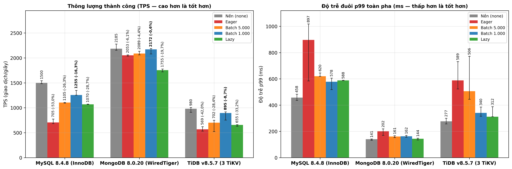

# Bản thảo hoàn chỉnh: Mục 2.6 (Báo cáo chính) & Phụ lục D (Phân tích chuyên sâu và Thực nghiệm)

> **Hướng dẫn sử dụng file này:**
> - Toàn bộ **7 biểu đồ** trong `docs/figures/2.4/` đã được **bỏ phần tiêu đề nằm trên đỉnh ảnh** (`suptitle`) và đồng bộ tên chiến lược gọn gàng (`Eager`, `Batch 5.000`, `Batch 1.000`, `Lazy`, `Nền (none)`), đặt dòng tên hình chuẩn nằm ngay bên dưới mỗi ảnh để dán thẳng vào Word.
> - **PHẦN A** đồng bộ khớp với trang 36–39 báo cáo chính hiện tại của nhóm (~2 trang kèm 2 biểu đồ cột chính).
> - **PHẦN B (Phụ lục D)** trình bày chuyên sâu theo mạch Mục 2.2 – 2.5 và giữ nguyên 100% mã tham chiếu (`Phụ lục D.1`, `Bảng D.1–D.5`, `Hình D.1–D.5`).

---

# PHẦN A — MỤC 2.6 TRONG BÁO CÁO CHÍNH (BẢN NGẮN GỌN ~2 TRANG)

## 2.6. Đổi lược đồ khi đang bán hàng

### 2.6.1. Vấn đề kỹ thuật, cơ chế và phương pháp triển khai

Trong thực tế vận hành, nhu cầu bổ sung thuộc tính mới hoặc thay đổi cấu trúc dữ liệu thường phát sinh ngay khi hệ thống đang chịu tải cao. Bài toán này đặt ra hai rủi ro chính: **(1)** thao tác thay đổi cấu trúc bảng (DDL) phải xin khóa siêu dữ liệu (*Metadata Lock — MDL*), dễ gây chặn dây chuyền các giao dịch khác nếu đang có truy vấn đọc kéo dài; **(2)** việc cập nhật bổ sung giá trị cho hàng triệu bản ghi cũ (*data migration*) sẽ cạnh tranh trực tiếp tài nguyên khóa, bộ nhớ đệm và ghi đĩa với luồng mua hàng đang chạy. Cụ thể trong thực nghiệm này, nhóm kiểm chứng kịch bản thêm cột chiết khấu `ol_discount` và trạng thái chuyển đổi `ol_mig_state` trên bảng lớn nhất `order_line` (**2.998.678 dòng**, `W = 10`; công thức tính chi tiết xem *Phụ lục D.1*).

Về cơ chế nội tại, **MySQL 8.4 (InnoDB)** hỗ trợ `ALGORITHM=INSTANT` không chạm dữ liệu nhưng vẫn cần khóa độc quyền `EXCLUSIVE` MDL ở đầu/cuối lệnh; **MongoDB 8.0 (WiredTiger)** linh hoạt lược đồ (*schemaless*) không cần `ALTER` nhưng `createIndex` vẫn chờ snapshot cũ khi chốt; **TiDB v8.5** dùng Online DDL nhiều trạng thái trung gian, chờ giao dịch đọc cũ kết thúc *schema lease* mà không xếp hàng chặn giao dịch mới.

Để đổi lược đồ mà không gián đoạn dịch vụ, nhóm áp dụng quy trình tương thích hai phiên bản lược đồ (*Expand → Migrate → Contract*): mọi đơn hàng `New-Order` mới đều ghi sẵn giá trị `ol_discount` kèm trạng thái `MIGRATED`, đồng thời bổ sung luồng truy vấn đọc `"Xem đơn cũ"` chiếm tỉ lệ `q` tổng tải để đánh giá ba chiến lược cập nhật dữ liệu cũ:
- **Eager:** Luồng nền cập nhật liên tục (`sleep = 0`) theo lô lớn.
- **Batch nền:** Luồng nền cập nhật từng lô nhỏ theo tiền tố khóa chính (`1.000` hoặc `5.000` dòng `order_line`), nghỉ `20 ms` giữa các lô.
- **Lazy (lấy cảm hứng từ BullFrog [8] ở tầng ứng dụng):** Chuyển đổi có điều kiện ngay trên đường đọc khi `"Xem đơn cũ"` gặp bản ghi `UNMIGRATED`, kết hợp luồng quét nền chậm (`sleep ≥ 50 ms`).

### 2.6.2. Thiết kế kịch bản thử nghiệm và phân tích kết quả

Thực nghiệm gồm **159/159 lượt đo `VALID`** (thỏa mãn đồng thời 3 luật tồn kho mục 2.1, bảo toàn chính xác số dòng `order_line`, `0` dòng `UNMIGRATED` và `0` dòng sai công thức sau chuyển đổi), chạy trên 1 máy ảo AWS `c6i.4xlarge` (Docker Compose giới hạn công bằng `8 vCPU / 16 GiB RAM`, bộ nhớ đệm `3 GiB` và độ bền ngang nhau; nhãn **sơ bộ**). Mỗi cấu hình lặp **3 lần độc lập** (`30 s` warmup + `60 s` đo), được thiết kế thành ba nhóm kịch bản trả lời ba câu hỏi riêng biệt:
- **DDL gốc (lúc `t = 5 s`, có/không có 1 giao dịch đọc mở `60 s`):** Nhằm tách bạch chi phí chép dữ liệu vật lý (`INSTANT` so với `COPY`) khỏi rủi ro chặn dây chuyền của khóa siêu dữ liệu (*Metadata Lock*) khi có truy vấn đọc kéo dài, đồng thời kiểm chứng hiệu quả giải pháp `lock_wait_timeout = 3` trên MySQL và đối chiếu với TiDB/MongoDB.
- **So sánh chiến lược (`none`, Eager, Batch 5.000, Batch 1.000, Lazy ở tải chuẩn `64 client, θ = 0,5` và tải cao `128 client, θ = 0,9`, `q = 25%`):** Nhằm định lượng sự đánh đổi giữa tốc độ hoàn tất chuyển đổi và mức sụt giảm TPS / gai độ trễ p99, đồng thời kiểm tra độ bền vững của kết luận khi tranh chấp Flash-sale tăng mạnh.
- **Quét tỉ lệ đọc đơn cũ (`q ∈ {5%, 25%, 50%}`):** Nhằm xác định ngưỡng đảo chiều hiệu năng giữa cập nhật nền (Batch 1.000) và cập nhật theo yêu cầu trên đường đọc (Lazy) khi tần suất khách hàng tra cứu đơn cũ thay đổi.

*(Toàn bộ phân tích cơ chế sâu, bảng số liệu chi tiết, biểu đồ tải cao/quét `q`, chuỗi thời gian và minh chứng demo được trình bày tại **Phụ lục D**).*

*Hình 2.6.1. So sánh thông lượng (TPS) và thời gian đóng băng 0 TPS ở kịch bản DDL gốc trên ba DBMS (`64 client, θ = 0,5, q = 25%`).*

- **MySQL:** `ADD COLUMN INSTANT` không gây treo khi tải bình thường (`0 s`, `1.420,2 TPS`), nhưng chỉ cần **1 giao dịch đọc giữ mở 60 s** là `ALTER` kẹt khóa siêu dữ liệu (*MDL*), làm treo cứng toàn bảng **57 s** (`502,1 TPS`). Đặt `lock_wait_timeout = 3` kèm retry giúp DDL tự rút khỏi hàng đợi, giảm đóng băng còn **2 s** và khôi phục lên `1.276,8 TPS`.
- **TiDB:** Nhờ cơ chế Online DDL đa phiên bản, lệnh `ALTER` chỉ chờ giao dịch đọc cũ kết thúc mà không chặn giao dịch mới (**`0 s` đóng băng**, `1.042,2 TPS`).
- **MongoDB:** Không rơi về `0 TPS`, nhưng giữ snapshot 60 s khi chốt `createIndex` gây áp lực bộ nhớ đệm làm TPS giảm từ `2.125,5` xuống `706,1`.

*Hình 2.6.2. So sánh thông lượng (TPS) và độ trễ đuôi p99 giữa các chiến lược chuyển dữ liệu ở tải chuẩn (`64 client, θ = 0,5, q = 25%`).*

- **Eager:** Xong nhanh nhất (`71–127 s`) nhưng tranh chấp khóa và ghi đĩa mạnh, làm TPS sụt sâu trên MySQL (`-53,0%`; tải cao tụt `-62,8%`, gai p99 lên `22,2 s`) và TiDB (`-42,0%`); riêng MongoDB ít ảnh hưởng hơn (`-6,1%`).
- **Batch lô `1.000` (nghỉ `20 ms`):** Giữ khóa ngắn và nhường I/O nên **đạt TPS cao nhất trên cả ba hệ ở cả hai mức tải** (`-0,6%` MongoDB, `-8,7%` TiDB, `-16,3%` MySQL ở tải chuẩn) và giảm `25,5×` gai p99 của Eager trên MySQL (*Bảng D.3, Hình D.3*).
- **Lazy và điểm đảo chiều theo `q`:** Giữ p99 toàn pha sát nền nhất trên MongoDB (`1,02×`) và TiDB (`1,13×`), nhưng biến đọc đơn cũ thành ghi đồng bộ. Khi quét `q ∈ {5%, 25%, 50%}`, **MySQL đảo chiều rõ rệt**: Lazy chỉ thắng Batch ở `q = 5%` (`-18,6%` vs `-21,7%`), từ `q ≥ 25%` tụt sau Batch; còn trên MongoDB, Batch 1.000 thắng TPS ở mọi `q` (*Bảng D.4, Hình D.4–D.5*).

---
---

# PHẦN B — PHỤ LỤC D: PHÂN TÍCH CHUYÊN SÂU VÀ THỰC NGHIỆM MỤC 2.6

## Phụ lục D: Phân tích cơ chế và thực nghiệm đổi lược đồ trực tuyến khi đang bán hàng (Online Schema Evolution)

Nếu các mục 2.2 đến 2.5 tập trung giải quyết bài toán tranh chấp ghi trên bảng tồn kho `stock` và bảng đơn hàng `orders`, thì **Phụ lục D** đi sâu vào một thách thức vận hành thực tế khác của hệ thống thương mại điện tử triển khai liên tục (*Continuous Deployment*): **thay đổi cấu trúc lược đồ và tính toán lại dữ liệu lịch sử trên bảng lớn nhất hệ thống ngay trong lúc đang mở bán Flash-sale**.

Trên bộ dữ liệu xuất phát từ TPC-C với `W = 10` kho, bảng chi tiết đơn hàng `order_line` lưu trữ sẵn **2.998.678 bản ghi lịch sử** (`ol_o_id ≤ 3000`), đồng thời liên tục nhận bản ghi mới từ luồng đặt đơn `New-Order` và phục vụ người dùng tra cứu lại đơn hàng đã mua. Giả sử nghiệp vụ yêu cầu bổ sung ngay cột tiền chiết khấu `ol_discount` (tính từ bảng giá `item`) và cột trạng thái chuyển đổi `ol_mig_state` cho toàn bộ đơn hàng cũ lẫn mới mà không được dừng hệ thống. Nội dung của phụ lục này trả lời ba câu hỏi kỹ thuật:
1. **Ở giai đoạn thay đổi cấu trúc gốc (DDL):** Vì sao các cơ chế *"Online DDL"* vẫn có thể làm đóng băng toàn bộ luồng mua hàng về `0 TPS` trong thực tế, cơ chế khóa bên trong MySQL, MongoDB và TiDB khác nhau ra sao, và làm thế nào để hóa giải? (**Mục D.2**)
2. **Ở giai đoạn chuyển đổi gần 3 triệu dòng dữ liệu cũ:** Đánh đổi về thông lượng, độ trễ đuôi `p99` và thời gian hoàn tất giữa ba phương pháp — *Eager*, *Batch nền* và *Lazy* — diễn biến như thế nào trên từng hệ quản trị ở cả tải chuẩn lẫn tải cao Flash-sale? (**Mục D.3**)
3. **Khi tần suất tra cứu đơn cũ `q` thay đổi:** Ở ngưỡng nào thì chi phí ghi ngay trên đường đọc của phương pháp *Lazy* vượt quá lợi ích của việc trì hoãn chuyển đổi so với *Batch nền*? (**Mục D.4**)

---

### D.1. Hai giai đoạn thay đổi lược đồ, ba phương pháp chuyển đổi và ánh xạ vào bài toán

#### D.1.1. Hai giai đoạn của bài toán đổi lược đồ trực tuyến và thách thức riêng

Trong vận hành thực tế, việc chạy xong lệnh `ALTER TABLE ... ADD COLUMN` (hoặc dùng cơ sở dữ liệu linh hoạt lược đồ như MongoDB) mới chỉ giải quyết được phần vỏ cấu trúc. Một quy trình đổi lược đồ trực tuyến có dữ liệu dẫn xuất luôn gồm hai giai đoạn với nút thắt tài nguyên hoàn toàn khác nhau:
- **Giai đoạn 1 – Thay đổi cấu trúc bảng (DDL):** Cập nhật siêu dữ liệu (*metadata*) để khai báo cột mới hoặc dựng chỉ mục mới. Thách thức lớn nhất ở đây không chỉ nằm ở việc tránh chép lại bảng vật lý, mà nằm ở **cơ chế khóa siêu dữ liệu (*Metadata Lock — MDL*)**: để bảo đảm tính nhất quán phiên bản lược đồ, lệnh DDL phải phối hợp với các giao dịch đang mở và rất dễ gây hiệu ứng chặn dây chuyền toàn bảng nếu gặp truy vấn đọc kéo dài.
- **Giai đoạn 2 – Chuyển đổi dữ liệu lịch sử (*Data Migration*):** Tính toán và cập nhật giá trị mới cho hàng triệu bản ghi cũ đã tồn tại trước thời điểm đổi lược đồ. Ngay cả khi giai đoạn 1 hoàn tất tức thì (như `ALGORITHM=INSTANT` trên MySQL hay *schemaless* trên MongoDB), giai đoạn 2 vẫn bắt buộc phải đọc/ghi dữ liệu thật và **cạnh tranh trực tiếp khóa dòng, bộ nhớ đệm và băng thông ghi đĩa bền vững (`fsync` / journal / Raft)** với các giao dịch mua hàng đang chạy.

#### D.1.2. Ba phương pháp chuyển đổi dữ liệu lịch sử

Để giải quyết giai đoạn 2 mà không phải dừng hệ thống, ba phương pháp tiêu biểu đại diện cho ba cách phân bổ chi phí cập nhật được đặt lên bàn cân:
1. **Chuyển ồ ạt (*Eager*):** Một tiến trình nền quét và cập nhật liên tục toàn bộ dữ liệu cũ không nghỉ (`sleep = 0`) trong các giao dịch kích thước lớn. Cách này giúp dữ liệu hội tụ về lược đồ mới nhanh nhất, nhưng dồn toàn bộ áp lực khóa và ghi đĩa vào một khoảng thời gian ngắn.
2. **Chuyển nền theo lô nhỏ có điều tiết (*Batch nền*):** Tiến trình nền chia dải dữ liệu cũ thành từng giao dịch nhỏ (ví dụ `1.000` hoặc `5.000` dòng) và chủ động nghỉ một nhịp ngắn (`20 ms`) giữa hai lô liên tiếp để nhường khóa và chu kỳ ghi đĩa cho giao dịch của người dùng, chấp nhận kéo dài tổng thời gian chạy nền.
3. **Chuyển lười theo yêu cầu (*Lazy*, lấy cảm hứng từ hướng tiếp cận *Lazy Evaluation* [8] ở tầng ứng dụng):** Không vội cập nhật ngay toàn bộ bảng mà trì hoãn tới khi có truy vấn đọc thực sự chạm vào bản ghi cũ chưa chuyển đổi thì mới tính toán và cập nhật ngay bản ghi đó trước khi trả kết quả, kết hợp một luồng quét nền tốc độ rất chậm (`sleep ≥ 50 ms`) để thu dọn dần phần dữ liệu ít được đọc. Cách này giảm tối đa luồng ghi nền nhưng lại biến một phần truy vấn đọc của người dùng thành giao dịch ghi đồng bộ.

#### D.1.3. Ánh xạ vào bài toán Flash-sale của nhóm và điều kiện kiểm định

Nhóm ánh xạ trực tiếp hai giai đoạn và ba phương pháp trên vào bộ khung thực nghiệm TPC-C tùy biến (`W = 10` kho) theo quy trình tương thích hai phiên bản lược đồ (*Expand → Migrate → Contract*):
- **Lược đồ đích và công thức nghiệp vụ:** Bảng/collection `order_line` (**2.998.678 dòng cũ** có `ol_o_id ≤ 3000`) được bổ sung cột chiết khấu `ol_discount` (đơn vị xu) và cột trạng thái `ol_mig_state` (`'UNMIGRATED'` hoặc `'MIGRATED'`; trên MongoDB, tài liệu cũ thiếu trường được coi là `UNMIGRATED`). Mức chiết khấu tính theo công thức tất định và lũy đẳng (*chạy lại nhiều lần không đổi kết quả*) từ giá mặt hàng `i_price` trong bảng `item`:

$$\text{ol\_discount} = \left\lfloor \frac{\text{ol\_quantity} \times \text{i\_price} \times r}{100} \right\rfloor, \quad \text{với } r = \begin{cases} 10 & \text{nếu } i\_price \ge 5000 \\ 5 & \text{nếu } 2500 \le i\_price < 5000 \\ 0 & \text{nếu } i\_price < 2500 \end{cases}$$

- **Tải hỗn hợp trong lúc đổi lược đồ:** Mọi đơn `New-Order` mới phát sinh đều ghi sẵn `ol_discount` kèm trạng thái `'MIGRATED'`. Bên cạnh luồng đặt đơn và thanh toán (`New-Order : Payment = 1 : 1`), hệ thống bổ sung giao dịch đọc **`"Xem đơn cũ"`** chiếm tỷ trọng `q` tổng tải (truy vấn ngẫu nhiên một đơn lịch sử `ol_o_id ≤ 3000`), đồng thời tách riêng phép đo độ trễ `p99` của lượt đọc đơn đã chuyển (`read_clean_p99`) và lượt đọc phải kích hoạt cập nhật tại chỗ của Lazy (`read_migrated_p99`).
- **Thực thi phù hợp với từng DBMS:** Trên **MySQL** và **TiDB**, các lô cập nhật quét tuần tự theo tiền tố khóa chính cụm `(ol_w_id, ol_d_id, ol_o_id BETWEEN ? AND ?)` kết hợp `JOIN item` và điều kiện `AND ol_mig_state = 'UNMIGRATED'` để tránh quét toàn bảng (riêng TiDB ở chế độ Eager chia theo cụm 1.000 đơn để phù hợp giới hạn giao dịch phân tán). Trên **MongoDB**, tiến trình nạp bảng giá `item` vào bộ nhớ, quét theo dải `_id` chưa chuyển đổi và gom vào lệnh `bulkWrite` với `writeConcern: {w: "majority", j: true}` nhằm bảo đảm độ bền ngang với hai hệ SQL.
- **Sáu điều kiện kiểm định tính đúng đắn (`VALID`):** Một lượt chạy chỉ được ghi nhận hợp lệ khi thỏa mãn đồng thời **3 luật tồn kho gốc** (*không âm kho, khớp sổ bán hàng, không trùng đơn*) và **3 luật chuyển đổi**: *(4)* bảo toàn chính xác tổng số dòng `order_line` (`2.998.678 + số dòng đơn mới`); *(5)* `0` dòng còn ở trạng thái `UNMIGRATED` khi kết thúc; và *(6)* `0` dòng sai công thức `ol_discount` khi kiểm chéo toàn bảng với `item`. Toàn bộ **159/159 lượt đo** (66 MySQL, 54 MongoDB, 39 TiDB) đều đạt `VALID`.

---

### D.2. Chẩn đoán tác động của lệnh DDL gốc và bẫy kẹt khóa siêu dữ liệu

Trước khi so sánh các chiến lược cập nhật dữ liệu, thí nghiệm đầu tiên kiểm tra trực tiếp tuyên bố *"thay đổi lược đồ không gián đoạn"* của ba hệ quản trị dưới tải thực tế (`64 client`, `θ = 0,5`, `q = 25%`). Lệnh DDL gốc (`ADD COLUMN`, `ADD INDEX` hoặc `createIndex`) được phát vào giây thứ `t = 5 s` của pha đo trong hai bối cảnh đối chứng: *(i)* hệ thống chỉ chạy các giao dịch ngắn thông thường; và *(ii)* tại giây `t = 3 s`, có **duy nhất 1 phiên đọc báo cáo** mở giao dịch `BEGIN; SELECT ol_o_id FROM order_line LIMIT 1;` và giữ chưa chốt trong `60 s` (mô phỏng truy vấn phân tích chậm hoặc kết nối ứng dụng quên đóng giao dịch). Kết quả tổng hợp tại **Bảng D.1** và diễn biến từng giây tại **Hình D.1**.

**Bảng D.1:** *Thông lượng, độ trễ đỉnh theo giây và thời gian đóng băng hệ thống khi phát lệnh DDL gốc lúc `t = 5 s` dưới tải (`W = 10`, `2.998.678` dòng `order_line`, `64 client`, `θ = 0,5`, `q = 25%`).*

| Hệ DBMS | Kịch bản DDL | Lượt VALID | TPS trung vị | p99 toàn pha (ms) | Đỉnh p99 1s (ms) | Thời gian DDL (s) | Đóng băng lâu nhất | Cơ chế bên trong giải thích kết quả |
| --- | --- | :---: | ---: | ---: | ---: | ---: | ---: | --- |
| **MySQL 8.4.8** | `ADD COLUMN INSTANT` | 6/6 | **1.420,2** | 523,9 | 713,7 | **0,05 s** | **0 s** | Chỉ ghi thêm định nghĩa cột vào từ điển dữ liệu |
| **MySQL 8.4.8** | `ADD COLUMN COPY` | 3/3 | **903,4** | 562,2 | **22.857,9** | **22,7 s** | **21 s** | Tạo bảng tạm, chép lại ~3 triệu dòng và khóa ghi |
| **MySQL 8.4.8** | `ADD INDEX INPLACE` | 3/3 | **1.084,6** | 537,6 | 3.255,2 | **24,3 s** | **1 s** | Dựng cây B+Tree tại chỗ, ghi đệm thay đổi đồng thời |
| **MySQL 8.4.8** | **Đọc mở 60s + `INSTANT` (`mdl_freeze`)** | 3/3 | **502,1** *(-66,5%)* | 350,8 | **58.066,7** | **58,0 s** | **57 s** | `EXCLUSIVE` MDL đứng đầu hàng đợi chặn cứng 47–52 phiên sau |
| **MySQL 8.4.8** | **Đọc mở 60s + `lock_wait_timeout = 3`** | 3/3 | **1.276,8** *(2,54×)* | 473,7 | **3.208,6** | 29,5 s *(retry)* | **2 s** | DDL tự hủy sau 3s chờ khóa, giải phóng hàng đợi giao dịch |
| **MongoDB 8.0.20** | `createIndex` *(thường)* | 3/3 | **2.125,5** | 171,8 | 422,9 | **8,8 s** | **0 s** | Không cần DDL thêm trường; dựng chỉ mục nền không khóa bảng |
| **MongoDB 8.0.20** | **Đọc mở 60s + `createIndex`** | 3/3 | **706,1** *(-66,8%)* | 140,7 | 359,0 | **66,8 s** | **0 s** | Không treo `0 TPS`, nhưng ghim snapshot 60s gây áp lực bộ đệm |
| **TiDB v8.5.7** | `ADD COLUMN` *(Online DDL)* | 3/3 | **920,1** | 284,8 | 380,3 | **1,2 s** | **0 s** | Chuyển trạng thái siêu dữ liệu bất đồng bộ kiểu Google F1 |
| **TiDB v8.5.7** | `ADD INDEX` *(Online DDL)* | 3/3 | **848,1** | 339,5 | 732,6 | **41,9 s** | **0 s** | Quét và điền chỉ mục phân tán nền trên 3 nút TiKV |
| **TiDB v8.5.7** | **Đọc mở 60s + `ADD COLUMN`** | 3/3 | **1.042,2** | **250,9** | **422,7** | **59,3 s** | **0 s** | DDL tự đợi phiên đọc cũ kết thúc, không chặn giao dịch mới |

*Hình D.1. Diễn biến thông lượng (TPS) theo từng giây ở kịch bản DDL gốc trên MySQL 8.4.8, MongoDB 8.0.20 và TiDB v8.5.7 (vạch chấm đen tại `t = 5 s` đánh dấu thời điểm phát lệnh DDL).*

Đối chiếu **Bảng D.1** và đường cong theo từng giây trên **Hình D.1** làm rõ bản chất cơ chế đồng bộ lược đồ của từng hệ quản trị:

- **Trên MySQL InnoDB — Sự khác biệt giữa chi phí vật lý và bẫy hàng đợi Metadata Lock:** Khi chỉ có các giao dịch ngắn, `ALGORITHM=INSTANT` phát huy đúng thiết kế khi hoàn tất trong `0,05 s` với `0 s` đóng băng (`1.420,2 TPS`), vượt xa `ALGORITHM=COPY` phải chép vật lý ~3 triệu dòng mất `22,7 s` và khóa ghi `21 s` (đỉnh `p99` vọt lên `22,9 s`). Thế nhưng, trong kịch bản `mdl_freeze`, dù vẫn dùng chính lệnh `ALGORITHM=INSTANT` đó, đường màu đỏ trên khung trái **Hình D.1** lập tức rơi thẳng đứng về **`0 TPS` suốt `57 s` liên tiếp** (đỉnh `p99` chạm `58.066,7 ms`, thông lượng cả pha mất `66,5%`). Ảnh chụp trực tiếp bảng `performance_schema.metadata_locks` tại giây `t = 8 s` xác nhận nguyên nhân: phiên đọc dài giữ vé `SHARED_READ (GRANTED)`; phiên `ALTER` xin vé độc quyền `EXCLUSIVE` không được nên đứng chờ ở `PENDING`; và do **quy tắc chống đói khóa của MySQL ưu tiên yêu cầu `EXCLUSIVE` đang chờ trước mọi yêu cầu mới**, toàn bộ **`47–52` phiên đặt đơn và xem đơn đến sau** (`35–42` vé `SHARED_WRITE` và `6–16` vé `SHARED_READ`) đều bị chặn cứng ở trạng thái `PENDING` phía sau lệnh `ALTER`.
- **Cơ chế hóa giải trên MySQL bằng `lock_wait_timeout` ngắn kèm thử lại:** Khi gắn thêm `SET SESSION lock_wait_timeout = 3` cho riêng kết nối chạy DDL (đường xanh dương chấm gạch trên **Hình D.1**), hễ chờ quá 3 giây không lấy được vé `EXCLUSIVE`, lệnh `ALTER` tự nhận lỗi timeout và **rút khỏi hàng đợi MDL**, lập tức thông luồng cho hàng chục giao dịch mua hàng đi qua trước khi nghỉ ngắn rồi thử lại. Giải pháp đơn giản ở tầng vận hành này kéo thời gian đóng băng từ **`57 s` xuống `2 s` (giảm 28,5 lần)**, hạ đỉnh `p99` **18 lần** (`58,1 s → 3,2 s`) và nâng thông lượng lên **`1.276,8 TPS` (gấp `2,54×`)**. *(Lưu ý kỹ thuật cho con số `p99 toàn pha = 350,8 ms` có vẻ thấp ở dòng `mdl_freeze`: do hệ thống bị treo cứng trong 57 giây chỉ hoàn thành đúng 1 đợt xả giao dịch cuối pha, mẫu thống kê bị co lại nên ở kịch bản treo cứng cần đọc chỉ số **thời gian đóng băng** và **đỉnh p99 theo giây** thay vì p99 gộp toàn pha).*
- **Trên TiDB v8.5 — Ưu thế của Online DDL đa phiên bản kiểu Google F1:** Khung phải **Hình D.1** cho thấy đường thông lượng của TiDB giữ phẳng quanh `~900–1.050 TPS` không hề gãy nhịp ở cả ba kịch bản (`0 s` đóng băng). Ngay cả khi có phiên đọc giữ mở `60 s`, cơ chế Metadata Lock thế hệ mới của TiDB chỉ buộc tiến trình điều phối DDL tự đứng đợi phiên đọc cũ kết thúc (`59,3 s`) trước khi lật trạng thái lược đồ nhằm tránh lỗi `Information schema is changed`, còn **mọi giao dịch mua hàng mới vẫn được cấp phát bình thường trên phiên bản lược đồ hiện hành** (`1.042,2 TPS`, `p99 = 250,9 ms`).
- **Trên MongoDB 8.0 — Không khóa bảng nhưng chịu áp lực ghim Snapshot MVCC:** Do thêm trường mới trên MongoDB không cần lệnh DDL, nhóm kiểm tra thao tác nặng nhất là dựng chỉ mục phụ `createIndex`. Ở điều kiện thường, lệnh hoàn tất trong `8,8 s` với `2.125,5 TPS`. Tuy nhiên, khi có một giao dịch đa tài liệu giữ mở snapshot `60 s` (đường đỏ khung giữa **Hình D.1**), thông lượng không rơi về `0` (`0 s` đóng băng) nhưng lùi dần xuống mức trung vị `706,1 TPS` (`-66,8%`) và thời gian tạo chỉ mục kéo dài lên `66,8 s`: nguyên nhân là bước chốt chỉ mục (*commit index build*) phải đợi giao dịch cũ nhả khóa ý định (*intent lock*), đồng thời WiredTiger phải giữ lại toàn bộ chuỗi phiên bản cũ trong bộ nhớ đệm `3 GiB` phục vụ snapshot đang mở, làm tăng chi phí quản lý trang đệm (*eviction pressure*).

---

### D.3. Đánh giá ba chiến lược chuyển dữ liệu ở tải chuẩn và tải cao Flash-sale

Sau khi đã thêm cột an toàn, thí nghiệm thứ hai cố định tỉ lệ đọc đơn cũ `q = 25%` và đo tác động của giai đoạn cập nhật gần 3 triệu dòng lịch sử bằng ba chiến lược (**Eager**, **Batch lô `5.000` và `1.000` dòng nghỉ `20 ms`**, **Lazy**) so với mốc **Nền (`none` — không chạy chuyển đổi)** trên hai mức áp lực: **tải chuẩn** (`64 client, θ = 0,5`, **Bảng D.2** & **Hình D.2**) và **tải cao Flash-sale** (`128 client, θ = 0,9`, **Bảng D.3** & **Hình D.3**).

**Bảng D.2:** *So sánh ba chiến lược chuyển dữ liệu ở tải chuẩn (`64 client`, `θ = 0,5`, `q = 25%`; trung vị và khoảng min–max qua 3 lần lặp độc lập).*

| Hệ DBMS | Chiến lược | TPS trung vị *(min–max)* | Thay đổi TPS *(vs nền)* | p99 toàn pha *(ms)* | Tỉ số p99 *(× nền)* | Đỉnh p99 1s *(ms)* | `read_clean` / `read_migrated` p99 *(ms)* | Hoàn tất nền *(s)* |
| --- | --- | --- | ---: | ---: | ---: | ---: | :---: | ---: |
| **MySQL 8.4.8** | Nền (`none`) | **1.499,6** *(1.483,2–1.543,5)* | 0,0% | 457,6 | 1,00× | — | — | — |
| **MySQL 8.4.8** | **Eager** | **704,9** *(684,2–773,2)* | **-53,0%** | 896,6 | **1,96×** | **8.202,9** | 13,8 / — | **71,3 s** |
| **MySQL 8.4.8** | **Batch 5.000** | **1.104,8** *(1.094,2–1.106,0)* | -26,3% | 619,5 | 1,35× | 846,0 | 15,3 / — | 89,7 s |
| **MySQL 8.4.8** | **Batch 1.000** | **1.255,2** *(1.254,7–1.349,5)* | **-16,3%** | **578,2** | **1,26×** | 730,2 | 15,4 / — | 106,5 s |
| **MySQL 8.4.8** | **Lazy** | **1.069,8** *(1.066,6–1.072,6)* | -28,7% | 588,5 | 1,29× | **684,2** | **16,5 / 575,0** | 97,6 s |
| **MongoDB 8.0.20** | Nền (`none`) | **2.185,4** *(2.153,0–2.277,5)* | 0,0% | 140,7 | 1,00× | — | 94,8 / — | — |
| **MongoDB 8.0.20** | **Eager** | **2.053,0** *(2.036,8–2.062,0)* | -6,1% | 201,5 | 1,43× | 479,8 | 158,4 / — | **126,8 s** |
| **MongoDB 8.0.20** | **Batch 5.000** | **2.088,7** *(2.062,0–2.133,8)* | -4,4% | 161,1 | 1,15× | 393,5 | 99,2 / — | 197,3 s |
| **MongoDB 8.0.20** | **Batch 1.000** | **2.172,4** *(2.080,2–2.186,8)* | **-0,6%** | 162,3 | 1,15× | 477,7 | 107,7 / — | 207,8 s |
| **MongoDB 8.0.20** | **Lazy** | **1.755,2** *(1.720,6–1.777,2)* | -19,7% | **143,6** | **1,02×** | **234,0** | **99,2 / 102,6** | 202,0 s |
| **TiDB v8.5.7** | Nền (`none`) | **980,1** *(909,7–1.005,2)* | 0,0% | 276,6 | 1,00× | — | 35,5 / — | — |
| **TiDB v8.5.7** | **Eager** | **568,5** *(532,8–619,7)* | **-42,0%** | 588,5 | **2,13×** | **1.668,5** | 60,0 / — | **81,3 s** |
| **TiDB v8.5.7** | **Batch 5.000** | **702,1** *(523,4–748,0)* | -28,4% | 506,4 | 1,83× | 934,1 | 55,1 / — | 117,4 s |
| **TiDB v8.5.7** | **Batch 1.000** | **895,0** *(753,7–918,5)* | **-8,7%** | 340,4 | 1,23× | **599,9** | 39,9 / — | 133,8 s |
| **TiDB v8.5.7** | **Lazy** | **655,0** *(628,2–660,4)* | -33,2% | **311,8** | **1,13×** | 707,6 | **39,0 / 226,9** | 131,9 s |

*Hình D.2. Diễn biến TPS (hàng trên) và độ trễ p99 thang log (hàng dưới) theo từng giây của Eager, Batch 1.000 và Lazy tại tải chuẩn (`64 client, θ = 0,5, q = 25%`; vạch chấm tại `t = 2 s` đánh dấu thời điểm bắt đầu chuyển đổi).*

**Bảng D.3:** *So sánh ba chiến lược chuyển dữ liệu ở tải cao Flash-sale (`128 client`, `θ = 0,9`, `q = 25%`, `45/45` lượt `VALID`).*

| Hệ DBMS | Chiến lược | TPS trung vị *(min–max)* | Thay đổi TPS *(vs nền)* | p99 toàn pha *(ms)* | Tỉ số p99 *(× nền)* | Đỉnh p99 1s *(ms)* | `read_clean` / `read_migrated` p99 *(ms)* | Hoàn tất nền *(s)* |
| --- | --- | --- | ---: | ---: | ---: | ---: | :---: | ---: |
| **MySQL 8.4.8** | Nền (`none`) | **1.890,3** *(1.871,6–2.164,8)* | 0,0% | 728,2 | 1,00× | — | 12,5 / — | — |
| **MySQL 8.4.8** | **Eager** | **702,6** *(656,4–831,9)* | **-62,8%** | 999,1 | **1,37×** | **22.201,0** | 11,6 / — | **128,8 s** |
| **MySQL 8.4.8** | **Batch 5.000** | **1.472,4** *(1.472,0–1.474,4)* | -22,1% | 817,8 | 1,12× | 1.038,0 | 13,6 / — | 163,3 s |
| **MySQL 8.4.8** | **Batch 1.000** | **1.587,8** *(1.559,6–1.614,0)* | **-16,0%** | 789,6 | 1,08× | **868,7** | 13,1 / — | 170,0 s |
| **MySQL 8.4.8** | **Lazy** | **1.288,0** *(1.284,5–1.288,2)* | -31,9% | **779,8** | **1,07×** | 873,9 | **14,6 / 739,5** | 166,9 s |
| **MongoDB 8.0.20** | Nền (`none`) | **2.652,3** *(2.589,8–2.703,7)* | 0,0% | 298,9 | 1,00× | — | 86,8 / — | — |
| **MongoDB 8.0.20** | **Eager** | **2.425,6** *(2.424,5–2.562,3)* | -8,5% | 309,2 | 1,03× | 487,9 | 111,6 / — | **138,3 s** |
| **MongoDB 8.0.20** | **Batch 5.000** | **2.446,3** *(2.136,0–2.490,7)* | -7,8% | 306,4 | 1,02× | 457,1 | 89,9 / — | 205,3 s |
| **MongoDB 8.0.20** | **Batch 1.000** | **2.478,6** *(2.411,5–2.547,0)* | **-6,5%** | **304,2** | **1,02×** | **448,8** | 113,8 / — | 211,5 s |
| **MongoDB 8.0.20** | **Lazy** | **1.979,6** *(1.950,6–1.994,1)* | -25,4% | 322,4 | 1,08× | 502,4 | **128,1 / 136,1** | 203,1 s |
| **TiDB v8.5.7** | Nền (`none`) | **1.073,5** *(1.028,9–1.086,1)* | 0,0% | 667,2 | 1,00× | — | 45,4 / — | — |
| **TiDB v8.5.7** | **Eager** | **708,6** *(668,1–723,4)* | -34,0% | 1.087,0 | 1,63× | 2.027,3 | 66,5 / — | **85,3 s** |
| **TiDB v8.5.7** | **Batch 5.000** | **568,2** *(551,7–615,4)* | -47,1% | 1.308,5 | 1,96× | 2.108,5 | 72,7 / — | 127,1 s |
| **TiDB v8.5.7** | **Batch 1.000** | **710,4** *(638,1–792,9)* | **-33,8%** | **999,5** | **1,50×** | **1.434,3** | 71,6 / — | 131,6 s |
| **TiDB v8.5.7** | **Lazy** | **567,8** *(524,6–610,6)* | -47,1% | 1.100,0 | 1,65× | 1.491,7 | **71,7 / 373,6** | 145,7 s |

*Hình D.3. Biểu đồ cột so sánh thông lượng (TPS) và độ trễ đuôi p99 tại tải cao Flash-sale (`128 client, θ = 0,9, q = 25%`).*

Phân tích đồng thời hai mức tải qua **Bảng D.2 – D.3** và **Hình D.2 – D.3** cho thấy ba quy luật gắn chặt với kiến trúc lưu trữ của từng DBMS:

1. **Vì sao Eager gây sụp đổ trên MySQL và TiDB nhưng lại ít làm suy suyển MongoDB?**
   - Trên **MySQL InnoDB**, giao dịch Eager quét và khóa cập nhật từng kho (~`300.000` dòng/giao dịch). Việc sửa dồn dập một lượng lớn trang lá B+Tree làm tràn ngập bộ đệm `3 GiB` bằng trang bẩn (*dirty pages*), đồng thời chiếm nghẽn băng thông ghi `redo log` và `binlog` (`flush=1, sync_binlog=1`). Như thấy rõ ở đường đỏ khung trái **Hình D.2**, ngay từ giây `t = 2 s`, thông lượng MySQL sụt một nửa (`-53,0%`) và xuất hiện các gai `p99` lên tới `8,2 s`; khi nâng lên tải cao `128 client, θ = 0,9` (**Bảng D.3**), tranh chấp cộng hưởng đẩy mức sụt TPS lên **`-62,8%`**, gai `p99` theo giây chạm **`22.201,0 ms` (`22,2 s`)** và bản thân thời gian hoàn tất của Eager cũng bị kéo giãn gần gấp đôi (`71,3 s → 128,8 s`).
   - Trên **TiDB**, các cụm ghi lớn liên tiếp của Eager buộc tầng TiKV phải thực hiện `Prewrite` và `Commit` hai pha kèm ghi nhật ký Raft trên hàng vạn cặp Key–Value cùng lúc, làm TPS sụt **`-42,0%`** ở tải chuẩn (`p99` tăng `2,13×`).
   - Trái lại, trên **MongoDB WiredTiger**, Eager chỉ làm giảm nhẹ **`-6,1%`** TPS ở tải chuẩn và **`-8,5%`** ở tải cao. Nguyên nhân là WiredTiger quản lý khóa ở mức từng tài liệu độc lập và gom ghi qua cơ chế *group commit* vào journal: luồng `bulkWrite` chỉ sửa các tài liệu lịch sử `ol_o_id ≤ 3000` của `order_line`, tách biệt hoàn toàn khỏi vùng tài liệu `stock` đang có tranh chấp mua hàng và các tài liệu đơn mới `ol_o_id > 3000`.

2. **Vì sao Batch lô nhỏ `1.000` dòng (nghỉ `20 ms`) dẫn đầu thông lượng trên cả ba hệ ở mọi mức tải và vượt trội lô `5.000` dòng?**
   - Chia nhỏ công việc thành từng giao dịch **1.000 dòng (~100 đơn)** đi đúng theo thứ tự khóa chính cụm giúp phạm vi giữ khóa cực hẹp (chỉ vài chục trang B+Tree/tài liệu mỗi lần), kết hợp khoảng nghỉ `20 ms` đóng vai trò "van điều áp" nhường luồng ghi nhật ký đĩa cho các giao dịch `New-Order` và `Payment` xen vào.
   - Khi tăng kích thước lô lên **5.000 dòng**, thời gian giữ khóa và lượng dữ liệu dồn vào mỗi nhịp `COMMIT` lớn gấp 5 lần: trên MySQL tải chuẩn, mức sụt TPS nặng hơn từ `-16,3%` lên `-26,3%`; đặc biệt trên **TiDB ở tải cao (`128 client, θ = 0,9`, Bảng D.3)**, lô `5.000` dòng làm tăng mạnh xung đột vùng khóa và chi phí 2PC khiến TPS tụt sâu `-47,1%` (`p99 = 1.308,5 ms`), kém hơn cả Eager, trong khi **Batch `1.000` dòng vẫn giữ ngôi đầu cả về TPS (`710,4 TPS`, `-33,8%`) lẫn `p99` (`999,5 ms`)** và trên MySQL cắt giảm tới **25,5 lần** gai độ trễ đỉnh của Eager (`22.201,0 ms → 868,7 ms`).

3. **Bằng chứng trực tiếp về chi phí biến đọc thành ghi của Lazy tại `q = 25%`:**
   - Cột `read_clean / read_migrated p99` trong **Bảng D.2** và **Bảng D.3** phơi bày chính xác cơ chế vật lý bên trong Lazy: trên MySQL, một truy vấn đọc đơn đã chuyển đổi chỉ mất **`16,5 ms`** (`14,6 ms` ở tải cao), nhưng khi chạm phải đơn `UNMIGRATED` và phải thực thi `UPDATE + COMMIT (fsync)` đồng bộ, độ trễ `p99` của chính truy vấn đó vọt lên **`575,0 ms` (chậm gấp 34,8 lần)** ở tải chuẩn và **`739,5 ms` (chậm gấp 50,7 lần)** ở tải cao! Trên TiDB, độ trễ đọc cũng nhảy vọt từ `39,0 ms` lên `226,9 ms` (`5,8×`). Chính khoản phạt ghi đồng bộ trên mỗi đơn lẻ này kéo thông lượng tổng của Lazy ở `q = 25%` xuống thấp hơn Batch 1.000 trên cả ba hệ, dù luồng quét nền chạy thưa giúp đường `p99` toàn pha của Lazy rất mượt (`1,02×` trên MongoDB; `1,13×` trên TiDB).

---

### D.4. Phân tích điểm đảo chiều theo tỉ lệ đọc đơn cũ `q`

Để kiểm chứng khi nào phương pháp Lazy phát huy ưu thế và khi nào bị vượt qua bởi Batch nền, nhóm giữ nguyên cấu hình `64 client, θ = 0,5` và quét tỷ trọng giao dịch `"Xem đơn cũ"` qua ba mức **`q = 5%` (ít đọc lịch sử)**, **`q = 25%` (trung bình)** và **`q = 50%` (tra cứu lịch sử cao)** trên MySQL và MongoDB (**Bảng D.4**, **Hình D.4** và **Hình D.5**). *(Lưu ý đọc bảng: khi `q` tăng, tỷ trọng truy vấn đọc nhẹ trong tổng tải tăng thay cho giao dịch ghi `New-Order`/`Payment` nặng hơn, nên TPS của đường Nền `none` tự nhiên tăng từ `1.262 → 2.012` trên MySQL và `1.883 → 3.044` trên MongoDB; vì vậy mọi so sánh đều dựa trên **mức sụt giảm `%` so với đường Nền tại cùng mức `q`**).*

**Bảng D.4:** *Đối chiếu Batch 1.000 và Lazy khi quét tỉ lệ đọc đơn cũ `q ∈ {5%, 25%, 50%}` trên MySQL 8.4.8 và MongoDB 8.0.20 (`64 client`, `θ = 0,5`).*

| Hệ DBMS | Tỉ lệ `q` | Nền (`none`) TPS / p99 | **Batch 1.000** TPS *(vs nền)* / p99 *(× nền)* | **Lazy** TPS *(vs nền)* / p99 *(× nền)* | Số dòng chuyển on-demand (Lazy) | Chiến lược tối ưu về TPS |
| --- | :---: | --- | --- | --- | ---: | --- |
| **MySQL 8.4.8** | **`5%`** | 1.262,0 / 501,5 ms | 988,0 *(-21,7%)* / 644,7 ms *(1,29×)* | **1.027,1** *(-18,6%)* / **603,8 ms** *(1,20×)* | 27.515 *(0,92%)* | **Lazy thắng** *(cả TPS & p99)* |
| **MySQL 8.4.8** | **`25%`** | 1.499,6 / 457,6 ms | **1.255,2** *(-16,3%)* / **578,2 ms** *(1,26×)* | 1.069,8 *(-28,7%)* / 588,5 ms *(1,29×)* | 141.056 *(4,70%)* | **Đảo chiều → Batch 1.000** |
| **MySQL 8.4.8** | **`50%`** | 2.011,8 / 386,1 ms | **1.553,4** *(-22,8%)* / 559,5 ms *(1,45×)* | 1.165,4 *(-42,1%)* / **553,3 ms** *(1,43×)* | 294.463 *(9,82%)* | **Batch 1.000 (+33,3% TPS)** |
| **MongoDB 8.0.20** | **`5%`** | 1.882,9 / 152,5 ms | **1.835,5** *(-2,5%)* / 162,6 ms *(1,07×)* | 1.754,7 *(-6,8%)* / **157,6 ms** *(1,03×)* | 47.846 *(1,60%)* | **Batch 1.000 (+4,6% TPS)** |
| **MongoDB 8.0.20** | **`25%`** | 2.185,4 / 140,7 ms | **2.172,4** *(-0,6%)* / 162,3 ms *(1,15×)* | 1.755,2 *(-19,7%)* / **143,6 ms** *(1,02×)* | 228.944 *(7,63%)* | **Batch 1.000 (+23,8% TPS)** |
| **MongoDB 8.0.20** | **`50%`** | 3.044,2 / 101,0 ms | **2.829,7** *(-7,0%)* / 114,2 ms *(1,13×)* | 1.788,9 *(-41,2%)* / **107,3 ms** *(1,06×)* | 446.218 *(14,88%)* | **Batch 1.000 (+58,2% TPS)** |

*Hình D.4. Biểu đồ cột so sánh thông lượng của Batch 1.000 và Lazy khi quét `q ∈ {5%, 25%, 50%}` trên MySQL 8.4.8 và MongoDB 8.0.20 (`64 client, θ = 0,5`).*

*Hình D.5. Đường cong TPS và độ trễ p99 toàn pha theo tỉ lệ truy cập đơn cũ `q ∈ {5%, 25%, 50%}` (điểm trung vị kèm thanh sai số min–max của 3 lần chạy).*

Kết quả trên **Hình D.4** và **Hình D.5** chỉ rõ ranh giới hiệu quả giữa hai phương pháp theo đặc trưng tải:
- **Điểm đảo chiều trên MySQL giữa `q = 5%` và `q = 25%`:**
  - Tại **`q = 5%`**, chỉ có `27.515` dòng (`0,92%` bảng `order_line`) bị kích hoạt chuyển đổi trên đường đọc trong suốt 60 giây đo. Nhờ tần suất phát sinh `UPDATE + fsync` lẻ rất thấp, đồng thời luồng quét nền của Lazy nghỉ dài hơn (`≥ 50 ms` so với `20 ms` của Batch), **Lazy vượt lên thắng Batch 1.000 ở cả thông lượng (`1.027,1` so với `988,0 TPS`, tức `-18,6%` so với `-21,7%`) lẫn độ trễ `p99` (`603,8 ms` so với `644,7 ms`)**. Lúc này, hệ thống tận dụng được ưu thế chỉ chuyển đổi đúng tập nhỏ dữ liệu đang thực sự cần đọc và nạp trang đệm một lần cho cả hai thao tác [8].
  - Tuy nhiên, khi `q` tăng lên **`25%`** (`141.056` dòng on-demand) và **`50%`** (`294.463` dòng on-demand — gấp hơn 10 lần mức `5%`), hàng vạn truy vấn đọc vốn dĩ không tốn I/O đĩa bị biến thành hàng vạn giao dịch ghi nhỏ lẻ, mỗi giao dịch đều bắt đĩa cứng thực hiện `fsync` riêng rẽ. Trong khi đó, **Batch 1.000** giữ cho toàn bộ `50%` lưu lượng `"Xem đơn cũ"` vẫn là truy vấn `SELECT` MVCC siêu nhẹ, còn phần ghi nền được gom `1.000` dòng mới `fsync` một lần. Hệ quả là tại `q = 50%`, Batch 1.000 đạt `1.553,4 TPS` (`-22,8%`), **nhanh hơn Lazy tới `+33,3%`** (`1.165,4 TPS`, `-42,1%`).
- **Sự nhất quán trên MongoDB — Tách biệt rõ mục tiêu tối ưu TPS và tối ưu `p99`:** Trên MongoDB, thao tác `bulkWrite` nền của Batch 1.000 nhẹ đến mức chỉ làm giảm `0,6%–7,0%` TPS ở mọi mức `q`, trong khi mỗi lượt chuyển đổi lẻ của Lazy phải mở một phiên giao dịch với `writeConcern: {w: "majority", j: true}`, ghìm trần thông lượng của Lazy quanh ngưỡng `1.755–1.789 TPS` (thấp hơn Batch tới `58,2%` ở `q = 50%`). Ngược lại, nếu xét riêng **độ trễ đuôi `p99` toàn pha** (hàng dưới khung phải **Hình D.5**), đường của Lazy gần như trùng khít với đường Nền không chuyển đổi (`1,02×–1,06×`), cho thấy việc giảm nhịp quét nền giúp hạn chế tốt nhất các gai độ trễ nền.

---

### D.5. Quy trình vận hành khuyến nghị, giới hạn phạm vi và kịch bản kiểm chứng thực tế

#### D.5.1. Quy trình 4 bước đổi lược đồ không gián đoạn và bảng chọn chiến lược

Tổng hợp kết quả của cả ba kịch bản, nhóm đúc kết quy trình vận hành **"Bảo vệ khóa → Mở rộng tức thì → Chuyển đổi thích ứng theo `q` → Đối soát & Thu gọn"** cùng hướng dẫn chọn chiến lược tại **Bảng D.5**:
1. **Bước 1 – Bảo vệ khóa siêu dữ liệu trước khi phát DDL:** Rà soát các phiên giao dịch mở kéo dài (`information_schema.innodb_trx` / `processlist`) và **bắt buộc đặt `SET SESSION lock_wait_timeout = 3` kèm vòng lặp thử lại** trên kết nối quản trị MySQL để triệt tiêu nguy cơ kẹt dây chuyền hàng chục giây.
2. **Bước 2 – Mở rộng cấu trúc không chạm dữ liệu (*Expand*):** Dùng `ALGORITHM=INSTANT` (MySQL), Online DDL (TiDB) hoặc thêm trường linh hoạt (MongoDB); triển khai mã ứng dụng ghi sẵn dữ liệu chuẩn hóa (`MIGRATED`) cho đơn mới và hỗ trợ đọc cả hai định dạng.
3. **Bước 3 – Chuyển đổi dữ liệu lịch sử (*Migrate*) theo đặc trưng tải thực tế:** Lựa chọn giữa Batch 1.000 và Lazy theo **Bảng D.5**; tuyệt đối không chạy Eager trong khung giờ cao điểm trên MySQL và TiDB.
4. **Bước 4 – Đối soát và thu gọn (*Contract*):** Sau khi truy vấn kiểm chéo xác nhận `0` bản ghi `UNMIGRATED` và khớp 100% công thức dẫn xuất, gỡ bỏ nhánh đọc tương thích cũ và xóa cột trạng thái tạm `ol_mig_state` vào khung giờ thấp điểm.

**Bảng D.5:** *Khuyến nghị lựa chọn chiến lược chuyển đổi dữ liệu lịch sử theo đặc trưng hệ thống.*

| Tình huống vận hành thực tế | Chiến lược khuyến nghị | Cơ sở thực nghiệm & Đánh đổi |
| --- | --- | --- |
| Tải hỗn hợp thông thường hoặc tra cứu đơn cũ đáng kể (`q ≥ 25%`) trên cả 3 hệ | **Batch nền lô nhỏ `1.000` dòng, nghỉ `20 ms`** | Đạt TPS cao nhất trên cả MySQL (`-16,3%`), TiDB (`-8,7%`) và MongoDB (`-0,6%`); cắt `25,5×` gai `p99` so với Eager ở tải cao. Hoàn tất nền chậm hơn Eager `1,4–1,6×`. |
| Bảng lịch sử ít được đọc lại trong giờ cao điểm (`q ≤ 5%`) trên MySQL | **Lazy trên đường đọc + quét nền chậm (`≥ 50 ms`)** | Tận dụng ưu thế kiểu BullFrog: chỉ ~`1%` bảng phải chuyển đồng bộ, thắng Batch 1.000 cả về TPS (`-18,6%` vs `-21,7%`) lẫn `p99` (`1,20×` vs `1,29×`). |
| Ưu tiên giữ độ trễ đuôi `p99` toàn hệ thống sát mức bình thường nhất trên MongoDB / TiDB | **Lazy trên đường đọc + quét nền chậm** | Giữ `p99` toàn pha chỉ `1,02×` (MongoDB) và `1,13×` (TiDB) so với nền, đổi lại thông lượng tổng thấp hơn Batch 1.000 khi `q` lớn. |
| Bảo trì ngoài giờ / cửa sổ tải cực thấp cần xong nhanh nhất | **Eager** *(hoặc Batch tăng cỡ lô, giảm `sleep`)* | Hoàn tất nhanh nhất (`71–127 s` cho ~3 triệu dòng), nhưng không dùng trong giờ mở bán vì gây sụt `42–63%` TPS và gai `p99` tới `22,2 s`. |

#### D.5.2. Giới hạn của thực nghiệm Mục 2.6

Theo cùng nguyên tắc công bố giới hạn của Mục 2.7.3, các kết luận trên đặt trong ba phạm vi rõ ràng:
- **Môi trường đo sơ bộ một máy ảo Docker:** Khác với 839 lượt đo chính thức trên cụm nhiều máy ảo AWS của Mục 2.2–2.5, toàn bộ 159 lượt đo `VALID` của Mục 2.6 được thực hiện trên một máy ảo `c6i.4xlarge` với giới hạn tài nguyên ngang nhau cho từng hệ (`8 vCPU / 16 GiB RAM`, bộ đệm `3 GiB`, độ bền ngang nhau) nên được gắn nhãn **số đo sơ bộ**; trên TiDB, 3 nút TiKV chia sẻ cùng máy chủ vật lý.
- **Phạm vi quét `q` trên TiDB:** Phép quét biên `q = 5%` và `q = 50%` chưa thực hiện trên TiDB (TiDB đã được kiểm chứng đầy đủ tại mốc trung tâm `q = 25%` ở cả tải chuẩn `64 client`, tải cao `128 client` và toàn bộ kịch bản DDL gốc).
- **Phạm vi loại phép biến đổi:** Thực nghiệm khảo sát phép biến đổi dẫn xuất `1:1` kết nối khóa ngoại (`order_line JOIN item`) tương thích ngược; các phép tách/gộp bảng không tương thích ngược (`1:n`, `n:n` như trong nguyên mẫu BullFrog sửa nhân PostgreSQL [8]) nằm ngoài phạm vi triển khai tầng ứng dụng không sửa nhân DBMS.

#### D.5.3. Minh chứng thực nghiệm thực tế và hướng dẫn tái lập

Toàn bộ dữ liệu thô (`159` tệp `result.json` kèm chuỗi thời gian từng giây), kịch bản tự động và hướng dẫn kiểm chứng trực quan đều được lưu trữ công khai trong kho mã nguồn của nhóm (`https://github.com/cuongpluss11/DBMS`):
- **Tái lập bộ phép đo và biểu đồ:** Các kịch bản `scripts/run-2.4-e1.sh`, `scripts/run-2.4-eager.sh`, `scripts/run-2.4-batch.sh`, `scripts/run-2.4-lazy.sh` tự động khôi phục dữ liệu sạch trước từng lượt đo, chạy tải và kiểm định 6 điều kiện `VALID`; lệnh `python scripts/plot-2.4.py` trích xuất trực tiếp từ `results/official/2.4-*/` để vẽ lại toàn bộ biểu đồ Mục 2.6 và Phụ lục D.
- **Kịch bản kiểm chứng trực quan trên giao diện quản trị (`docs/demo-ui-2.6.md`):** Cho phép tái hiện tức thì trên 4 phiên SQL độc lập cảnh `SELECT` bị chặn dây chuyền phía sau `ALTER TABLE ... ALGORITHM=INSTANT` trong `performance_schema.metadata_locks` trên MySQL, kiểm chứng `SET SESSION lock_wait_timeout = 3` tự thoát sau 3 giây để giải phóng phiên đọc đồng thời, đối chiếu trực tiếp với TiDB Online DDL không chặn giao dịch mới, và kiểm tra tính lũy đẳng (`0 rows affected` khi chạy lại lần hai) của câu lệnh cập nhật có điều kiện.
