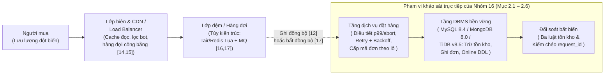

# Bản thảo hoàn chỉnh: Chuẩn hóa Mục 2.7.4, Tài liệu tham khảo [12]–[17] & Phụ lục E

> **Hướng dẫn sử dụng file này (đồng bộ 100% format với `docs/report-2.6-and-appendix.md` và Phụ lục A, B, C, D):**
> - **PHẦN A:** Bản rà soát và hiệu đính nhẹ **Mục 2.7.4** (trang 44 PDF hiện tại — sửa 2 lỗi gõ máy `vấn về` → `vấn đề`, `Sotify` → `Shopify` và gắn mã trích dẫn `[12]–[17]`) kèm danh mục **Tài liệu tham khảo `[12]–[17]`** đúng chuẩn IEEE của trang 43–44.
> - **PHẦN B (Phụ lục E):** Viết theo đúng cấu trúc học thuật của **Phụ lục C & D**: mở đầu bằng đoạn dẫn nhập và 3 câu hỏi định hướng, chia thành `E.1 – E.5`, đánh mã bảng thống nhất `Bảng E.1 – E.4` và `Hình E.1`, tách bạch nghiêm ngặt giữa **"Nội dung công bố"** và **"Đối chiếu với kết quả thực nghiệm của nhóm"**, đồng thời tuân thủ chặt bảng kỷ luật khẳng định ở `docs/khung-bao-cao.md` (giữ nhãn *sơ bộ Docker* cho Mục 2.6 và fault injection MySQL/MongoDB, cận dưới máy tải cho MongoDB nhúng, khoảng min–max/lần dựng cụm cho TiDB).

---

# PHẦN A — HIỆU ĐÍNH MỤC 2.7.4 & BỔ SUNG TÀI LIỆU THAM KHẢO [12]–[17] (TRANG 43–44 BÁO CÁO CHÍNH)

> **Lưu ý quan trọng trên trang 44 bản PDF hiện tại của bạn:**
> 1. Dòng 1 của Mục 2.7.4 đang bị lỗi gõ máy: *"Các **vấn về** được khảo sát..."* → sửa thành *"Các **vấn đề** được khảo sát..."*.
> 2. Dòng 3 của Mục 2.7.4 đang ghi nhầm tên nền tảng: *"tài liệu công khai của **Sotify**, Shopee và Alibaba Cloud"* (và trong câu hỏi bạn gõ *spotify*) → sửa thành **`Shopify`** (nền tảng thương mại điện tử công bố các bài kỹ thuật `[12]–[15]`, không phải ứng dụng nghe nhạc Spotify).
> 3. Bổ sung mã trích dẫn `[12]–[17]` ngay trong Mục 2.7.4 và nối tiếp `[12]–[17]` sau `[11]` ở mục **Tài liệu tham khảo** (thay cho ký hiệu tạm `[E1]–[E6]`). Nhớ cập nhật lại **Mục lục** ở trang 3 để hiện dòng `2.7.4. Liên hệ thực tiễn và khả năng ứng dụng`.

## 2.7.4. Liên hệ thực tiễn và khả năng ứng dụng *(Bản đã hiệu đính để thay vào trang 44)*

Các vấn đề được khảo sát trong báo cáo có sự tương đồng với những thách thức kỹ thuật trong quá trình vận hành hệ thống thương mại điện tử quy mô lớn. Từ những tài liệu kỹ thuật công khai của Shopify [12]–[15], Shopee [16] và Alibaba Cloud [17], có thể thấy việc kiểm soát tranh chấp ghi trên dữ liệu nóng, bảo đảm tính nhất quán của tồn kho, điều tiết lưu lượng theo phản hồi tải và tối ưu mô hình dữ liệu trước khi mở rộng ngang đều đóng vai trò trọng yếu trong xử lý tải đột biến.

Kết quả thực nghiệm của nhóm ở Mục 2.2–2.6 cung cấp cơ sở định lượng để tham khảo khi lựa chọn cơ chế kiểm soát đồng thời, thiết kế phân chia tồn kho kết hợp cấp mã đơn theo lô, chống trùng đơn hàng khi tiến trình ứng dụng gặp sự cố, đánh giá điều kiện mở rộng cùng chi phí sao chép của hệ quản trị cơ sở dữ liệu phân tán và thực hiện thay đổi lược đồ trực tuyến dưới tải giao dịch.

Các thực nghiệm trong báo cáo không hướng đến việc tái hiện toàn bộ kiến trúc Flash-sale của một nền tảng thương mại điện tử cụ thể mà tập trung cô lập và phân tích tầng giao dịch cơ sở dữ liệu bền vững. Do khác biệt về quy mô hạ tầng, phân phối tải và ranh giới xác nhận đơn hàng, các con số thông lượng không dùng để ngoại suy trực tiếp sang hệ thống doanh nghiệp; việc áp dụng vào thực tế cần đánh giá thêm cơ chế giữ và hoàn trả tồn kho theo thời hạn, thanh toán bất đồng bộ, hàng đợi thông điệp, tính sẵn sàng cao và khả năng tự động chuyển đổi dự phòng (*failover*) khi máy chủ cơ sở dữ liệu gặp sự cố.

Chi tiết đối chiếu với các trường hợp thực tế và khả năng ứng dụng của từng kết quả thực nghiệm được trình bày tại **Phụ lục E**.

---

## Bổ sung vào cuối mục Tài liệu tham khảo *(Nối tiếp ngay sau [11] ở trang 44)*

[12] E. Noel, "We replaced Redis with MySQL for inventory reservations—and it scaled," *Shopify Engineering*, May 12, 2026. [Online]. Available: https://shopify.engineering/scaling-inventory-reservations [Accessed: Nov. 28, 2026].

[13] J. Neufeld, "Performance Testing At Scale—for BFCM and Beyond," *Shopify Engineering*, Jan. 27, 2023. [Online]. Available: https://shopify.engineering/scale-performance-testing [Accessed: Nov. 28, 2026].

[14] E. Stolarsky, "Surviving Flashes of High-Write Traffic Using Scriptable Load Balancers (Part I)," *Shopify Engineering*, 2017. [Online]. Available: https://shopify.engineering/surviving-flashes-of-high-write-traffic-using-scriptable-load-balancers-part-i [Accessed: Nov. 28, 2026].

[15] E. Stolarsky, "Surviving Flashes of High-Write Traffic Using Scriptable Load Balancers (Part II)," *Shopify Engineering*, Feb. 5, 2017. [Online]. Available: https://shopify.engineering/surviving-flashes-of-high-write-traffic-using-scriptable-load-balancers-part-ii [Accessed: Nov. 28, 2026].

[16] C. Liu and C. Hong, "How Shopee Chose the Right Database for Their Applications," *PingCAP Case Study*, 2020. [Online]. Available: https://www.pingcap.com/case-study/choosing-right-database-for-your-applications/ [Accessed: Nov. 28, 2026].

[17] Alibaba Cloud, "Build a business system that can handle flash sales," *Alibaba Cloud Tair (Redis OSS-Compatible) Documentation*. [Online]. Available: https://www.alibabacloud.com/help/en/redis/use-cases/use-apsaradb-for-redis-to-build-a-business-system-that-can-handle-flash-sales [Accessed: Nov. 28, 2026].

---
---

# PHẦN B — PHỤ LỤC E: ĐỐI CHIẾU VỚI KIẾN TRÚC FLASH-SALE THỰC TẾ VÀ KHẢ NĂNG ỨNG DỤNG KẾT QUẢ NGHIÊN CỨU

## Phụ lục E: Đối chiếu với kiến trúc Flash-sale thực tế và khả năng ứng dụng kết quả nghiên cứu

Nếu **Phụ lục A và B** trình bày chi tiết cấu hình vận hành của MongoDB và TiDB, **Phụ lục C** cung cấp toàn bộ bảng kiểm chứng thực nghiệm của Mục 2.1–2.5 và **Phụ lục D** đi sâu vào bài toán đổi lược đồ trực tuyến của Mục 2.6, thì **Phụ lục E** đặt các kết quả thực nghiệm của nhóm cạnh những báo cáo kỹ thuật công khai từ **Shopify [12]–[15]**, **Shopee [16]** và **Alibaba Cloud [17]**. Mục tiêu của phụ lục không phải là mô tả toàn diện kiến trúc nội bộ của các doanh nghiệp, mà nhằm xác lập vị trí của tầng giao dịch cơ sở dữ liệu trong một hệ thống Flash-sale hoàn chỉnh, làm rõ điểm tương đồng lẫn khác biệt về cơ chế kỹ thuật, và chỉ ra phạm vi ứng dụng hợp lệ của các kết quả nghiên cứu.

Nội dung của phụ lục trả lời ba câu hỏi định hướng:
1. **Về ranh giới kiến trúc:** Bộ khung thực nghiệm của nhóm đang khảo sát lớp nào trong chuỗi xử lý Flash-sale nhiều tầng của các nền tảng thương mại điện tử, và các nguồn tư liệu công khai liên quan trực tiếp hay gián tiếp tới từng câu hỏi nghiên cứu ở mức nào? (**Mục E.1**)
2. **Về cơ chế kỹ thuật:** Các hiện tượng và giải pháp đã định lượng trong Phần 2 — gồm phân tách điểm nóng tồn kho, cơ chế `NOWAIT`, kiểm thử tải lệch cực đoan, điều tiết lưu lượng theo độ trễ, mở rộng cụm TiKV và bảo toàn tính nguyên tử giữa trừ kho với ghi đơn — tương ứng ra sao với thiết kế thực tế của Shopify, Shopee và Alibaba Cloud? (**Mục E.2 – E.4**)
3. **Về khả năng ứng dụng và giới hạn ngoại suy:** Những bài học thiết kế nào có thể tham khảo trực tiếp từ số liệu của nhóm, và những điều kiện thực tế nào chưa nằm trong phạm vi đo đạc? (**Mục E.5**)

> **Nguyên tắc phương pháp luận trong Phụ lục E:** Mọi tiểu mục dưới đây đều tách bạch rõ hai phần: *(i)* **Nội dung từ nguồn công bố** (chỉ tóm tắt trung thực thông tin kỹ thuật có trong tài liệu gốc `[12]–[17]`) và *(ii)* **Đối chiếu với kết quả của nhóm** (phân tích độc lập dựa trên số liệu thực nghiệm ở Phần 2). Các bài viết kỹ thuật doanh nghiệp không phải là benchmark độc lập cùng cấu hình, và việc đối chiếu không hàm ý rằng giải pháp của nhóm đã được triển khai tại các nền tảng nêu trên hay dùng số TPS của nhóm để dự báo năng lực sản xuất của doanh nghiệp.

---

### E.1. Định vị phạm vi nghiên cứu trong kiến trúc Flash-sale nhiều lớp thực tế

Trong thực tế vận hành thương mại điện tử quy mô lớn, lưu lượng Flash-sale hiếm khi đi thẳng từ trình duyệt của người mua vào máy chủ cơ sở dữ liệu mà thường đi qua nhiều lớp bảo vệ và phân tách trách nhiệm. **Hình E.1** minh họa chuỗi xử lý tham khảo tổng hợp từ các tài liệu kỹ thuật công khai `[12]–[17]` và đóng khung chính xác vùng phạm vi mà bộ benchmark của nhóm khảo sát.

*Hình E.1. Vị trí của bộ khung thực nghiệm Nhóm 16 trong chuỗi kiến trúc xử lý Flash-sale nhiều lớp tham khảo.*

Quan sát **Hình E.1**, có thể thấy nghiên cứu của nhóm tập trung cô lập **tầng dịch vụ đặt hàng, cơ chế thử lại/điều tiết và tầng cơ sở dữ liệu giao dịch bền vững** (nơi trạng thái tồn kho và đơn hàng phải thỏa mãn ba luật bất biến). Các lớp phía trước như mạng phân phối nội dung (CDN), lọc lưu lượng tại biên hay hàng đợi thông điệp bất đồng bộ là các lựa chọn kiến trúc tùy theo từng nền tảng (không mặc định mọi hệ thống đều bắt buộc dùng Redis hay Kafka, như chính trường hợp Shopify chuyển giữ hàng từ Redis về MySQL `[12]`). **Bảng E.1** tổng hợp sáu nguồn tài liệu công khai được sử dụng để đối chiếu và mức độ liên hệ của từng nguồn với báo cáo.

**Bảng E.1:** *Tổng hợp các nguồn tư liệu kỹ thuật công khai và mức độ liên quan với các mục trong Phần 2.*

| Nguồn công bố & Loại bằng chứng | Nội dung kỹ thuật cốt lõi trong nguồn | Mục đối chiếu trong báo cáo | Mức độ liên quan |
| --- | --- | :---: | --- |
| **Shopify [12]** *(bài kỹ thuật triển khai thực tế, 2026)* | Chuyển giữ hàng (*inventory reservations*) từ Redis sang MySQL cùng sổ kho; tách đơn vị hàng khả dụng, dùng `SKIP LOCKED`, khóa chính ghép và `READ COMMITTED`. | Mục 2.3, 2.4.1, 2.4.2, 2.4.4 | **Trực tiếp** *(tranh chấp dòng nóng, chia nhỏ tồn kho & ACID)* |
| **Shopify [13]** *(bài kỹ thuật kiểm thử quy mô lớn, 2023)* | Kiểm thử tải toàn hệ thống cho BFCM, bao gồm kịch bản chuyên biệt nhiều người dùng cùng mua một mặt hàng Flash-sale; lưu ý khoảng cách giữa tải tổng hợp và production. | Mục 2.1.1, 2.2 | **Trực tiếp về phương pháp tạo tải** |
| **Shopify [14], [15]** *(loạt bài kỹ thuật điều tiết tải ghi, 2017)* | Đặt bộ điều tiết bằng Nginx/OpenResty (Lua) ở biên mạng để bảo vệ CSDL trước đột biến ghi; cải tiến từ polling ngẫu nhiên sang hàng đợi ưu tiên theo thời điểm đến. | Mục 2.4.3 | **Trực tiếp về nguyên lý điều tiết tải** *(khác tầng thực thi)* |
| **Shopee trên PingCAP [16]** *(case study khách hàng, số liệu đến cuối 2019)* | Chiến lược chọn MySQL, Redis và mở rộng ngang trên TiDB (>20 cụm, >400 nút); kinh nghiệm hợp nhất nhiều shard MySQL và chi phí truy vấn quét rộng. | Phần 1.5, Mục 2.5, 2.6 | **Gián tiếp** *(bối cảnh chọn & mở rộng DBMS, không mô tả trừ kho trực tiếp)* |
| **Alibaba Cloud [17]** *(tài liệu kiến trúc tham khảo Tair)* | Kiến trúc phân tầng: CDN lọc đọc, Tair/Redis lọc yêu cầu và chạy Lua script trừ tồn nguyên tử trong bộ nhớ, đẩy hàng đợi ghi đơn bất đồng bộ xuống CSDL. | Mục 2.3.2, 2.3.3, 2.4.4 | **Tham khảo kiến trúc** *(đối chiếu ranh giới nguyên tử giao dịch)* |

---

### E.2. Đối chiếu trực tiếp với Shopify: Giữ hàng bằng MySQL, kiểm thử tải và điều tiết lưu lượng

#### E.2.1. Phân tách điểm nóng tồn kho và giao dịch ACID trên MySQL [12]

- **Nội dung từ nguồn công bố [12]:** Trong nhiều năm, Shopify sử dụng bộ đếm trong Redis để giữ hàng tạm thời khi khách bước vào luồng thanh toán (*checkout*), trong khi sổ cái tồn kho chính nằm trên MySQL. Kiến trúc tách rời hai hệ lưu trữ này làm phát sinh khoảng hở tính nhất quán nguyên tử khi xác nhận mua hàng, thiếu nhận biết tồn kho đa địa điểm và tăng chi phí vận hành. Năm 2026, Shopify công bố chuyển cơ chế giữ hàng về chung cơ sở dữ liệu MySQL với sổ tồn kho để tận dụng giao dịch ACID. Để tránh hàng nghìn luồng cùng khóa một dòng bộ đếm duy nhất của mặt hàng nóng, Shopify biểu diễn mỗi đơn vị hàng khả dụng thành một dòng trong một *pool* giới hạn tối đa `1.000` dòng cho mỗi cặp *(sản phẩm, địa điểm)* và dùng truy vấn `SELECT ... FOR UPDATE SKIP LOCKED` để các giao dịch đồng thời bỏ qua dòng đang bị khóa, lấy ngay đơn vị hàng rảnh khác. Khi pool vơi, tiến trình nền bổ sung từ sổ kho; nếu pool cạn hẳn dưới tải đột biến, hệ thống phải bổ sung đồng bộ dưới khóa. Thiết kế này đi kèm tối ưu khóa chính ghép, hạ mức cô lập xuống `READ COMMITTED` để giảm *gap lock*, lấy khóa theo thứ tự nhất quán chống *deadlock* và chạy đối chứng song song (*shadow mode*) với Redis trước khi cắt chuyển.
- **Đối chiếu với kết quả thực nghiệm của nhóm (Mục 2.2 và 2.4):** Trường hợp của Shopify [12] là minh chứng thực tế gần nhất với chẩn đoán ở Mục 2.2 (cập nhật trực tiếp một dòng tồn kho nóng trên MySQL khiến thời gian chờ khóa dòng chiếm tới `97%` thời gian client ở `64 client`, chế độ `"một món"`, làm thông lượng tụt từ `1.416` xuống `426 TPS`) và giải pháp phân tách điểm nóng bằng **chia slot tồn kho** ở Mục 2.4.1. Tuy cùng dựa trên nguyên lý chia nhỏ tài nguyên tranh chấp ngay trong CSDL quan hệ để bảo toàn giao dịch ACID, hai cách tiếp cận có những khác biệt kỹ thuật rõ rệt như tổng hợp tại **Bảng E.2**.

**Bảng E.2:** *Đối chiếu thiết kế giữ hàng trên MySQL của Shopify [12] với kỹ thuật chia slot tồn kho và cơ chế tối ưu của nhóm (Mục 2.4).*

| Khía cạnh kỹ thuật | Thiết kế của Shopify [12] | Thiết kế thực nghiệm của Nhóm 16 (Mục 2.4) |
| --- | --- | --- |
| **Đơn vị phân tách dữ liệu** | Mỗi dòng trong *pool* đại diện cho **1 đơn vị hàng** khả dụng (tối đa `1.000` dòng/cặp sản phẩm–địa điểm). | Tồn kho của một mặt hàng được chia đều thành **`N` dòng (`slot`)**, mỗi slot chứa nhiều đơn vị hàng (`N ∈ {1, 3, 9, 27}`). |
| **Cơ chế chọn phần tồn kho và né khóa** | Dùng `SELECT ... FOR UPDATE SKIP LOCKED` để tự động nhảy qua dòng đang bị giao dịch khác khóa. | Ứng dụng chọn ngẫu nhiên một slot và chạy `UPDATE` có điều kiện; nếu slot thiếu hàng thì thử lần lượt các slot còn lại *(chưa dùng `SKIP LOCKED`)*. |
| **Bổ sung tồn kho động** | Có cơ chế nạp thêm dòng vào pool từ sổ kho nền hoặc nạp đồng bộ dưới khóa khi pool cạn. | Số lượng phân bổ cố định vào `N` slot từ đầu lượt chạy; không có luồng cân bằng lại giữa các slot khi đang bán. |
| **Bảo toàn tính đúng đắn** | Giao dịch ACID giữ hàng tạm thời và xác nhận khớp với sổ cái tồn kho trên cùng MySQL. | Giao dịch ACID trừ tồn kho và ghi `orders`/`order_line` nguyên tử, kiểm định nghiêm ngặt qua 3 luật tồn kho (`VALID` 100%). |
| **Giới hạn đánh đổi ở biên hết hàng** | Khi pool `1.000` dòng cạn đồng thời, bước nạp lại đồng bộ dưới khóa làm tăng độ trễ giao dịch. | Mỗi dòng đơn lấy trọn từ một slot nên khi gần hết hàng có thể báo thiếu hàng cục bộ dù tổng các slot cộng lại vẫn đủ. |

Phân tích sâu số liệu của nhóm giúp làm rõ thêm hai điểm kỹ thuật quan trọng khi tham chiếu sang thiết kế kiểu Shopify:
1. **Không quy toàn bộ mức tăng thông lượng cho riêng việc chia dòng tồn kho:** Ở Mục 2.4.1 (**Bảng 2.4.1**, `64 client`, `"một món"`), cấu hình `27 slot` kết hợp cấp mã đơn theo lô `50` nâng TPS từ `426` lên `2.741` trên MySQL, từ `673` lên `3.955` trên MongoDB giao dịch và từ `255` lên `2.157` trên TiDB (tăng `5,9–8,5 lần`; tính riêng đơn đặt thành công tăng `6,4–8,5 lần`). Tuy nhiên, phép đo tách biến ở Mục 2.4.2 (**Bảng 2.4.2**, `N = 9`) chứng minh riêng kỹ thuật cấp mã đơn theo lô `50` đã đóng góp mức tăng `1,2–2,5 lần` sau khi dòng tồn kho được chia nhỏ (trong khi ở `N = 1`, cấp lô gần như không giúp MySQL và TiDB: `425 → 397` và `246 → 229 TPS`). Điều này gợi ý rằng trong thực tế, sau khi hóa giải điểm nóng tồn kho (bằng chia slot hoặc pool đơn vị), điểm nghẽn thứ cấp sẽ lập tức dịch chuyển sang các bộ đếm tuần tự dùng chung (như `d_next_o_id` hoặc khóa tự tăng).
2. **Sự khác biệt bản chất giữa `NOWAIT` và `SKIP LOCKED`:** Ở Mục 2.4.4 (**Bảng 2.4.5**, `128 client`, `"một món"`), nhóm thử nghiệm `SELECT ... FOR UPDATE NOWAIT` trên một dòng tồn kho MySQL: TPS tổng tăng `72%` (`375 → 644 TPS`) nhưng số đơn đặt hàng thành công thực tế lại **giảm `10%`** (`11.214` xuống `10.052` đơn trong 60 giây, khoảng `65%` yêu cầu `New-Order` bị hủy ngay với `Error 3572`), và phần tăng TPS chỉ đến từ giao dịch `Payment` không còn bị nghẽn kết nối. Kết quả này giải thích vì sao `NOWAIT` trên một bản ghi đơn lẻ không giải quyết được bài toán mua hàng, đồng thời làm sáng tỏ lý do Shopify phải kết hợp **nhiều dòng ứng viên trong pool** với **`SKIP LOCKED`** (bỏ qua dòng bận để lấy dòng rảnh kế tiếp thay vì trả lỗi hủy đơn). Do nhóm chưa cài đặt và đo trực tiếp `SKIP LOCKED` trên mô hình pool từng đơn vị, báo cáo giữ ranh giới phân biệt rõ hai giải pháp này.

#### E.2.2. Thiết kế kiểm thử tải Flash-sale cực đoan [13]

- **Nội dung từ nguồn công bố [13]:** Để chuẩn bị cho dịp mua sắm cao điểm Black Friday – Cyber Monday (BFCM), Shopify thực hiện kiểm thử tải quy mô đầy đủ trên môi trường tương đương sản xuất, trong đó xây dựng riêng một kịch bản Flash-sale mô phỏng hàng loạt người mua cùng nhắm vào một sản phẩm duy nhất để tạo đột biến ghi trực diện xuống tầng lưu trữ. Tác giả nhấn mạnh vai trò của CDN/cache đối với tải đọc và lưu ý rằng tải tổng hợp (*synthetic load*), dù cần thiết để tìm nút cổ chai, không bao giờ thay thế hoàn toàn sự đa dạng của lưu lượng người dùng thật.
- **Đối chiếu với kết quả thực nghiệm của nhóm (Mục 2.1.1 và 2.2):** Cách xây dựng kịch bản của nhóm đi cùng triết lý cô lập điểm gãy này khi mở rộng chuẩn TPC-C sang dải độ lệch Zipf `θ ∈ {0; 0,5; 0,7; 0,9}` kèm chế độ cực đoan `"một món"` (`100%` đơn hàng tập trung vào duy nhất một SKU), đồng thời tách riêng lượt đo tốc độ (tồn đầu `10^9`) khỏi lượt kiểm luật hết hàng (tồn đầu `1.000`). Kết quả ở Mục 2.2 (**Bảng 2.2.1**) cho thấy nếu chỉ kiểm thử tới `θ = 0,7` thì thông lượng cả ba DBMS gần như đi ngang so với tải đều `θ = 0`, chỉ giảm nhẹ `10–16%` tại `θ = 0,9` và chỉ thực sự bộc lộ sự sụp đổ `2,8–3,7 lần` ở chế độ `"một món"`. Dù vậy, bài viết `[13]` chỉ củng cố tính hợp lý của việc đưa kịch bản cực đoan một SKU vào bộ kiểm thử, không xác nhận rằng tỷ lệ `New-Order : Payment = 1 : 1` hay quy mô cụm `24 vCPU` của nhóm đại diện cho lưu lượng thực tế tại Shopify.

#### E.2.3. Điều tiết lưu lượng (Backpressure) và bài học hiệu chỉnh ngưỡng [14], [15]

- **Nội dung từ nguồn công bố [14], [15]:** Khi đối mặt với các đợt mở bán gây đột biến ghi vượt xa khả năng chịu tải của CSDL, Shopify triển khai lớp điều tiết tải bằng kịch bản Lua trên tầng cân bằng tải biên Nginx/OpenResty, đưa người mua vượt ngưỡng vào phòng chờ (*waiting room*) trước khi chạm vào ứng dụng lõi. Ở phiên bản đầu, cơ chế cho trang chờ tự làm mới ngẫu nhiên (*polling*) gây mất công bằng khi người đến muộn vẫn có thể lọt qua trước người đến sớm. Ở phiên bản cải tiến, Shopify tính toán ngưỡng tiếp nhận động theo năng lực xử lý phản hồi từ hệ thống phía sau và sắp xếp ưu tiên theo dấu thời gian đến đầu tiên, giúp cải thiện rõ rệt phân bố thời gian chờ thanh toán.
- **Đối chiếu với kết quả thực nghiệm của nhóm (Mục 2.4.3):** Bộ điều tiết thích ứng của nhóm (giảm một nửa giới hạn đồng thời chạm mặt hàng nóng mỗi giây nếu `p99` vượt ngưỡng hoặc tỉ lệ hủy vượt `10%`, ngược lại tăng thêm `1` theo hướng điều khiển tải thích ứng `[7]`) chia sẻ cùng nguyên lý **phản hồi áp lực ngược (*backpressure*) để chống suy sụp dây chuyền**, nhưng khác vị trí đặt chốt chặn (tầng worker ứng dụng thay vì tầng Load Balancer biên) và chưa có hàng đợi ưu tiên công bằng theo thứ tự đến (**Bảng E.3**).

**Bảng E.3:** *Tổng hợp phản ứng trái chiều của bộ điều tiết dưới tải vòng mở trong thực nghiệm của nhóm (Bảng 2.4.3–2.4.4, `256 client`, `θ = 0,9`, chia `9 slot` + lô mã `50`) và hàm ý triển khai.*

| Hệ quản trị & Mức tải đặt vòng mở | Kết quả đo thực tế của Nhóm 16 | Hàm ý kỹ thuật khi đối chiếu với bài toán điều tiết thực tế [14], [15] |
| --- | --- | --- |
| **MongoDB 8.0.20** *(tải đặt `3.700 yêu cầu/s`, bằng `120%` mốc vòng đóng 64 client)* | Độ trễ đuôi `p99` giảm mạnh từ **`327 ms` xuống `67 ms`** (`315 → 96 ms` ở tải `3.100/s`), trong khi TPS thực tế vẫn giữ trọn vẹn ~`3.700 TPS`. | Điều tiết giúp gọt phẳng gai độ trễ đuôi hiệu quả trên cơ chế hủy–thử lại của WiredTiger *(lưu ý: ở `256 client`, MongoDB vẫn đáp ứng đủ tải đặt nên thí nghiệm chưa ép hệ thống vào vùng quá tải thực sự)*. |
| **MySQL 8.4.8 — Ngưỡng mặc định `500 ms`** *(tải đặt `1.800/s` và `2.200/s`)* | Phản tác dụng: ở tải `1.800/s`, TPS tụt từ `1.788` xuống **`1.399`** (lặp lại: `1.383`), `p99` vọt từ `555 ms` lên **`4.712 ms`**, từ chối `20,7%`. Ở tải `2.200/s`, TPS mất gần một nửa (`2.041 → 1.071`), từ chối **`50,5%`**. | Đặt ngưỡng cắt (`500 ms`) thấp hơn độ trễ `p99` tự nhiên của hệ thống khi chỉ chia slot (`555 ms` và `1.736 ms`) làm bộ điều tiết bóp nghẹt đồng thời quá sớm, khiến yêu cầu dồn ứ tại hàng đợi ứng dụng. |
| **MySQL 8.4.8 — Nới ngưỡng `1.000 ms` và `2.000 ms`** *(cùng phiên đo kiểm soát)* | Tại tải `1.800/s`, TPS khôi phục hoàn toàn về **`1.800` và `1.799 TPS`** (`0%` từ chối, `p99` ~`598–608 ms`); tại tải `2.200/s` với ngưỡng `2.000 ms`, đạt `2.034 TPS` (`p99 = 1.634 ms`), ngang chia slot đơn thuần. | Ngưỡng điều tiết không thể gán cứng một hằng số chung cho mọi DBMS mà bắt buộc hiệu chỉnh theo đặc tính độ trễ nền của từng động cơ lưu trữ *(lưu ý: tải vòng mở chưa được đo trên TiDB)*. |

---

### E.3. Đối chiếu với Shopee: Chiến lược lựa chọn DBMS và điều kiện mở rộng ngang trên TiDB [16]

- **Nội dung từ nguồn công bố [16]:** Trong tài liệu nghiên cứu tình huống công bố trên PingCAP (số liệu ghi nhận đến cuối năm 2019), đội ngũ quản trị cơ sở dữ liệu của Shopee trình bày quy tắc phân tầng lưu trữ theo đặc trưng tải: giữ **MySQL** làm lựa chọn mặc định cho các nghiệp vụ giao dịch chuẩn có biên độ dự báo được, đặt **Redis** làm lớp đệm hấp thụ lưu lượng đọc/ghi đột biến trong các đợt khuyến mãi lớn, và chuyển sang **TiDB** (vận hành hơn `20` cụm với hơn `400` nút và trên `200 TB` dữ liệu vào thời điểm công bố) cho các bài toán dữ liệu lớn cần mở rộng ngang không muốn tự phân mảnh (*manual sharding*) ở tầng ứng dụng hoặc cần Online DDL không gián đoạn — tiêu biểu như lưu trữ nhật ký kiểm toán, hợp nhất dữ liệu từ nhiều shard MySQL (đơn hàng, sản phẩm) và hệ thống tin nhắn trực tuyến. Đáng chú ý, tài liệu cũng chia sẻ một bài học vận hành: khi hợp nhất `1.000` bảng MySQL về một bảng lớn trên TiDB, một số mẫu truy vấn quét rộng trở nên đắt đỏ, buộc đội kỹ thuật phải tái cấu trúc cách tổ chức phục vụ truy vấn và chuyển phần lớn tải đọc liên quan sang Redis.
- **Đối chiếu với kết quả thực nghiệm của nhóm (Mục 2.5 và 2.6):** Dù bối cảnh sử dụng TiDB trong `[16]` không xác nhận việc Shopee dùng TiDB để trừ trực tiếp dòng tồn kho Flash-sale, kinh nghiệm *"mở rộng ngang bằng hệ phân tán vẫn phụ thuộc chặt vào mẫu truy cập dữ liệu"* hoàn toàn nhất quán với kết quả thực nghiệm ở **Mục 2.5** của nhóm:
  1. **Tương tác giữa thiết kế dữ liệu và mở rộng phần cứng (`2×2`, Bảng 2.5.1):** Dưới tải lệch `θ = 0,9` và `64 client`, nếu giữ nguyên một dòng tồn kho cho mỗi mặt hàng (trừ có điều kiện), việc tăng gấp ba số nút lưu trữ từ `1` lên `3 TiKV` chỉ giúp thông lượng nhích lên **`1,22–1,29 lần`** qua hai lần dựng cụm độc lập (`616 → 751 TPS` ở lần dựng 1; `631 → 812 TPS` ở lần dựng 2), do không nút TiKV nào chạm trần CPU (`63–123% / 200%`) mà luồng xử lý bị kẹt trên hàng chờ khóa của Region nóng. Ngược lại, khi phân tán điểm nóng thành `27 slot` (tạo `136` Region rải đều `46/45/45` trên 3 nút TiKV) kết hợp cấp mã theo lô `50`, việc nâng từ `1` lên `3 TiKV` tăng thông lượng **`2,51–2,64 lần`**, tạo hiệu ứng tương tác đạt tổng cộng **`3,44–3,80 lần`** so với mốc ban đầu (`616 → 2.121 TPS`, khoảng min–max `1.545–2.188`; lần dựng 2 đạt `2.397 TPS`). Tương tự, việc đổi khóa chính bảng `orders` từ tự tăng sang `AUTO_RANDOM` đẩy hệ số mở rộng từ `2,20×` lên `2,82×` nhờ triệt tiêu điểm nóng chèn ở Region cuối bảng (**Bảng C.4.3**).
  2. **Định lượng trước chi phí sao chép Raft (`rf=3`, Bảng 2.5.3):** Khi triển khai thực tế cần khả năng chịu lỗi nút lưu trữ (`rf=3` thay vì `rf=1` dùng để cô lập biến), phép đo đảo thứ tự `rf=3 → rf=1 → rf=3` trên cấu hình `2 vCPU/TiKV` chỉ ra thông lượng giảm nhất quán **`25–47%`** ở tải đều và mọi cấu hình chia slot do chi phí xử lý `commit_log` và `apply_log` của Raft đẩy CPU cả ba nút TiKV chạm trần `197–200%` (trong khi ở cấu hình hot SKU không chia slot, số liệu biến động đảo chiều `+25% / -3%` nên chưa kết luận được).
  3. **Liên hệ về Online DDL (Mục 2.6):** Ưu điểm Online DDL không chặn giao dịch mới được Shopee nhắc tới trong `[16]` cũng được nhóm quan sát trực tiếp trên TiDB v8.5.7 ở Mục 2.6 (**Hình 2.6.1**, số đo **sơ bộ trên Docker**): ngay cả khi có giao dịch đọc mở kéo dài `60 s`, lệnh `ALTER TABLE ... ADD COLUMN` trên TiDB đạt **`0 s` đóng băng** (`1.042,2 TPS`), trái ngược với hiện tượng kẹt dây chuyền Metadata Lock suốt `57 s` trên MySQL nếu không đặt `lock_wait_timeout` ngắn.

---

### E.4. Đối chiếu với Alibaba Cloud: Kiến trúc nhiều lớp và ranh giới nguyên tử giao dịch [17]

- **Nội dung từ nguồn công bố [17]:** Tài liệu kiến trúc tham khảo của Alibaba Cloud cho dịch vụ cơ sở dữ liệu trong bộ nhớ Tair (tương thích Redis OSS) mô tả mô hình kinh điển để gánh các đợt Flash-sale cực lớn bằng cách tách tải thành bốn lớp: *(1)* CDN hấp thụ nội dung tĩnh; *(2)* cụm Tair kiểm tra và lọc yêu cầu không hợp lệ (công bố khả năng xử lý trên `600.000 QPS` ở lớp lọc); *(3)* thực thi **Lua script nguyên tử** ngay trong bộ nhớ Tair để kiểm tra điều kiện còn hàng và trừ bộ đếm tồn kho mà không cần khóa dòng CSDL (công bố trên `100.000 QPS` ở lớp trừ tồn); và *(4)* đẩy thông tin đơn hàng hợp lệ vào hàng đợi danh sách (`LPUSH`/`BRPOP` hoặc Message Queue) để các tiến trình nền ghi bất đồng bộ xuống cơ sở dữ liệu quan hệ (như RDS MySQL hoặc PolarDB), trả phản hồi đặt hàng sớm cho người mua ngay khi đẩy vào hàng đợi thành công. Bản thân tài liệu `[17]` cũng khuyến nghị nếu một mặt hàng quá nóng làm nghẽn một phân mảnh bộ nhớ thì tiếp tục chia nhỏ khóa tồn kho thành nhiều khóa con (`product_123_1`, `product_123_2`, ...).
- **Đối chiếu với kết quả thực nghiệm của nhóm (Mục 2.3 và 2.4.4):** Đặt kiến trúc nhiều lớp của Alibaba Cloud `[17]` cạnh bộ khung của nhóm giúp làm rõ hai góc độ bổ trợ nhau mà không mâu thuẫn:
  1. **Sự khác biệt về thước đo và tầng chịu trách nhiệm:** Các con số hàng trăm nghìn QPS trong `[17]` đo thông lượng thao tác trong bộ nhớ ở lớp lọc/trừ bộ đếm trước khi đơn hàng được ghi bền xuống đĩa; chúng không tương đương trực tiếp với chỉ số TPS trong báo cáo của nhóm — vốn đo trọn vẹn giao dịch `New-Order`/`Payment` có ép đồng bộ nhật ký xuống đĩa cứng EBS (`innodb_flush_log_at_trx_commit=1, sync_binlog=1` trên MySQL; `w: "majority", j: true` trên MongoDB; đồng bộ Raft trên TiKV). Ngay cả khi có lớp đệm phía trước, tầng CSDL bền vững ở cuối chuỗi vẫn phải tiếp nhận luồng ghi đơn, đối soát sổ sách và chống trùng lặp khi worker tiêu thụ hàng đợi thử lại.
  2. **Bài toán ranh giới nguyên tử khi tách rời bước trừ kho và bước lưu đơn:** Một kịch bản Lua chạy nguyên tử bên trong Redis/Tair chỉ bảo đảm không âm bộ đếm tại thời điểm trừ trong bộ nhớ, nhưng **không tự động tạo thành một giao dịch ACID xuyên qua hàng đợi và CSDL đơn hàng**. Nếu tiến trình ứng dụng trừ kho xong trong bộ nhớ nhưng gặp sự cố trước khi thông điệp đơn hàng được đẩy bền vững vào hàng đợi hoặc trước khi ghi xuống CSDL (mà không có cơ chế đối soát bù trừ/khôi phục thông điệp chặt chẽ), hệ thống sẽ rơi vào trạng thái **tồn kho đã giảm nhưng đơn hàng bị mất**. Hiện tượng khoảng hở nguyên tử này tương đồng trực tiếp về mặt bản chất với thí nghiệm **MongoDB nhúng** của nhóm ở Mục 2.3.3 và 2.4.4 (**Bảng 2.4.5**): bằng cách bỏ giao dịch nhiều tài liệu để trừ `stock` bằng một lệnh `updateOne` nguyên tử đơn tài liệu rồi mới chèn riêng tài liệu `orders` nhúng, MongoDB nhúng đạt cận dưới **`8.354 TPS`** (`p99 = 30 ms`, gấp khoảng `9,9 lần` TPS và `15,2 lần` số đơn đặt thành công so với MongoDB giao dịch nhiều tài liệu `845 TPS`, khi CPU máy tải đã chạm `78%`). Thế nhưng, phép kiểm thử tiêm lỗi ứng dụng chết giữa hai bước ở Mục 2.3.3 xác nhận tồn kho bị trừ vĩnh viễn không có đơn tương ứng, vi phạm luật khớp sổ sách (**`INVALID`**). Phép liên hệ này minh họa rõ sự đánh đổi giữa tốc độ và ranh giới nguyên tử giao dịch, đồng thời không hàm ý rằng kiến trúc tham khảo của Alibaba Cloud thiếu an toàn nếu người triển khai bổ sung đầy đủ cơ chế bền vững hóa hàng đợi và đối soát định kỳ.

---

### E.5. Ma trận khả năng ứng dụng, đóng góp tham khảo và giới hạn ngoại suy

#### E.5.1. Ma trận đối chiếu kết quả nghiên cứu với bài toán thực tế

Tổng hợp toàn bộ phân tích ở Mục E.2–E.4, **Bảng E.4** ánh xạ từng nhóm kết quả thực nghiệm ở Mục 2.2–2.6 sang vấn đề thực tế tương ứng, tóm tắt giá trị tham khảo khi thiết kế hệ thống và ghi kèm điều kiện giới hạn bắt buộc lưu ý.

**Bảng E.4:** *Ma trận đối chiếu kết quả thực nghiệm của Nhóm 16 (Mục 2.2–2.6) với các nguồn thực tế, khả năng ứng dụng và điều kiện giới hạn.*

| Bài toán thực tế & Nguồn liên hệ | Kết quả thực nghiệm cốt lõi của Nhóm 16 | Khả năng ứng dụng tham khảo trong thiết kế | Giới hạn phạm vi & Điều kiện cần bổ sung |
| --- | --- | --- | --- |
| **1. Chẩn đoán nghẽn Hot SKU** *(Shopify [12], [13])* | **Mục 2.2:** Tải đi ngang ở `θ ≤ 0,7`, giảm nhẹ ở `θ = 0,9` nhưng sụt `2,8–3,7×` ở `"một món"` (`64 client`); tăng lên `256 client` không cứu được đơn thành công. MySQL chờ khóa dòng `97%` thời gian; MongoDB hủy–thử lại `40,4%`. | Cung cấp quy trình kiểm thử độ lệch cực đoan và bộ chỉ số phân biệt nghẽn do xếp hàng chờ khóa (2PL) với nghẽn do bão xung đột ghi (MVCC). | Trên TiDB mới suy ra cơ chế xếp hàng ở Region nóng từ chế độ bi quan mặc định, chưa thu thập số đo thời gian chờ khóa trực tiếp. |
| **2. Phân tách điểm nóng tồn kho & bộ đếm** *(Shopify [12], Alibaba [17])* | **Mục 2.4.1–2.4.2 & 2.4.4:** Chia `27 slot` + lô mã `50` tăng TPS `5,9–8,5×` (đơn thành công `6,4–8,5×`), giữ `100% VALID`. Cấp lô mã riêng đóng góp `1,2–2,5×` khi đã chia `9 slot`. `Stored Procedure` trên MySQL tăng `69%`; `NOWAIT` làm giảm `10%` đơn thành công. | Áp dụng mẫu chia slot tồn kho kết hợp cấp phát mã/ID theo lô ngay trong giao dịch ACID khi muốn giữ dữ liệu trên một tầng DBMS mà không tách sang Redis. | Cần xử lý thêm bài toán báo hết hàng giả cục bộ khi tổng các slot còn ít, cơ chế gom/cân bằng lại slot, hoặc thử nghiệm thêm `SKIP LOCKED` theo pool đơn vị. |
| **3. Chống oversell, mất cập nhật & trùng đơn khi lỗi** *(Shopify [12], Alibaba [17])* | **Mục 2.3:** `825/839` lượt AWS có bảo vệ đều `VALID` (kể cả `27` lượt tồn nhỏ hết hàng thật); `14` lượt đọc–ghi đè trên MySQL/TiDB đều `INVALID`. Ràng buộc `UNIQUE(request_id)` + đọc đối chiếu giữ `0` vi phạm qua `76` và `95` lần giết trúng cửa sổ commit trên TiDB (`p_upper ≈ 3,2–3,9%`). | Mẫu thiết kế chuẩn cho dịch vụ đặt hàng: gộp kiểm tra–trừ tồn vào một lệnh có điều kiện, gắn khóa lũy đẳng `request_id` và bắt buộc truy vấn đối chiếu trước khi retry lỗi mơ hồ. | Kiểm thử giết tiến trình trên MySQL/MongoDB mới ở mức **sơ bộ Docker**, số lần giết còn nhỏ (`28–129` lần), độ trễ sau commit là nhân tạo; chưa kiểm chứng sự cố sập nút DBMS (*failover*) hay chia cắt mạng. |
| **4. Điều tiết lưu lượng chống quá tải** *(Shopify [14], [15])* | **Mục 2.4.3:** Dưới tải vòng mở `256 client`, điều tiết cắt giảm `p99` trên MongoDB (`327 → 67 ms`), nhưng trên MySQL ngưỡng `500 ms` làm sụt `22–48%` TPS; nâng lên `1.000–2.000 ms` mới khôi phục ngang chia slot. | Cảnh báo thực tiễn khi cài đặt *adaptive throttling*: phải đo phân phối `p99` nền của từng DBMS để đặt ngưỡng cắt hợp lý, tránh kích hoạt từ chối sớm gây nghẽn hàng đợi. | Chưa đo tải vòng mở trên TiDB; chưa đưa MongoDB vào vùng quá tải thực sự; bộ điều tiết ở ứng dụng chưa có cơ chế xếp hàng công bằng theo thứ tự đến như tầng biên `[15]`. |
| **5. Mở rộng ngang DBMS phân tán & Replication** *(Shopee / PingCAP [16])* | **Mục 2.5:** Thêm `1 → 3 TiKV` đơn lẻ ở hot SKU chỉ tăng `1,22–1,29×`, nhưng kết hợp chia `27 slot` đạt `3,44–3,80×`; `AUTO_RANDOM` nâng hệ số mở rộng từ `2,20×` lên `2,82×`. Bật `rf=3` giảm `25–47%` TPS ở tải ghi lan rộng (`2 vCPU/TiKV`). | Quy tắc lập kế hoạch dung lượng cho NewSQL: bắt buộc khử điểm nóng khóa dữ liệu và khóa tự tăng trước khi thêm nút lưu trữ, đồng thời dự trù khấu hao CPU cho đồng thuận Raft `rf=3`. | Cụm `1` và `3 TiKV` dựng tách biệt; chi phí `25–47%` của `rf=3` gắn với cấu hình nút nhỏ `2 vCPU/TiKV`; chưa tách riêng đóng góp của `Async Commit` / `1PC` ở đơn nhiều kho. |
| **6. Đổi lược đồ trực tuyến khi đang mở bán** *(Mở rộng độc lập — liên hệ Online DDL [16])* | **Mục 2.6 *(sơ bộ Docker)*:** `INSTANT` trên MySQL vẫn treo `57 s` nếu vướng 1 phiên đọc dài (`lock_wait_timeout = 3` rút xuống `2 s`); TiDB `0 s` đóng băng. Khi chuyển ~`3 triệu` dòng cũ, `Batch 1.000` (nghỉ `20 ms`) dẫn đầu TPS ở `q ≥ 25%`; `Lazy` thắng trên MySQL khi ít đọc đơn cũ (`q = 5%`). | Quy trình 4 bước an toàn cho đội vận hành CI/CD: đặt `lock_wait_timeout` ngắn kèm retry trước mọi lệnh DDL trên MySQL, tránh chạy `Eager` giờ cao điểm và chọn `Batch 1.000` hoặc `Lazy` theo tỷ trọng đọc lịch sử `q`. | Toàn bộ `159` lượt đo của Mục 2.6 là **số đo sơ bộ trên một máy ảo Docker** (`8 vCPU / 16 GiB`); chưa quét `q = 5%, 50%` trên TiDB; không có nguồn doanh nghiệp xác nhận chính xác cùng công thức chuyển đổi này. |

#### E.5.2. Tổng hợp giới hạn ngoại suy sang hệ thống thương mại điện tử sản xuất

Để bảo đảm tính trung thực học thuật, kết quả thực nghiệm của nhóm không được dùng để ngoại suy trực tiếp thành thông lượng cam kết hay bảng xếp hạng tuyệt đối cho hệ thống doanh nghiệp vì bốn khác biệt cấu trúc sau:
1. **Khác biệt về quy trình nghiệp vụ giữ hàng và thanh toán:** Trong thực tế thương mại điện tử (như luồng checkout của Shopify `[12]`), đơn hàng thường trải qua hai bước tách rời theo thời gian: *giữ hàng tạm thời có thời hạn (TTL)* khi khách vào trang thanh toán, chờ cổng thanh toán bên thứ ba xác nhận trong vài giây đến vài phút, sau đó mới *chốt trừ kho vĩnh viễn* hoặc *hoàn trả tồn kho* nếu khách hủy/hết hạn. Workload của nhóm gộp bước trừ kho và chốt đơn vào một giao dịch ngắn duy nhất (vài chục mili-giây), chưa mô hình hóa vòng đời hết hạn và hoàn tồn kho.
2. **Khác biệt về kiến trúc phân tầng và bộ nhớ đệm:** Nghiên cứu cố định bộ nhớ đệm `3 GiB` cho mỗi hệ và tắt mọi lớp cache ngoài DBMS để ép tranh chấp bộc lộ rõ trên tầng lưu trữ và đĩa bền vững; trong khi hệ thống sản xuất thường kết hợp CDN, cache đọc phân tán và phần cứng NVMe/RAM lớn hơn nhiều lần `[13], [16], [17]`.
3. **Khác biệt về phân bổ tài nguyên nội bộ cụm:** Ở đợt đo chính (`24 vCPU / 60 GiB RAM`), cụm TiDB dành `16 vCPU` cho TiDB Server và chỉ còn `6 vCPU` chia cho `3` nút TiKV (`2 vCPU/nút`), đồng thời dùng `rf=1` làm mốc cô lập biến; tỷ lệ phân bổ vCPU khác giữa lớp tính toán SQL và lớp lưu trữ TiKV trên phần cứng lớn hơn sẽ làm thay đổi điểm bão hòa tương đối giữa ba hệ quản trị.
4. **Phạm vi mô hình sự cố:** Nghiên cứu mới kiểm chứng sự cố tiến trình ứng dụng chết đột ngột khi máy chủ DBMS vẫn hoạt động bình thường; các kịch bản sống còn khác của vận hành thực tế — gồm sập nút Primary/Leader, bầu chọn lại nhóm Raft/Replica Set, trễ sao chép liên vùng dữ liệu (*multi-AZ / multi-region*) và khôi phục từ hàng đợi bất đồng bộ — là hướng mở rộng cần thiết cho các nghiên cứu tiếp theo.
